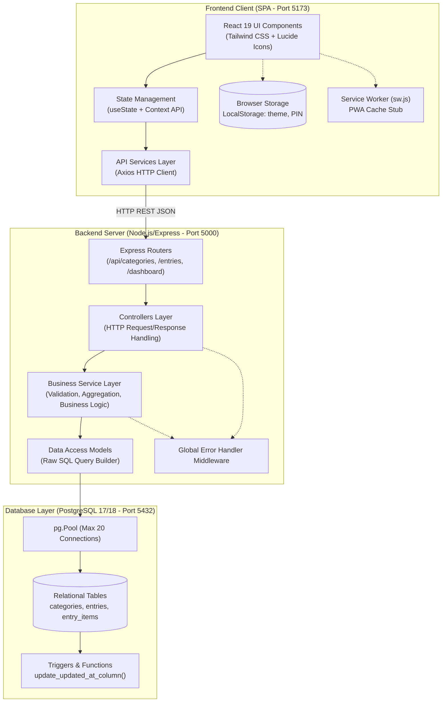

# 01. System Architecture Audit — Personal Organizer

**Project:** Personal Organizer ("One App, All Your Lists")  
**Audit Date:** October 2026  
**Auditor:** Senior Software Architect, Database Architect & Senior Full Stack Engineer  
**Classification:** Technical Architecture Assessment  

---

## 1. Executive Summary

ระบบ **Personal Organizer** ถูกออกแบบขึ้นภายใต้สถาปัตยกรรม **Decoupled Client-Server (2-Tier SPA + RESTful API)** โดยแบ่งการทำงานออกเป็น 2 ส่วนหลักอย่างชัดเจน:
1. **Frontend Client:** พัฒนาด้วย React 18/19, TypeScript, Vite และ Tailwind CSS
2. **Backend Server:** พัฒนาด้วย Node.js และ Express 4.x เชื่อมต่อกับฐานข้อมูล PostgreSQL 17/18 ผ่านไลบรารี `pg` (node-postgres)

แม้ว่าโครงสร้างโปรเจกต์ภายนอกจะมีการจัดโฟลเดอร์ตามมาตรฐานที่ดี (Separation of Routes, Controllers, Services, Models) แต่เมื่อเจาะลึกในระดับ Source Code จริง พบว่าระบบยังมีช่องว่างทางสถาปัตยกรรม (Architectural Gaps) ที่ส่งผลต่อความน่าเชื่อถือ, ความสามารถในการขยายตัว (Scalability) และความเสี่ยงต่อการเกิดข้อผิดพลาดในการพัฒนาต่อยอด (Regression Risks)

---

## 2. High-Level System Architecture Diagram



---

## 3. Detailed Architecture Analysis

### 3.1 Frontend Architecture

#### Tech Stack
- **Framework:** React 19.3.1 (`react`, `react-dom`)
- **Build Tool:** Vite 8.3.5 with `@vitejs/plugin-react`
- **Language:** TypeScript 7.0.2 (`tsconfig.app.json`, `tsconfig.node.json`)
- **Styling:** Tailwind CSS 3.4.17 with PostCSS and Autoprefixer
- **Icons:** Lucide React 1.65.0
- **HTTP Client:** Axios 1.21.0

#### Routing System
- **สถานะ:** *Virtual Tab Switching (Non-URL Routed)*
- **ไฟล์อ้างอิง:** [App.tsx](file:///d:/Personal_Organizer/frontend/src/App.tsx#L23-L28), [Sidebar.tsx](file:///d:/Personal_Organizer/frontend/src/components/layout/Sidebar.tsx#L30-L38), [BottomNav.tsx](file:///d:/Personal_Organizer/frontend/src/components/layout/BottomNav.tsx#L22-L79)
- **การทำงานจริง:**
  ระบบ**ไม่ได้ติดตั้งและไม่ได้ใช้งาน** Client-side Routing Library (เช่น `react-router-dom` หรือ `@tanstack/react-router`) แต่ใช้ Local State ใน `App.tsx` เป็นตัวควบคุม:
  ```typescript
  // frontend/src/App.tsx
  const [currentTab, setCurrentTab] = useState<'dashboard' | 'all' | 'calendar' | 'categories' | 'favorites' | 'archive'>('dashboard');
  ```
- **ข้อจำกัดทางสถาปัตยกรรม:**
  1. ไม่มีการเชื่อมต่อกับ Browser History ทำให้ผู้ใช้ไม่สามารถกดปุ่ม Back/Forward ของเบราว์เซอร์ได้
  2. ไม่รองรับ Deep Linking เช่น ไม่สามารถส่ง URL ลิงก์ตรงไปยังหมวดหมู่เฉพาะ (`/lists?category=2`) หรือหน้ารายละเอียดรายการได้
  3. เมื่อผู้ใช้ Refresh หน้าจอ เบราว์เซอร์จะรีเซ็ตกลับมาที่หน้า `dashboard` เสมอ

#### State Management
- **สถานะ:** *Distributed Component State + Key Remount Pattern*
- **ไฟล์อ้างอิง:** [App.tsx](file:///d:/Personal_Organizer/frontend/src/App.tsx#L28-L29), [App.tsx](file:///d:/Personal_Organizer/frontend/src/App.tsx#L165-L225)
- **การทำงานจริง:**
  1. ไม่มีการใช้ Global State Management Library (Redux, Zustand, Recoil, Jotai, TanStack Query)
  2. React Context API ถูกใช้งานอย่างจำกัดเพียง 2 ตัวคือ:
     - [ThemeContext.tsx](file:///d:/Personal_Organizer/frontend/src/context/ThemeContext.tsx) สำหรับ Dark/Light mode
     - [ToastContext.tsx](file:///d:/Personal_Organizer/frontend/src/context/ToastContext.tsx) สำหรับ Toast notification
  3. **Anti-Pattern (Key Remount Hack):** ใน `App.tsx` เพื่อให้หน้า UI รีโหลดข้อมูลใหม่หลังจากบันทึกข้อมูล มีการใช้เทคนิคบังคับ Unmount/Remount คอมโพเนนต์ทั้งหน้าด้วยการเปลี่ยนค่า `refreshKey`:
     ```tsx
     // frontend/src/App.tsx (L166, L178, L192, L203, L212, L223)
     <DashboardPage key={`dashboard_${refreshKey}`} ... />
     <AllListsPage key={`all_${refreshKey}`} ... />
     ```
  4. **Anti-Pattern (Hard Page Reload):** เมื่อมีการลบข้อมูลในหลายหน้า เช่น `handleConfirmDeleteEntry` ใน [App.tsx](file:///d:/Personal_Organizer/frontend/src/App.tsx#L99), `handlePermanentDelete` ใน [ArchivePage.tsx](file:///d:/Personal_Organizer/frontend/src/pages/ArchivePage.tsx#L58) และ `handleConfirmDelete` ใน [CategoriesPage.tsx](file:///d:/Personal_Organizer/frontend/src/pages/CategoriesPage.tsx#L51) พบการสั่ง:
     ```javascript
     window.location.reload();
     ```
     ซึ่งเป็นการทำลายความเป็น Single Page Application (SPA) ส่งผลให้เกิด Blank Screen และทำลาย Client State ทั้งหมด

#### PWA & Offline Architecture
- **สถานะ:** *Partially Implemented (Offline Broken)*
- **ไฟล์อ้างอิง:** [manifest.json](file:///d:/Personal_Organizer/frontend/public/manifest.json), [sw.js](file:///d:/Personal_Organizer/frontend/public/sw.js), [index.html](file:///d:/Personal_Organizer/frontend/index.html#L18-L24)
- **การทำงานจริง:**
  - `manifest.json` ถูกตั้งค่าพื้นฐานครบถ้วน (name, short_name, display: standalone, theme_color)
  - `sw.js` มีการลงทะเบียนใน `index.html` แต่ในขั้นตอน `install` ไม่มีการ Pre-cache ไฟล์ใดๆ:
    ```javascript
    // frontend/public/sw.js
    self.addEventListener('install', (event) => {
      self.skipWaiting();
    });
    ```
  - ใน `fetch` event มีคำสั่ง `caches.match(event.request)` เมื่อ network ล้มเหลว แต่เนื่องจากไม่เคยมีข้อมูลใน Cache ทำให้เมื่อ Offline แอปพลิเคชันจะไม่สามารถแสดงผลใดๆ ได้เลย

---

### 3.2 Backend Architecture

#### Tech Stack
- **Runtime:** Node.js (CommonJS modules)
- **Framework:** Express.js 4.21.1
- **Driver:** `pg` 8.13.1 (node-postgres)
- **Utilities:** `cors` 2.8.5, `dotenv` 16.4.5

#### Architectural Pattern: Layered Architecture
โครงสร้าง Backend ถูกจัดวางแบบ Layered Architecture 4 ชั้น:
1. **Routing Layer (`src/routes/`):**
   - [routes/index.js](file:///d:/Personal_Organizer/backend/src/routes/index.js) ทำหน้าที่รวม Router ย่อย
   - [routes/categoryRoutes.js](file:///d:/Personal_Organizer/backend/src/routes/categoryRoutes.js) (`/api/categories`)
   - [routes/entryRoutes.js](file:///d:/Personal_Organizer/backend/src/routes/entryRoutes.js) (`/api/entries`)
   - [routes/dashboardRoutes.js](file:///d:/Personal_Organizer/backend/src/routes/dashboardRoutes.js) (`/api/dashboard`)
2. **Controller Layer (`src/controllers/`):**
   - [categoryController.js](file:///d:/Personal_Organizer/backend/src/controllers/categoryController.js), [entryController.js](file:///d:/Personal_Organizer/backend/src/controllers/entryController.js), [dashboardController.js](file:///d:/Personal_Organizer/backend/src/controllers/dashboardController.js)
   - สกัดพารามิเตอร์ (`req.params`, `req.query`, `req.body`), เรียก Service และส่ง Response ด้วย `apiResponse.js`
3. **Service Layer (`src/services/`):**
   - [categoryService.js](file:///d:/Personal_Organizer/backend/src/services/categoryService.js), [entryService.js](file:///d:/Personal_Organizer/backend/src/services/entryService.js), [dashboardService.js](file:///d:/Personal_Organizer/backend/src/services/dashboardService.js)
   - ตรวจสอบความถูกต้องของข้อมูลเบื้องต้น (เช่น ความยาวชื่อ, ความมีอยู่ของ Category ก่อนสร้าง Entry)
4. **Data Access Layer (`src/models/`):**
   - [categoryModel.js](file:///d:/Personal_Organizer/backend/src/models/categoryModel.js), [entryModel.js](file:///d:/Personal_Organizer/backend/src/models/entryModel.js), [entryItemModel.js](file:///d:/Personal_Organizer/backend/src/models/entryItemModel.js)
   - เขียนคำสั่ง SQL ตรง (Raw SQL) ผ่าน `pool.query()`

#### Missing Layers in Backend
1. **Authentication / Authorization Middleware:** ไม่พบ Middleware ตรวจสอบตัวตน หรือจำกัดสิทธิ์ใดๆ
2. **Input Validation Middleware:** ไม่มีการใช้ Validation schema เช่น `zod`, `joi`, หรือ `express-validator` ใน Route level
3. **Security Middleware:** ขาด `helmet` (สำหรับ HTTP Headers ป้องกันการโจมตี) และ `express-rate-limit` (ป้องกัน DoS / Brute-force)

---

## 4. Evaluation of 8 Core Architectural Questions

### คำถามที่ 1: ระบบใช้ Architecture รูปแบบใด?
**คำตอบ:**  
- **ระบบโดยรวม:** Decoupled Client-Server Monolith (Single-tenant SPA + REST API + Relational Database)
- **Frontend:** Component-based SPA แบบ Single Page Virtual-tab Rendering (ไม่มี Client Router)
- **Backend:** Traditional 4-Layer Architecture (Routes -> Controllers -> Services -> Models -> Database Driver)

### คำถามที่ 2: โครงสร้างโปรเจกต์มีความเหมาะสมหรือไม่?
**คำตอบ:** **เหมาะสมในระดับปานกลาง (Fair)**  
- **ข้อดี:** โครงสร้างโฟลเดอร์ฝั่ง Backend และ Frontend มีการแยกตามประเภทชัดเจน (`controllers`, `services`, `models`, `components`, `pages`, `utils`) ทำให้ค้นหาไฟล์ได้ง่าย
- **ข้อจำกัด:** 
  - การจัด Monorepo ยังเป็นแบบ Manual (แยก package.json เป็น 3 ตัว: root, backend, frontend) โดยไม่มี Monorepo tool (เช่น Turborepo, pnpm workspaces, npm workspaces) ทำให้ต้องรัน `npm install` แยกแต่ละโฟลเดอร์
  - Frontend นำ `pages/` มารวมไว้ในโฟลเดอร์เดียวและ mount พร้อมกันใน `App.tsx` ทั้งหมด แทนที่จะใช้ Route-based lazy loading

### คำถามที่ 3: Component มีการแยกหน้าที่ชัดเจนหรือไม่?
**คำตอบ:** **แยกหน้าที่ได้ชัดเจนบางส่วน (Partially Separated)**  
- **ข้อดี:** Component ขนาดเล็กใน `components/common/` (`Button`, `Card`, `Badge`, `Input`, `EmptyState`) มีหน้าที่ชัดเจน Reusable ได้ดี
- **ปัญหาที่พบ:**
  - [EntryCard.tsx](file:///d:/Personal_Organizer/frontend/src/components/entries/EntryCard.tsx) (419 บรรทัด) แบกรับหน้าที่มากเกินไป: แสดงการ์ด, แสดงรายการย่อย Checklist, คำนวณความคืบหน้า, จัดการ Dropdown Menu, เรียก Haptic, เรียกฟังก์ชัน Share LINE, เปิดโหมด Shopping
  - [EntryFormModal.tsx](file:///d:/Personal_Organizer/frontend/src/components/entries/EntryFormModal.tsx) (600 บรรทัด) รวม Logic การกรอกข้อมูล, การบันทึกเสียง (Web Speech API 2 ชุด), การจัดการ Sub-items, การคำนวณราคารวม, และการแปลง Tag ไว้ใน Component เดียว

### คำถามที่ 4: Business Logic ถูกแยกออกจาก UI หรือไม่?
**คำตอบ:** **ยังแยกได้ไม่สมบูรณ์ (Mixed Concerns)**  
- ในฝั่ง Frontend: Logic การคำนวณราคารวมของ Sub-items ([EntryFormModal.tsx#L143-L144](file:///d:/Personal_Organizer/frontend/src/components/entries/EntryFormModal.tsx#L143-L144)) และ Logic การจัดรูปแบบข้อความแชร์ไปยัง LINE ([shareUtils.ts](file:///d:/Personal_Organizer/frontend/src/utils/shareUtils.ts)) ถูกผูกไว้กับ UI Component โดยไม่มี Custom Hook หรือ State Store แยกออกมา
- ในฝั่ง Backend: มีการแยก Service และ Model ออกจาก Controller ได้ดี แต่ใน Model มี Logic การคำนวณและ Sync ข้อมูลผสมอยู่ เช่น [entryItemModel.js#L124-L139](file:///d:/Personal_Organizer/backend/src/models/entryItemModel.js#L124-L139) ฟังก์ชัน `syncParentAmount` ซึ่งควรเป็นหน้าที่ของ Service Layer

### คำถามที่ 5: มีส่วนใดที่มี Coupling สูงเกินไป (High Coupling)?
**คำตอบ:**  
1. **[App.tsx](file:///d:/Personal_Organizer/frontend/src/App.tsx) กับ ทุก Page Component:** `App.tsx` ทำหน้าที่เป็น God Component ที่ถือ State ทั้งหมด (Categories, EditingEntry, DeletingEntryId, ShoppingModeEntry, PinModal) และส่ง Props ข้ามลงไปลึก (Prop Drilling)
2. **`entries` และ `entry_items` ใน Data Access Layer:** [entryModel.js](file:///d:/Personal_Organizer/backend/src/models/entryModel.js#L270-L288) มีการเขียน SQL เข้าไปจัดการตาราง `entry_items` โดยตรง แทนที่จะเรียกผ่าน `entryItemModel.js` ส่งผลให้ Model ทั้งสองผูกติดกันแน่น (Tightly Coupled)

### คำถามที่ 6: มี Duplicate Logic หรือ Code Duplication หรือไม่?
**คำตอบ:** **พบ Code Duplication ในระดับสูง**  
1. **Date String Formatter:** มีการประกาศฟังก์ชัน `getLocalDateString()` ซ้ำกันใน:
   - [backend/src/controllers/entryController.js#L4-L9](file:///d:/Personal_Organizer/backend/src/controllers/entryController.js#L4-L9)
   - [backend/src/models/entryModel.js#L3-L8](file:///d:/Personal_Organizer/backend/src/models/entryModel.js#L3-L8)
2. **SQL Subquery for Items:** คำสั่ง `json_agg` เพื่อดึง Sub-items ของ Entry เขียนซ้ำกันถึง 5 จุดใน [entryModel.js](file:///d:/Personal_Organizer/backend/src/models/entryModel.js) (ใน `findAll`, `findById`, `getDashboardSummary.upcomingQuery`, `overdueQuery`, `recentQuery`)
3. **Frontend Action Handlers:** ฟังก์ชัน `handleToggleStatus`, `handleToggleFavorite`, `handleToggleArchive`, `handleToggleSubItem` ถูกเขียนซ้ำแทบจะบรรทัดต่อบรรทัดใน 4 หน้า:
   - [DashboardPage.tsx#L65-L103](file:///d:/Personal_Organizer/frontend/src/pages/DashboardPage.tsx#L65-L103)
   - [AllListsPage.tsx#L80-L129](file:///d:/Personal_Organizer/frontend/src/pages/AllListsPage.tsx#L80-L129)
   - [CalendarViewPage.tsx#L58-L105](file:///d:/Personal_Organizer/frontend/src/pages/CalendarViewPage.tsx#L58-L105)
   - [FavoritesPage.tsx#L46-L90](file:///d:/Personal_Organizer/frontend/src/pages/FavoritesPage.tsx#L46-L90)

### คำถามที่ 7: ระบบสามารถขยายฟีเจอร์ในอนาคตได้ง่ายเพียงใด (Extensibility)?
**คำตอบ:** **ขยายได้ยากหากไม่ Refactor สถาปัตยกรรมหลักก่อน**  
- **อุปสรรคสำคัญ:**
  1. การไม่มีระบบ Multi-tenant หรือ User Authentication หมายความว่าหากต้องการเพิ่มระบบ User ต้องรื้อ Database Schema และ Backend Query ทั้งหมด
  2. การไม่มี Client Router ทำให้การเพิ่มหน้าใหม่ หรือการแชร์ลิงก์หน้างานเฉพาะทำไม่ได้ทันที
  3. การไม่มี Centralized State Manager ทำให้เมื่อเพิ่ม Entity ใหม่ ข้อมูลจะไม่ Sync กันระหว่างหน้า ต้องพึ่งพา `window.location.reload()` หรือ `refreshKey`

### คำถามที่ 8: มีจุดใดที่เสี่ยงต่อการเกิด Regression เมื่อแก้ไขโค้ด?
**คำตอบ:**  
1. **การแก้ไขคำสั่ง SQL ใน `entryModel.js`:** เนื่องจากมี Subquery `json_agg` ซ้ำกัน 5 จุด หากแก้ Schema ของ `entry_items` แต่แก้ Query ไม่ครบ จะทำให้บางหน้าแสดงผลเพี้ยนหรือพังทันที
2. **การลบข้อมูล (Delete Flow):** ปัจจุบันอาศัย `window.location.reload()` หากผู้พัฒนาในอนาคตเปลี่ยนมาใช้วิธีลบ State ในเครื่องโดยไม่มี Cache Invalidation ที่ดี ข้อมูลในหน้ารวมและหน้า Dashboard จะแสดงตัวเลขไม่ตรงกัน
3. **การขาด Automated Tests:** ระบบไม่มี Unit Test หรือ Integration Test แม้แต่ไฟล์เดียว ทุกการแก้ไขมีความเสี่ยงสูงที่จะกระทบฟังก์ชันเดิมโดยไม่มีตัวตรวจจับ

---

## 5. Architectural Recommendations

1. **ติดตั้ง Client-side Router (`react-router-dom` v6/v7):** ย้ายจาก State-based tab switcher ไปเป็น URL-based routing (`/dashboard`, `/lists`, `/calendar`, `/categories`, `/archive`) พร้อมเปิดใช้ Code-splitting ผ่าน `React.lazy`
2. **นำ TanStack Query (React Query) มาใช้เป็น Server State Manager:** แทนที่การ fetch ด้วย `useEffect` และลบ `refreshKey`, `window.location.reload()` ทิ้งทั้งหมด
3. **สร้าง Centralized Hook สำหรับ Entry Actions:** สกัด `useEntryActions` เพื่อยุบ Logic การ toggle status, favorite, archive, subitem ที่ซ้ำกันใน 4 หน้าให้เหลือจุดเดียว
4. **เพิ่ม Security & Validation Layer ใน Backend:** นำ `helmet`, `express-rate-limit`, และ `zod` เข้ามาตรวจสอบและเสริมความปลอดภัยให้ API
