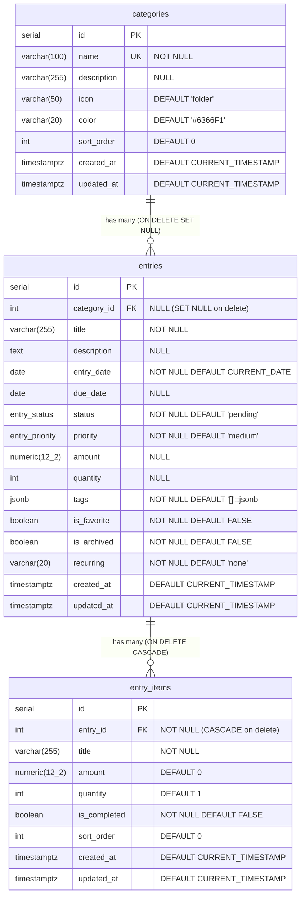
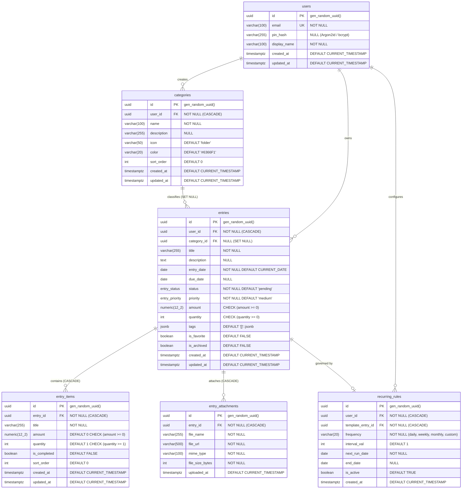

# 02. Database & Data Model Audit — Personal Organizer

**Project:** Personal Organizer ("One App, All Your Lists")  
**Audit Date:** October 2026  
**Auditor:** Senior Database Architect & Backend Engineer  
**Classification:** Database Architecture & Data Integrity Audit  

---

## 1. Executive Summary

ระบบจัดเก็บข้อมูลของโปรเจกต์ **Personal Organizer** ใช้ฐานข้อมูลเชิงสัมพันธ์ **PostgreSQL (เวอร์ชัน 17 / 18)** เป็นแกนหลักในการจัดเก็บข้อมูลของเซิร์ฟเวอร์ และใช้ **Browser LocalStorage** สำหรับจัดเก็บการตั้งค่าฝั่ง Client (Theme และ PIN Passcode)

จากการตรวจสอบไฟล์คำสั่ง SQL ใน [database/schema.sql](file:///d:/Personal_Organizer/database/schema.sql), [database/seeds.sql](file:///d:/Personal_Organizer/database/seeds.sql) และ Data Access Layer ใน `backend/src/models/` พบว่า:
1. การออกแบบ Relational Schema พื้นฐานอยู่ในเกณฑ์ดี มีการกำหนด Foreign Key Constraints, Cascading Rules, Triggers สำหรับ `updated_at` และ Indexes ที่เหมาะสม
2. **จุดบกพร่องวิกฤต (Critical Defects):**
   - **ขาดการใช้งาน Database Transactions (`BEGIN ... COMMIT ... ROLLBACK`):** การบันทึกข้อมูลแบบ Multi-Table (สร้างหรืออัปเดต Entry พร้อม Sub-items) รันด้วยคำสั่ง SQL แยกกัน หากเกิด Error ระหว่างลูป ข้อมูลจะเสียหายหรือสูญหายทันที
   - **Recurring Tasks ขาด Execution Engine:** คอลัมน์ `recurring` เป็นเพียง String Flag ในตาราง `entries` โดยไม่มีตารางหรือ Background Job มารองรับการสร้าง Task ซ้ำจริง
   - **ขาดระบบ Data Migration:** การเปลี่ยนแปลง Schema พึ่งพาไฟล์ SQL เดี่ยว และคำสั่ง `ALTER TABLE ... ADD COLUMN IF NOT EXISTS` ใน `schema.sql` ซึ่งไม่สามารถ Rollback หรือจัดการเวอร์ชันแบบ Production-grade ได้
   - **ระบบ Backup & Restore ไม่สมบูรณ์:** มีเพียง Export (CSV / JSON) แต่ไม่มีฟังก์ชัน Import / Restore ข้อมูลกลับเข้าสู่ฐานข้อมูล

---

## 2. Current Database Structure & Schema Analysis

### 2.1 Entity Relationship Overview (Current Schema)



---

### 2.2 Detailed Table Specifications

#### 1. ตาราง `categories`
- **ไฟล์อ้างอิง:** [schema.sql#L29-L38](file:///d:/Personal_Organizer/database/schema.sql#L29-L38)
- **วัตถุประสงค์:** จัดเก็บหมวดหมู่รายการที่ผู้ใช้กำหนดเอง
- **Primary Key:** `id SERIAL`
- **Constraints:**
  - `name VARCHAR(100) NOT NULL UNIQUE` (ป้องกันการตั้งชื่อหมวดหมู่ซ้ำ)
- **Triggers:** `trigger_categories_updated_at` อัปเดตฟิลด์ `updated_at = CURRENT_TIMESTAMP` อัตโนมัติ

#### 2. ตาราง `entries`
- **ไฟล์อ้างอิง:** [schema.sql#L47-L80](file:///d:/Personal_Organizer/database/schema.sql#L47-L80)
- **วัตถุประสงค์:** จัดเก็บบันทึกหลัก (Tasks, Expenses, Notes, Shopping Lists)
- **Primary Key:** `id SERIAL`
- **Foreign Key:** `category_id REFERENCES categories(id) ON DELETE SET NULL ON UPDATE CASCADE`
- **Custom ENUMs:**
  - `entry_status`: `'pending'`, `'in_progress'`, `'completed'`, `'cancelled'`
  - `entry_priority`: `'low'`, `'medium'`, `'high'`, `'urgent'`
- **JSONB Column:** `tags JSONB NOT NULL DEFAULT '[]'::jsonb`
- **Indexing:**
  - `idx_entries_category` บน `category_id` (B-Tree)
  - `idx_entries_status` บน `status` (B-Tree)
  - `idx_entries_due_date` บน `due_date` (B-Tree)
  - `idx_entries_favorite` บน `is_favorite` (B-Tree)
  - `idx_entries_archived` บน `is_archived` (B-Tree)
  - `idx_entries_entry_date` บน `entry_date` (B-Tree)
  - `idx_entries_tags` บน `tags` (GIN Index สำหรับค้นหา Tag)

#### 3. ตาราง `entry_items`
- **ไฟล์อ้างอิง:** [schema.sql#L82-L105](file:///d:/Personal_Organizer/database/schema.sql#L82-L105)
- **วัตถุประสงค์:** จัดเก็บรายการย่อย (Sub-items, Checklist, Granular Expense items)
- **Primary Key:** `id SERIAL`
- **Foreign Key:** `entry_id REFERENCES entries(id) ON DELETE CASCADE ON UPDATE CASCADE`
- **Indexing:** `idx_entry_items_entry_id` บน `entry_id` (B-Tree)

---

## 3. Evaluation of 7 Core Database Questions

### คำถามที่ 1: โครงสร้างข้อมูลรองรับฟีเจอร์ปัจจุบันครบหรือไม่?
**คำตอบ:** **รองรับฟีเจอร์พื้นฐานได้ แต่ไม่ครอบคลุมฟีเจอร์ระดับสูง (Incomplete for Advanced Features)**
- **ส่วนที่รองรับสมบูรณ์:**
  - รายการหลักและรายการย่อย (`entries`, `entry_items`)
  - การกรองสถานะ, ความสำคัญ, หมวดหมู่, และรายการโปรด
  - การจัดกลุ่มรายจ่ายตามหมวดหมู่ (Expense Analytics)
- **ส่วนที่ขาดหายไปจากโครงสร้าง:**
  1. **ระบบ User / Multi-tenancy:** ไม่มีตาราง `users` หรือ `user_id` ในทุกตาราง ข้อมูลทั้งหมดเป็น Global Shared Database
  2. **ระบบความปลอดภัย / PIN:** ไม่มีการเก็บรหัส PIN หรือ Password Hash ใน Database (ถูกเก็บเป็น Plaintext ใน Browser LocalStorage)
  3. **ระบบไฟล์แนบ (Attachments):** ไม่มีตารางหรือคอลัมน์รองรับการแนบไฟล์หรือรูปภาพ
  4. **Recurring Task Management:** ขาดข้อมูลความถี่ซ้ำขั้นสูง (Next Run Date, Recurrence Rule, Interval, End Date)

---

### คำถามที่ 2: มีข้อมูลซ้ำซ้อนหรือไม่ (Data Redundancy)?
**คำตอบ:** **พบปัญหา Denormalization และ State Redundancy**
- **ไฟล์อ้างอิง:** [entryModel.js#L216-L229](file:///d:/Personal_Organizer/backend/src/models/entryModel.js#L216-L229), [entryItemModel.js#L124-L139](file:///d:/Personal_Organizer/backend/src/models/entryItemModel.js#L124-L139)
- **ปัญหาที่พบ:**
  - คอลัมน์ `entries.amount` เก็บยอดรวมของรายการ ซึ่งในหลายกรณีถูก Sync มาจากผลรวมของ `entry_items.amount`
  - หากผู้ใช้แก้ไข `entry_items` นอกระบบ หรือเกิดกรณีลบ Sub-items ทั้งหมด ฟังก์ชัน `syncParentAmount` ใน [entryItemModel.js#L133](file:///d:/Personal_Organizer/backend/src/models/entryItemModel.js#L133) มีเงื่อนไข:
    ```javascript
    if (items_count > 0 && total_items_amount > 0) {
      await query(`UPDATE entries SET amount = $1 WHERE id = $2`, [total_items_amount, entryId]);
    }
    ```
    ทำให้เมื่อลบ Sub-items จนหมด (`items_count === 0`) หรือยอดรวมเป็น 0 คอลัมน์ `entries.amount` **จะไม่ถูกเคลียร์** ทำให้เกิดข้อมูลไม่สอดคล้องกัน (Inconsistent State)

---

### คำถามที่ 3: มีความเสี่ยงที่ข้อมูลสูญหายหรือไม่ (Risk of Data Loss)?
**คำตอบ:** **มีความเสี่ยงสูงมาก (High Risk due to Missing Transactions)**
- **ไฟล์อ้างอิง:** [entryModel.js#L362-L383](file:///d:/Personal_Organizer/backend/src/models/entryModel.js#L362-L383)
- **การวิเคราะห์ช่องโหว่:**
  ในการอัปเดต Entry พร้อมรายการย่อย โค้ดใช้วิธี **ลบรายการย่อยเดิมทิ้งทั้งหมด แล้วเริ่ม Insert ใหม่ทีละแถว**:
  ```javascript
  // frontend/src/models/entryModel.js
  if (Array.isArray(data.items)) {
    // 1. ลบทิ้งทั้งหมด
    await query(`DELETE FROM entry_items WHERE entry_id = $1`, [id]);
    
    // 2. ลูป Insert ทีละรายการ (ไม่มี Transaction ครอบ!)
    for (let i = 0; i < data.items.length; i++) {
      const item = data.items[i];
      if (item.title && item.title.trim()) {
        await query(
          `INSERT INTO entry_items (entry_id, title, amount, quantity, is_completed, sort_order)
           VALUES ($1, $2, $3, $4, $5, $6)`,
          [...]
        );
      }
    }
  }
  ```
- **ผลกระทบ:** หากเครือข่ายหลุด ข้อมูลรายการย่อยตัวใดตัวหนึ่งไม่ผ่านเกณฑ์ หรือเซิร์ฟเวอร์ Restart ระหว่างลูป ข้อมูล Sub-items เดิมที่ถูกลบไปแล้วจะไม่สามารถ Rollback ได้ ส่งผลให้ข้อมูลสูญหายถาวรทันที!

---

### คำถามที่ 4: การลบข้อมูลหลักส่งผลต่อข้อมูลย่อยอย่างไร (Cascade Behaviors)?
**คำตอบ:** **การตั้งค่า Cascading Rule ถูกต้องตามหลักการ Database Design**
1. **การลบ Category (`categories`):**
   - มี Foreign Key Constraint: `ON DELETE SET NULL ON UPDATE CASCADE` ([schema.sql#L68](file:///d:/Personal_Organizer/database/schema.sql#L68))
   - ผลลัพธ์: เมื่อลบหมวดหมู่ รายการ `entries` ที่อยู่ภายใต้หมวดหมู่นั้นจะไม่ถูกลบ แต่ค่า `category_id` จะกลายเป็น `NULL` (แสดงผลเป็น "ไม่มีหมวดหมู่")
2. **การลบ Entry (`entries`):**
   - มี Foreign Key Constraint: `ON DELETE CASCADE ON UPDATE CASCADE` ([schema.sql#L96](file:///d:/Personal_Organizer/database/schema.sql#L96))
   - ผลลัพธ์: เมื่อลบรายการหลัก รายการย่อยใน `entry_items` ที่ผูกกับ `entry_id` นั้นจะถูกลบออกตามโดยอัตโนมัติ ไม่เกิด Orphaned Rows

---

### คำถามที่ 5: การจัดการ Recurring Tasks ถูกออกแบบอย่างไร?
**คำตอบ:** **ออกแบบไว้เฉพาะระดับสัญลักษณ์ (Static Flag Only — Not Functioning)**
- **ไฟล์อ้างอิง:** [schema.sql#L61](file:///d:/Personal_Organizer/database/schema.sql#L61), [entryModel.js#L207](file:///d:/Personal_Organizer/backend/src/models/entryModel.js#L207)
- **สถานะ:**
  - ตาราง `entries` มีคอลัมน์ `recurring VARCHAR(20) NOT NULL DEFAULT 'none'`
  - รับค่า String เช่น `'none'`, `'daily'`, `'weekly'`, `'monthly'`
- **จุดที่ขาดหายไป:**
  1. ไม่มี Worker หรือ Cron Job (เช่น `node-cron`, `pg_cron`, หรือ `bullmq`) สำหรับตรวจสอบวันที่ถึงกำหนดเพื่อโคลนหรือสร้างรายการใหม่
  2. เมื่อผู้ใช้กดทำเครื่องหมายเสร็จสิ้น (`status = 'completed'`) ไม่มีการสร้าง Task รอบถัดไปขึ้นมา
  3. ฟิลด์ `recurring` จึงทำหน้าที่ได้เพียงเป็นป้ายข้อความ (Badge) แสดงบน UI เท่านั้น

---

### คำถามที่ 6: การสำรองและกู้คืนข้อมูลมีความปลอดภัยหรือไม่ (Backup & Restore Security)?
**คำตอบ:** **กึ่งปลอดภัยสำหรับการ Export แต่ "ไม่มีระบบ Restore"**
- **การสำรองข้อมูล (Export):**
  - ไฟล์อ้างอิง: [entryController.js#L147-L214](file:///d:/Personal_Organizer/backend/src/controllers/entryController.js#L147-L214)
  - ส่งออกข้อมูลเป็นไฟล์ JSON หรือ CSV (มี UTF-8 BOM `\uFEFF` เพื่อรองรับภาษาไทยใน Microsoft Excel)
  - ข้อมูลที่ส่งออกไม่มีการเข้ารหัสลับ (Encryption at rest) ใครที่ได้รับไฟล์สามารถอ่านข้อมูลส่วนตัวได้ทั้งหมด
- **การกู้คืนข้อมูล (Restore / Import):**
  - **ยังไม่มีการพัฒนา (Not Implemented)**
  - ไม่มี API Endpoint หรือ UI สำหรับอัปโหลดไฟล์ JSON/CSV กลับเข้าสู่ระบบ
  - หากระบบล่ม ผู้ใช้ต้องพึ่งพาคำสั่ง `pg_restore` หรือ `psql` ผ่าน Command Line เท่านั้น

---

### คำถามที่ 7: ควรปรับปรุง Data Model ส่วนใด?
**คำตอบ:**  
1. **เพิ่มตาราง `users` และฟิลด์ `user_id`:** เพื่อรองรับการแยกข้อมูลของผู้ใช้แต่ละคน (Multi-user)
2. **เพิ่มตาราง `recurring_rules` หรือปรับปรุงโครงสร้าง Recurring:** เก็บ `interval`, `recurrence_pattern`, `next_run_date`, `end_date`
3. **เพิ่ม Constraints เพื่อความถูกต้องของข้อมูล (Data Integrity):**
   - `CHECK (amount >= 0)`
   - `CHECK (quantity >= 0)`
   - `CHECK (recurring IN ('none', 'daily', 'weekly', 'monthly'))`
4. **นำระบบ Migration Tool มาใช้งาน:** เช่น Prisma, Drizzle ORM หรือ Knex.js Migrations แทนการใช้ raw script `initDb.js`

---

## 4. Proposed Next-Generation Database Schema

ด้านล่างนี้คือแบบจำลองโครงสร้างฐานข้อมูลใหม่ที่ได้รับการออกแบบเพื่อแก้ไขจุดบกพร่องทั้งหมด พร้อมรองรับ Multi-tenancy, Secure PIN, File Attachments และ Recurring Task Scheduler:


