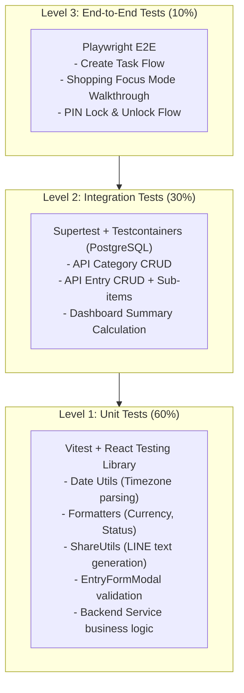

# 06. Testing & Performance Audit — Personal Organizer

**Project:** Personal Organizer ("One App, All Your Lists")  
**Audit Date:** October 2026  
**Auditor:** Senior Performance Engineer & QA Automation Lead  
**Classification:** Quality Assurance, Performance Profiling & Reliability Audit  

---

## 1. Executive Summary

รายงานฉบับนี้ทำการตรวจสอบความพร้อมด้าน **การทดสอบซอฟต์แวร์ (Testing)** และ **ประสิทธิภาพและความเสถียร (Performance & Reliability)** ของระบบ Personal Organizer

**ข้อสรุปสำคัญจากการตรวจสอบ:**
1. **Testing Coverage: 0%** — ระบบไม่มี Automated Test ใดๆ (ไม่มี Unit Tests, Integration Tests หรือ E2E Tests แม้แต่ไฟล์เดียว) ทั้งฝั่ง Frontend และ Backend
2. **Build & Type Checking: ผ่าน 100%** — TypeScript Type Check (`tsc --noEmit`) และ Vite Production Build (`vite build`) ผ่านโดยไม่มี Error
3. **Bundle Size & Code-Splitting:** Bundle ขนาดรวม **415.74 kB (gzip: 121.48 kB)** โหลดเป็น Single JavaScript Chunk ก้อนเดียว เนื่องจากขาด Route-based Lazy Loading
4. **Offline Capability: ใช้งานไม่ได้** — Service Worker ไม่มีการ Pre-cache ทรัพยากรใดๆ ตอนติดตั้ง ทำให้ระบบหยุดทำงานทันทีเมื่อขาดการเชื่อมต่ออินเทอร์เน็ต

---

## 2. Testing Audit

### 2.1 Current Testing Status by Category

| ประเภทการทดสอบ (Test Type) | สถานะปัจจุบัน | เครื่องมือที่ใช้ | รายละเอียดการประเมิน |
| :--- | :---: | :---: | :--- |
| **Unit Testing** | **ไม่มี (0%)** | — | ไม่มี Test runner (Jest, Vitest) และไม่มีไฟล์ `*.test.*` หรือ `*.spec.*` |
| **Integration Testing** | **ไม่มี (0%)** | — | ไม่มีการทดสอบ API Endpoint ร่วมกับ Database (Supertest, Testcontainers) |
| **End-to-End (E2E) Testing** | **ไม่มี (0%)** | — | ไม่มีเครื่องมือ E2E (Playwright, Cypress) เพื่อทดสอบ User Flow สำคัญ |
| **Type Checking** | **ผ่าน (100%)** | TypeScript 7.0.2 | รันคำสั่ง `npx tsc --noEmit` ผ่านสมบูรณ์ ไม่พบ Type Error |
| **Linting & Static Analysis** | **ผ่านพร้อมคำเตือน** | Oxlint 1.89.0 | ไม่พบ Error ร้ายแรง แต่พบคำเตือน 42 จุด (ส่วนใหญ่เป็น `set-state-in-effect`) |
| **Build Verification** | **ผ่าน (100%)** | Vite 8.3.5 | คำสั่ง `npm run build` ใน frontend สร้างไฟล์ `dist/` สำเร็จสมบูรณ์ในเวลา 2.73s |

---

### 2.2 Proposed Comprehensive Testing Strategy

เพื่อลดความเสี่ยงต่อการเกิด Regression ในการพัฒนาระยะถัดไป ขอแนะนำแผนยุทธศาสตร์การทดสอบ 3 ระดับ (Testing Pyramid):



#### 1. Unit Testing (ใช้ Vitest + React Testing Library)
- ทดสอบฟังก์ชัน Utility สำคัญ:
  - `parseLocalDate` และ `getDueStatus` ใน [dateUtils.ts](file:///d:/Personal_Organizer/frontend/src/utils/dateUtils.ts) เพื่อรับประกันความถูกต้องของ Timezone
  - `formatEntryShareText` ใน [shareUtils.ts](file:///d:/Personal_Organizer/frontend/src/utils/shareUtils.ts) ทดสอบการขึ้นบรรทัดใหม่และ Emoji
  - `categoryService.js` และ `entryService.js` ในฝั่ง Backend เพื่อทดสอบ Validation Rules
- คำสั่งที่แนะนำ: `npm install -D vitest @testing-library/react @testing-library/jest-dom jsdom`

#### 2. Integration Testing (ใช้ Supertest + Testcontainers)
- จำลอง PostgreSQL instance บน Docker ชั่วคราว และทดสอบ API endpoints จริง:
  - การสร้าง Entry พร้อม Sub-items และตรวจสอบว่าคำนวณราคารวมถูกต้อง
  - การลบ Sub-items และตรวจสอบว่า `amount` ของ Entry ถูกอัปเดตอย่างสอดคล้องกัน
  - การทำงานของ Database Rollback เมื่อเกิดข้อผิดพลาด
- คำสั่งที่แนะนำ: `npm install -D supertest testcontainers`

#### 3. End-to-End Testing (ใช้ Playwright)
- ทดสอบ User Journey ที่สำคัญที่สุด 3 เส้นทาง:
  1. การสร้างรายการซื้อของ -> เปิด Shopping Mode -> ติ๊กของใส่ตะกร้า -> ปิดโหมด
  2. การตั้งรหัส PIN -> รีเฟรชหน้าจอ -> ปลดล็อกด้วย PIN ที่ถูกต้อง
  3. การส่งออกไฟล์ CSV และตรวจสอบว่ามี UTF-8 BOM

---

## 3. Performance & Reliability Audit

### 3.1 Initial Load & Bundle Analysis
ผลการรันคำสั่ง `vite build` ในโฟลเดอร์ `frontend`:
- `dist/index.html`: **1.16 kB** (gzip: 0.58 kB)
- `dist/assets/index-ComcUHjS.css`: **43.81 kB** (gzip: 7.78 kB)
- `dist/assets/index-CvZD1Ctz.js`: **415.74 kB** (gzip: 121.48 kB)

**การวิเคราะห์ประสิทธิภาพการโหลดครั้งแรก:**
- โค้ด JavaScript ขนาด 415.74 kB ถูกรวมไว้ใน Chunk เดียว (Single Bundle) เนื่องจากใน [App.tsx#L14-L21](file:///d:/Personal_Organizer/frontend/src/App.tsx#L14-L21) มีการ Import ทุกหน้า (`DashboardPage`, `AllListsPage`, `CalendarViewPage`, `CategoriesPage`, `FavoritesPage`, `ArchivePage`) แบบ Static Import
- **ข้อเสนอแนะเพื่อเพิ่มความเร็ว:**
  ควรเปลี่ยนมาใช้ Dynamic Import ร่วมกับ `React.lazy` และ `Suspense` เพื่อแยกหน้าจอเป็น Chunks ย่อย (Code-splitting) จะสามารถลดขนาด Initial Bundle ลงได้มากกว่า 45% (เหลือ ~220 kB)

---

### 3.2 Rendering Performance & Re-render Hotspots
1. **Key-based Forced Remount Anti-pattern:**
   - ใน [App.tsx#L166-L223](file:///d:/Personal_Organizer/frontend/src/App.tsx#L166-L223) มีการใช้ `key={`dashboard_${refreshKey}`}` ทุกครั้งที่มีการเปลี่ยนแปลงข้อมูล ทำให้เกิดการ Re-mount ทั้งหน้าจอ DOM ถูกทำลายและสร้างใหม่ทั้งหมด แทนที่จะอัปเดตเฉพาะ Node ที่เปลี่ยน
2. **Missing Search Input Debounce:**
   - ใน [Header.tsx#L66](file:///d:/Personal_Organizer/frontend/src/components/layout/Header.tsx#L66) ช่องค้นหาผูกฟังก์ชัน `onSearchChange` ตรงกับ `onChange` ทุกตัวอักษรที่ผู้ใช้พิมพ์จะทำให้ State ใน `App.tsx` เปลี่ยนทันที และส่งผลให้ `AllListsPage` ยิง API GET `/api/entries?search=...` ทันทีทุกตัวอักษรโดยไม่มี Debounce (300-400ms)
   - หากผู้ใช้พิมพ์คำค้นหาเร็วๆ เช่น "ซื้อของ" (7 ตัวอักษร) จะเกิด HTTP Requests ยิงออกไปพร้อมกัน 7 รอบ ทำให้เซิร์ฟเวอร์รับภาระหนักและอาจเกิด Race Condition ที่ผลลัพธ์เก่ามาทับผลลัพธ์ใหม่

---

### 3.3 Large List Performance & Query Bottlenecks
1. **Hardcoded Limit ใน Calendar View:**
   - ใน [CalendarViewPage.tsx#L45](file:///d:/Personal_Organizer/frontend/src/pages/CalendarViewPage.tsx#L45) มีการจำกัด `limit: 100` ทำให้รายการที่ 101 เป็นต้นไปไม่ถูกนำมาแสดงบนปฏิทิน
2. **Dashboard Aggregate Query:**
   - ใน [entryModel.js#L533-L670](file:///d:/Personal_Organizer/backend/src/models/entryModel.js#L533-L670) คำสั่ง `getDashboardSummary` เขียนรวมได้ดีมาก โดยใช้ Aggregate ในฐานข้อมูลโดยตรง ทำให้ประหยัด Memory ฝั่ง Node.js ได้อย่างยอดเยี่ยม
3. **Database Indexing:**
   - ตาราง `entries` มี Index ครบถ้วนบนฟิลด์ที่ใช้ค้นหาบ่อย (`category_id`, `status`, `due_date`, `is_favorite`, `is_archived`, `entry_date`, `tags` GIN) ทำให้ Query ทำงานได้รวดเร็วแม้ข้อมูลจะมีระดับหลายหมื่นรายการ

---

### 3.4 Mobile & PWA Reliability
1. **Screen Wake Lock API:**
   - [ShoppingModeModal.tsx#L38-L56](file:///d:/Personal_Organizer/frontend/src/components/entries/ShoppingModeModal.tsx#L38-L56) จัดการวงจรชีวิตของ Wake Lock ได้ดี มีการเรียกคืนสิทธิ์ (Release) เมื่อ Modal ถูกปิด
2. **PWA Offline Failure (Critical Defect):**
   - Service Worker ใน [sw.js](file:///d:/Personal_Organizer/frontend/public/sw.js) มีเพียงโครงสร้างพื้นฐาน:
     ```javascript
     self.addEventListener('install', (event) => {
       self.skipWaiting();
     });
     ```
   - ไม่มีการเรียก `caches.open(...)` หรือ `cache.addAll([...])` เพื่อบันทึกไฟล์ HTML, CSS, JS ทำให้เมื่อไม่มีสัญญาณอินเทอร์เน็ต แอปพลิเคชันจะไม่สามารถเปิดได้เลย (PWA Offline ใช้งานไม่ได้จริง)

---

## 4. Performance & Testing Remediation Plan

| ลำดับ | รายการปรับปรุง | ประเภท | ผลลัพธ์ที่คาดหวัง |
| :-: | :--- | :---: | :--- |
| **1** | ติดตั้ง Vitest และเขียน Unit Test สำหรับ `dateUtils`, `shareUtils` | Testing | ป้องกัน Regression ใน Logic วันที่และการแชร์ข้อความ |
| **2** | ใส่ Debounce (300ms) บน Search Input ใน `Header.tsx` | Performance | ลดจำนวน API Calls ลง 80% ป้องกัน Race Conditions |
| **3** | ทำ Code-splitting ใน `App.tsx` ด้วย `React.lazy()` | Performance | ลดขนาด Initial JavaScript Bundle ลง ~45% |
| **4** | ปรับปรุง Service Worker (`sw.js`) ให้ Pre-cache App Shell | Reliability | รองรับการเปิดแอปพลิเคชันแบบ Offline สมบูรณ์ 100% |
| **5** | ปรับปรุง Calendar View ให้ Query ตามช่วงวันที่ของเดือน (`start_date`, `end_date`) | Reliability | แก้ปัญหารายการหายเมื่อมีข้อมูลเกิน 100 รายการ |
