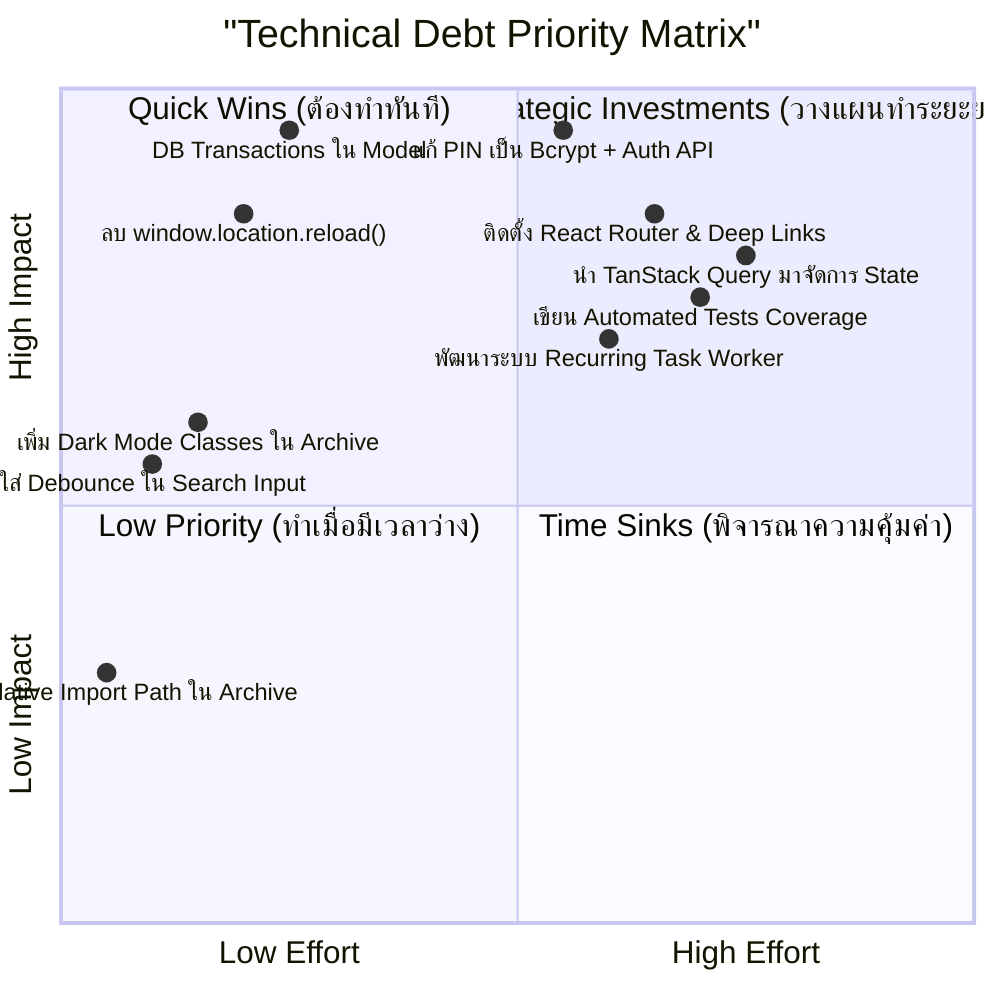

# 07. Technical Debt Audit — Personal Organizer

**Project:** Personal Organizer ("One App, All Your Lists")  
**Audit Date:** October 2026  
**Auditor:** Senior Software Architect & Lead Technical Consultant  
**Classification:** Technical Debt Inventory & Modernization Strategy  

---

## 1. Executive Summary

**หนี้ทางเทคนิค (Technical Debt)** ในโปรเจกต์ Personal Organizer เกิดขึ้นจากการเลือกใช้วิธีแก้ปัญหาแบบเฉพาะหน้า (Workarounds / Shortcuts) ในระหว่างการพัฒนาเพื่อให้ฟีเจอร์ทำงานได้รวดเร็ว เช่น การใช้ `window.location.reload()` เพื่อแก้ปัญหาข้อมูลไม่ซิงค์, การใช้ `key` remount แทนการจัดการ State ที่ถูกต้อง, และการสร้างระบบ PIN Lock ฝั่ง Client โดยไม่เชื่อมต่อกับความปลอดภัยฝั่งเซิร์ฟเวอร์

หากปล่อยให้หนี้ทางเทคนิคเหล่านี้สะสมต่อไป การพัฒนาฟีเจอร์ใหม่ในระยะถัดไป (เช่น ระบบ Multi-user, ระบบแจ้งเตือน, การเชื่อมต่อ Cloud Sync) จะทำได้ยากขึ้น มีต้นทุนการบำรุงรักษาสูงขึ้น และมีความเสี่ยงสูงที่จะเกิดข้อผิดพลาดรุนแรง (Regression) ในระบบเดิม

---

## 2. Technical Debt Categorization

### 2.1 Architectural Debt (หนี้ทางสถาปัตยกรรม)
1. **การขาด Client-Side Router:**
   - **ปัญหา:** ใช้ State-based Tab Switching ใน [App.tsx](file:///d:/Personal_Organizer/frontend/src/App.tsx#L24) แทนการใช้ `react-router-dom`
   - **ผลกระทบ:** ไม่รองรับ Deep Linking, กดปุ่มย้อนกลับของเบราว์เซอร์ไม่ได้, ไม่สามารถแชร์ URL ลิงก์ตรงได้
2. **การขาด Centralized State Manager:**
   - **ปัญหา:** ไม่มีการใช้ TanStack Query หรือ State Store ข้อมูลถูกดึงและเก็บแยกกันอิสระในแต่ละหน้า ทำให้ต้องใช้การ Remount หรือ Reload เพื่อดึงข้อมูลใหม่
3. **การออกแบบฐานข้อมูลแบบ Single-Tenant:**
   - **ปัญหา:** ไม่มีแนวคิดเรื่อง User Entity หรือสิทธิ์การเข้าถึง หากต้องการขยายให้รองรับผู้ใช้งานหลายคน ต้องแก้ไข Schema และ Query ใหม่ทั้งหมด

---

### 2.2 Database & Data Integrity Debt (หนี้ด้านฐานข้อมูล)
1. **การขาด Database Transactions ใน Multi-Table Writes:**
   - **ปัญหา:** ใน [entryModel.js#L365-L383](file:///d:/Personal_Organizer/backend/src/models/entryModel.js#L365-L383) มีการลบและวน Insert Sub-items โดยไม่มี `BEGIN ... COMMIT ... ROLLBACK`
   - **ผลกระทบ:** เสี่ยงต่อข้อมูลสูญหายถาวรหากเกิดข้อผิดพลาดระหว่างลูป
2. **การขาดระบบ Database Migration:**
   - **ปัญหา:** อาศัยไฟล์ `schema.sql` และ `initDb.js` รันคำสั่ง SQL ดิบ ไม่สามารถติดตามเวอร์ชันของ Schema หรือ Rollback ได้เมื่อขึ้น Production
3. **Recurring Tasks ขาด Execution Scheduler:**
   - **ปัญหา:** ฟิลด์ `recurring` ในตาราง `entries` เป็นเพียงป้ายบอกความถี่ แต่ไม่มี Worker หรือ Scheduler ในการสร้างรายการรอบถัดไปจริง

---

### 2.3 Code Quality & Anti-Pattern Debt (หนี้ด้านคุณภาพโค้ด)
1. **การใช้ `window.location.reload()`:**
   - **ปัญหา:** พบใน [App.tsx#L99](file:///d:/Personal_Organizer/frontend/src/App.tsx#L99), [ArchivePage.tsx#L58](file:///d:/Personal_Organizer/frontend/src/pages/ArchivePage.tsx#L58), [CategoriesPage.tsx#L51](file:///d:/Personal_Organizer/frontend/src/pages/CategoriesPage.tsx#L51)
   - **ผลกระทบ:** หน้าจอกระพริบ รีเซ็ต Context และ Client State ทั้งหมด
2. **การใช้ `key` Remount Hack:**
   - **ปัญหา:** ใช้ `key={`dashboard_${refreshKey}`}` ใน [App.tsx#L166](file:///d:/Personal_Organizer/frontend/src/App.tsx#L166) บังคับให้ React ทำลายและ Re-render DOM ทั้งหน้า
3. **Code Duplication ของ Action Handlers:**
   - **ปัญหา:** ฟังก์ชัน Toggle Status, Favorite, Archive ถูกเขียนซ้ำใน 4 หน้าหลัก รวมกว่า 160 บรรทัด
4. **ความผิดปกติของ Relative Import Path:**
   - **ปัญหา:** ใน [ArchivePage.tsx#L11-L12](file:///d:/Personal_Organizer/frontend/src/pages/ArchivePage.tsx#L11-L12):
     ```typescript
     import { renderCategoryIcon } from '../../src/utils/categoryIcons';
     import { formatDate } from '../../src/utils/dateUtils';
     ```
     เป็นการอ้างอิง Path ย้อนออกนอก `src` แล้วชี้กลับเข้ามาใน `src` อีกครั้ง

---

### 2.4 Security Debt (หนี้ด้านความปลอดภัย)
1. **Plaintext PIN Storage:** รหัสผ่านเก็บตรงๆ ใน `localStorage` ปลอดการเข้ารหัสลับ
2. **Client-Side Only Authentication:** API Server ไม่มี Auth Middleware ปล่อยให้ทุก Endpoint เปิดสาธารณะ
3. **ขาด Security Headers & Rate Limiting:** Backend ขาดไลบรารี `helmet` และ `express-rate-limit`

---

### 2.5 UI/UX & Styling Debt (หนี้ด้านการแสดงผล)
1. **Dark Mode Classes ตกหล่น:**
   - [ArchivePage.tsx](file:///d:/Personal_Organizer/frontend/src/pages/ArchivePage.tsx), [CategoriesPage.tsx](file:///d:/Personal_Organizer/frontend/src/pages/CategoriesPage.tsx), [EntryFilterBar.tsx](file:///d:/Personal_Organizer/frontend/src/components/entries/EntryFilterBar.tsx) ขาดคลาส `dark:` ทำให้ตัวหนังสือและพื้นหลังกลืนกัน
   - Badges ใน [formatters.ts](file:///d:/Personal_Organizer/frontend/src/utils/formatters.ts) และ [dateUtils.ts](file:///d:/Personal_Organizer/frontend/src/utils/dateUtils.ts) ค้างเป็นสีสว่างในโหมดมืด
2. **ขาด Input Debounce:** ช่องค้นหาใน Header ยิง Request ทุกตัวอักษรที่พิมพ์

---

## 3. Technical Debt Prioritization Matrix

การประเมินหนี้ทางเทคนิคตามกรอบ **Impact (ผลกระทบต่อระบบ)** เทียบกับ **Effort (แรงงานและเวลาที่ต้องใช้ในการแก้ไข)**:



---

## 4. Technical Debt Inventory Table

| ID | รายการหนี้ทางเทคนิค | หมวดหมู่ | ผลกระทบ (Impact) | ความยาก (Effort) | ลำดับความสำคัญ |
| :-: | :--- | :---: | :---: | :---: | :---: |
| **TD-01** | เพิ่ม Database Transaction ใน `createEntry` และ `updateEntry` | Database | วิกฤต (Critical) | ต่ำ (Low) | **P0 (ด่วนที่สุด)** |
| **TD-02** | ย้ายระบบ PIN ไปไว้ที่ Backend พร้อม Hash และ Auth Middleware | Security | วิกฤต (Critical) | ปานกลาง (Medium) | **P0 (ด่วนที่สุด)** |
| **TD-03** | ลบ `window.location.reload()` และอัปเดต State ผ่าน React ปกติ | Code Quality | สูง (High) | ต่ำ (Low) | **P1 (เร่งด่วน)** |
| **TD-04** | แก้ไข Dark Mode Classes ใน `ArchivePage`, `CategoriesPage`, `EntryFilterBar` | UI/UX | ปานกลาง (Medium) | ต่ำ (Low) | **P1 (เร่งด่วน)** |
| **TD-05** | เพิ่ม Debounce บนช่องค้นหาใน `Header.tsx` | Performance | ปานกลาง (Medium) | ต่ำ (Low) | **P1 (เร่งด่วน)** |
| **TD-06** | สกัด Custom Hook `useEntryActions.ts` ลดโค้ดซ้ำ 4 หน้า | Code Quality | ปานกลาง (Medium) | ต่ำ (Low) | **P2 (ควรทำ)** |
| **TD-07** | ติดตั้ง `react-router-dom` รองรับ URL-based Navigation | Architecture | สูง (High) | ปานกลาง (Medium) | **P2 (ควรทำ)** |
| **TD-08** | นำ TanStack Query มาแทนที่การดึงข้อมูลด้วย `useEffect` + `refreshKey` | Architecture | สูง (High) | สูง (High) | **P2 (ควรทำ)** |
| **TD-09** | ปรับปรุง PWA Service Worker (`sw.js`) ให้ Cache App Shell จริง | Reliability | ปานกลาง (Medium) | ปานกลาง (Medium) | **P3 (ระยะถัดไป)** |
| **TD-10** | พัฒนาระบบ Background Job / Worker สำหรับ Recurring Tasks | Feature/DB | ปานกลาง (Medium) | สูง (High) | **P3 (ระยะถัดไป)** |
