# 08. Final Technical Audit Summary — Personal Organizer

**Project Name:** Personal Organizer  
**Tagline:** "One App, All Your Lists"  
**Repository:** https://github.com/dewvx/Personal_Organizer.git  
**Audit Completed Date:** October 2026  
**Auditor Roles:** Senior Software Architect, Lead Database Architect & Senior Full Stack Engineer  
**Audit Scope:** Full Source Code Inspection (Frontend, Backend, Database, Security, Testing, Performance)  

---

## 1. Executive Summary

จากการดำเนินการตรวจสอบเชิงเทคนิค (Technical Audit) ต่อ Source Code ทั้งหมดของโปรเจกต์ **Personal Organizer** อย่างละเอียด โดยตรวจสอบเส้นทางการทำงานจริงของระบบ (End-to-End Code Tracing) ไม่ยึดถือเพียงชื่อ Component หรือคำอธิบายฟีเจอร์ในเอกสาร สรุปผลการประเมินได้ดังนี้:

โปรเจกต์ Personal Organizer เป็นแอปพลิเคชันที่มีศักยภาพสูง โค้ดถูกพัฒนาขึ้นอย่างเป็นระเบียบ มีการตั้งชื่อตัวแปรที่สื่อความหมายชัดเจน และมีแนวคิดด้าน UI/UX ที่ยอดเยี่ยม โดยเฉพาะฟีเจอร์เฉพาะทาง เช่น **โหมดซื้อของ (Shopping Focus Mode)** ที่มี Screen Wake Lock และ Haptic Feedback, การคำนวณราคารวมจากรายการย่อยแบบอัตโนมัติ (Sub-items Checklist), และการแชร์ข้อความภาษาไทยไปยังแอปพลิเคชัน LINE

อย่างไรก็ดี ระบบยังมี **จุดบกพร่องวิกฤต (Critical Vulnerabilities & Architectural Bottlenecks)** ที่จำเป็นต้องได้รับการปรับปรุงก่อนเปิดใช้งานบน Production หรือพัฒนาระยะถัดไป ได้แก่:
1. **ช่องโหว่ความปลอดภัยระดับวิกฤตของ Privacy PIN:** รหัส PIN ถูกเก็บเป็น Plaintext ใน Browser LocalStorage และไม่มีการคุ้มครองที่ Backend API
2. **ความเสี่ยงต่อข้อมูลสูญหาย (Data Loss):** การทำงานกับฐานข้อมูลหลายตารางพร้อมกัน (Multi-table writes) ขาดการใช้ Database Transactions (`BEGIN ... COMMIT`)
3. **ปัญหาการจัดการ State และ Routing:** การไม่มี Client-side Router และการพึ่งพาคำสั่ง `window.location.reload()` เพื่อแก้ปัญหาข้อมูลไม่ซิงค์

---

## 2. Current System Scorecard

| มิติการประเมิน (Dimension) | คะแนน (Score) | สถานะ (Status) | ข้อคิดเห็นหลัก (Key Takeaway) |
| :--- | :---: | :---: | :--- |
| **System Architecture** | **6.5 / 10** | ⚠️ ปานกลาง | โครงสร้างโฟลเดอร์ดี แต่ขาด Client Router และ State Manager |
| **Database & Data Model** | **7.0 / 10** | ⚠️ ปานกลาง | Schema และ Index ดีมาก แต่ขาด Transaction ครอบคลุมการบันทึก |
| **Code Quality & Typing** | **7.5 / 10** | 🟢 ดี | ตั้งชื่อดีเยี่ยม TypeScript ผ่าน 100% แต่มี Code Duplication |
| **Security & Privacy** | **3.5 / 10** | 🔴 วิกฤต | PIN เป็น Plaintext, API ไร้ Auth, เสี่ยงต่อ Brute-force |
| **Feature Completeness** | **7.5 / 10** | 🟢 ดี | พัฒนาไปแล้ว 12 หมวด (สมบูรณ์ 6 หมวด, กึ่งสมบูรณ์ 6 หมวด) |
| **Performance & Mobile** | **7.0 / 10** | 🟢 ดี | รันเร็วบนเครื่อง แต่ขาด Debounce และ PWA Offline ยังใช้ไม่ได้ |
| **Testing & Reliability** | **2.0 / 10** | 🔴 ต้องแก้ไขด่วน | Test Coverage 0% ขาดทั้ง Unit, Integration และ E2E |
| **ภาพรวมความพร้อมระบบ** | **6.0 / 10** | ⚠️ พร้อมระดับ MVP | พร้อมสำหรับ Local Prototype แต่ต้องปรับปรุงก่อน Production |

---

## 3. Answers to Core Completion Criteria

### 1. Architecture ปัจจุบันเป็นอย่างไร?
- ระบบทำงานในรูปแบบ **Decoupled Client-Server Monolith (SPA + REST API + PostgreSQL)**
- **Frontend:** React 19 + TypeScript + Vite + Tailwind CSS แสดงผลแบบ **Virtual Tab Switching** ผ่าน Local State ใน `App.tsx` (ไม่มี Client-side Routing Library)
- **Backend:** Node.js + Express 4.x จัดโครงสร้างแบบ 4-Layer Architecture (`routes` -> `controllers` -> `services` -> `models`)
- **จุดอ่อน:** มีความเป็น God Component ใน `App.tsx`, มีการใช้เทคนิค `key` remount hack และ `window.location.reload()` เพื่อรีเฟรชข้อมูล

---

### 2. Database มีความเหมาะสมหรือไม่?
- **เหมาะสมในระดับพื้นฐาน แต่มีจุดอันตราย:**
  - ตาราง `categories`, `entries`, `entry_items` มีความสัมพันธ์แบบ Relational ที่ดี มี Foreign Key Cascading และ Trigger `updated_at` ครบถ้วน
  - มี Index ทั้ง B-Tree และ GIN (บนคอลัมน์ tags JSONB) ทำให้ค้นหาได้รวดเร็ว
  - **จุดบกพร่องวิกฤต:** ขาดการใช้ Database Transaction ใน `createEntry` และ `updateEntry` เมื่อทำการลบและ Insert Sub-items ใหม่ เสี่ยงต่อข้อมูลสูญหายถาวรหากเกิด Network Error กลางทาง

---

### 3. Code Quality อยู่ในระดับใด?
- **อยู่ในเกณฑ์ดี (Good):**
  - รันผ่าน TypeScript Compiler (`tsc --noEmit`) 100% โดยไม่มี Type Error
  - รันผ่าน Vite Build สร้าง Production Bundle ได้อย่างสมบูรณ์
  - การตั้งชื่อตัวแปร ฟังก์ชัน และโฟลเดอร์ ชัดเจน อ่านเข้าใจง่าย
  - **จุดที่ต้องปรับปรุง:** Oxlint แจ้งเตือน 42 จุด (ส่วนใหญ่เป็น `set-state-in-effect`), ขาด Error Boundary, และมี Code Duplication สูงในส่วน Action Handlers 4 หน้าหลัก

---

### 4. ฟีเจอร์ใดสมบูรณ์แล้ว (Implemented)?
มี **6 หมวดหมู่** ที่ผ่านการยืนยันว่าทำงานได้จริงครบถ้วน:
1. **Core Lists & Sub-items:** บันทึกงาน รายการย่อย ติ๊ก Checklist และรวมยอดเงินอัตโนมัติ
2. **Shopping Focus Mode:** โหมดซื้อของเต็มจอ พร้อม Screen Wake Lock และขนาดปุ่มสัมผัสนิ้วโป้ง
3. **LINE / Social Sharing:** จัดรูปแบบข้อความภาษาไทย รองรับ Web Share API และ Clipboard Fallback
4. **Haptic Feedback:** ระบบสั่นสัมผัสบนมือถือ 4 รูปแบบพร้อม Fallback ปลอดภัย
5. **Dashboard & Analytics:** ตัวเลขสรุปสถิติ กราฟวิเคราะห์สัดส่วนรายจ่ายแยกตามหมวดหมู่
6. **Categories & Archive:** จัดการหมวดหมู่สี/ไอคอนอิสระ และระบบคลังเอกสารพร้อม Bulk Archive

---

### 5. ฟีเจอร์ใดต้องแก้ไข (Partially Implemented)?
มี **6 หมวดหมู่** ที่ต้องแก้ไขให้สมบูรณ์:
1. **Privacy PIN Lock:** ต้องย้ายการตรวจสอบไปที่เซิร์ฟเวอร์ และทำการ Hash ด้วย Argon2id/Bcrypt แทนการเก็บ Plaintext ใน LocalStorage
2. **Export CSV / JSON Backup:** ขาดระบบ **Import / Restore ข้อมูลกลับเข้าสู่ฐานข้อมูล**
3. **Calendar View:** ปัจจุบัน Hardcode Limit ไว้ที่ 100 รายการ ต้องปรับเป็น Query ตามช่วงวันที่ของเดือน (`start_date`, `end_date`)
4. **PWA (Progressive Web App):** Service Worker ยังไม่มีการ Pre-cache ไฟล์ ทำให้เมื่อ Offline ระบบจะล้มเหลวทันที
5. **Dark & Light Mode:** มีหลายหน้า (Archive, Categories, FilterBar) ที่ยังมี Hardcoded Light Classes ทำให้สีเพี้ยนในโหมดมืด
6. **Thai Speech-to-Text:** ใช้งานได้เฉพาะ Chrome/Edge บน HTTPS ขาดการแจ้งเตือนเมื่อเบราว์เซอร์ไม่รองรับ

---

### 6. Technical Debt ที่สำคัญที่สุดคืออะไร?
1. **Security Vulnerability:** รหัส PIN ถูก Bypass ได้ง่ายดายผ่าน DevTools และ API ไม่มี Authentication ใดๆ
2. **Missing DB Transactions:** ไม่มีการใช้ `BEGIN` / `COMMIT` ในการบันทึกรายการย่อย เสี่ยงต่อ Data Loss
3. **Hard Page Reload (`window.location.reload()`):** ทำลาย Lifecycle ของความเป็น Single Page Application (SPA)

---

## 4. Top 10 Prioritized Improvements (Roadmap)

แผนการปรับปรุงระบบเรียงตามลำดับความสำคัญและความคุ้มค่า:

```mermaid
flowchart LR
    subgraph Phase1 ["Phase 1: Security & Data Integrity (P0 - ทำทันที)"]
        F1["1. ใส่ DB Transactions<br/>(BEGIN/COMMIT ใน Model)"]
        F2["2. แก้ไขระบบ PIN Lock<br/>(Bcrypt Hash + API Auth)"]
        F3["3. ลบ window.location.reload()<br/>(จัดการ State ใน React)"]
    end

    subgraph Phase2 ["Phase 2: UX & Stability (P1 - ภายใน 2 สัปดาห์)"]
        F4["4. แก้ไข Dark Mode Classes<br/>(Archive, FilterBar, Badges)"]
        F5["5. ใส่ Debounce ในช่อง Search<br/>(ลดภาระ API 80%)"]
        F6["6. แก้ Bug Calendar View<br/>(Query ตามช่วงวันที่ของเดือน)"]
        F7["7. สกัด Custom Hook useEntryActions<br/>(ลด Code Duplication)"]
    end

    subgraph Phase3 ["Phase 3: Modern Architecture (P2 - ถัดไป)"]
        F8["8. ติดตั้ง React Router v6/v7<br/>(รองรับ Deep Links / Back Button)"]
        F9["9. นำ TanStack Query มาใช้<br/>(แทนที่ useEffect & refreshKey)"]
        F10["10. เขียน Automated Test Suite<br/>(Vitest Unit + Supertest API)"]
    end

    Phase1 --> Phase2
    Phase2 --> Phase3
```

1. **[P0] เพิ่ม Database Transaction ในคำสั่งสร้าง/แก้ไข Entry:** ครอบการลบและ Insert ของตาราง `entry_items` ด้วย Transaction เพื่อป้องกัน Data Loss
2. **[P0] ปรับปรุงระบบ PIN Lock ให้ปลอดภัย:** นำการตรวจสอบรหัส PIN ไปไว้ที่ Backend, ทำการ Hash ด้วย `bcrypt` หรือ `argon2`, และเพิ่ม Rate Limiting ป้องกัน Brute-force
3. **[P0] ลบ `window.location.reload()`:** แทนที่การรีโหลดทั้งหน้าจอด้วยการอัปเดต React State ในเครื่อง
4. **[P1] แก้ไข Dark Mode Classes ให้ครอบคลุม 100%:** ใส่คลาส `dark:` ใน `ArchivePage.tsx`, `CategoriesPage.tsx`, `EntryFilterBar.tsx`, และไฟล์ `formatters.ts`
5. **[P1] เพิ่ม Debounce (300ms) ในช่อง Search Input:** ป้องกันการยิง API ถี่เกินไปและลด Race Conditions
6. **[P1] แก้ไข Query ใน Calendar View:** ให้ส่ง `start_date` และ `end_date` เพื่อดึงเฉพาะรายการในเดือนนั้น แทนการ Hardcode `limit: 100`
7. **[P1] สกัด Custom Hook `useEntryActions`:** รวบฟังก์ชัน Toggle Status, Favorite, Archive และ Subitem ที่เขียนซ้ำกัน 4 หน้าให้เหลือจุดเดียว
8. **[P2] ติดตั้ง `react-router-dom`:** เปลี่ยนจาก Virtual Tab State เป็น URL Routing แท้จริง (`/dashboard`, `/lists`, `/calendar`, `/categories`)
9. **[P2] นำ TanStack Query (React Query) เข้ามาบริหาร Server State:** ยกเลิกการใช้ `useEffect` ดึงข้อมูลและยกเลิกการใช้ `key` remount hack
10. **[P2] พัฒนา Automated Testing Suite:** เริ่มต้นด้วย Vitest สำหรับคำนวณราคารวม วันที่ และฟังก์ชันแชร์ LINE พร้อม Supertest สำหรับ API CRUD

---

## 5. System Readiness for Next Development Phase

| ด้าน (Aspect) | ความพร้อม (Readiness) | คำแนะนำสำหรับทีมพัฒนา (Recommendation) |
| :--- | :---: | :--- |
| **การใช้งานส่วนตัว (Local MVP)** | **พร้อมใช้งาน (90%)** | สามารถรันใช้งานบนเครื่องส่วนบุคคลได้ทันที ฟีเจอร์หลักทำงานได้ดี |
| **การ Deploy สู่ Cloud / Production** | **ยังไม่พร้อม (30%)** | **ห้าม Deploy ขึ้นสู่อินเทอร์เน็ตสาธารณะ** จนกว่าจะแก้ไขระบบ PIN และใส่ Auth API |
| **การรองรับผู้ใช้งานหลายคน (Multi-user)** | **ต้อง Refactor (20%)** | ต้องเพิ่มตาราง `users` และคอลัมน์ `user_id` ใน Database ก่อนเริ่มพัฒนาฟีเจอร์ใหม่ |

---

## 6. Audit Documentation Index

รายงานผลการตรวจสอบเชิงเทคนิคฉบับสมบูรณ์ถูกจัดเก็บไว้ในโฟลเดอร์ `docs/audit/` ประกอบด้วย 8 ไฟล์ดังนี้:

1. [01_SYSTEM_ARCHITECTURE_AUDIT.md](file:///d:/Personal_Organizer/docs/audit/01_SYSTEM_ARCHITECTURE_AUDIT.md) — การวิเคราะห์สถาปัตยกรรมระบบทั้งฝั่ง Frontend และ Backend อย่างละเอียด
2. [02_DATABASE_AUDIT.md](file:///d:/Personal_Organizer/docs/audit/02_DATABASE_AUDIT.md) — การตรวจสอบโครงสร้างฐานข้อมูล PostgreSQL, Transaction, และแบบจำลอง Schema ใหม่
3. [03_CODE_QUALITY_AUDIT.md](file:///d:/Personal_Organizer/docs/audit/03_CODE_QUALITY_AUDIT.md) — การประเมินคุณภาพโค้ด, ผลการรัน Oxlint 42 จุด, และการวิเคราะห์ Anti-patterns
4. [04_SECURITY_AUDIT.md](file:///d:/Personal_Organizer/docs/audit/04_SECURITY_AUDIT.md) — การตรวจสอบช่องโหว่ความปลอดภัย, PIN Plaintext, Brute-force, และ API Access Control
5. [05_FEATURE_VERIFICATION.md](file:///d:/Personal_Organizer/docs/audit/05_FEATURE_VERIFICATION.md) — เมทริกซ์การตรวจสอบการทำงานจริงของฟีเจอร์ทั้ง 12 หมวดหมู่
6. [06_TESTING_AND_PERFORMANCE.md](file:///d:/Personal_Organizer/docs/audit/06_TESTING_AND_PERFORMANCE.md) — การตรวจสอบความครอบคลุมของการทดสอบ, ขนาด Bundle, และประสิทธิภาพการประมวลผล
7. [07_TECHNICAL_DEBT.md](file:///d:/Personal_Organizer/docs/audit/07_TECHNICAL_DEBT.md) — บัญชีหนี้ทางเทคนิค และแผนภาพจัดลำดับความสำคัญ Impact vs Effort
8. [08_FINAL_AUDIT_SUMMARY.md](file:///d:/Personal_Organizer/docs/audit/08_FINAL_AUDIT_SUMMARY.md) — บทสรุปผู้บริหาร Scorecard และบันทึกผลการตรวจสอบภาพรวมทั้งหมด
