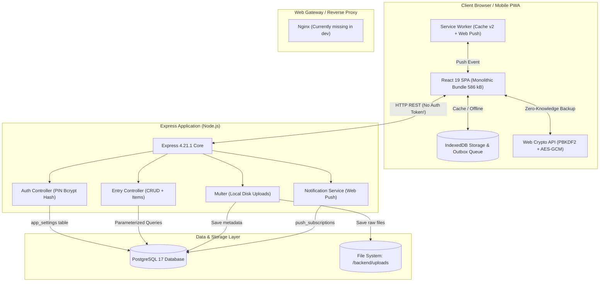

# รายงานการตรวจสอบความพร้อมสำหรับใช้งานจริง (Production Readiness Audit)
**โปรเจกต์:** Personal Organizer ("One App, All Your Lists.")  
**Repository:** https://github.com/dewvx/Personal_Organizer.git  
**วันที่ตรวจสอบ:** 31 ตุลาคม 2026  
**ผู้ตรวจสอบ:** Senior DevOps Engineer, Senior Backend Engineer, Application Security Engineer  

---

## 1. บทสรุปสำหรับผู้บริหาร (Executive Summary)

จากการตรวจสอบ Source Code จริงของทั้งระบบ (Frontend, Backend, Database, Service Worker, File Uploads, Offline Sync, และ Web Push Notification) ทั้ง 5 Phases เพื่อประเมินความพร้อมในการนำขึ้นใช้งานบนสภาพแวดล้อมจริง (Production Deployment)

### ผลการประเมินภาพรวม (Overall Verdict):
> 🛑 **NOT READY (ยังไม่พร้อมใช้งานจริงจนกว่าจะแก้ไข Blocker ระดับวิกฤต)**

แม้ว่าระบบจะมีฟังก์ชันการทำงานที่กว้างขวาง สถาปัตยกรรม UI มีความสมบูรณ์ และมีระบบเข้ารหัส Client-side Backup ที่แข็งแกร่ง แต่ยังมี **Blockers ด้านความปลอดภัยและเสถียรภาพระดับ P0** ที่หาก Deploy ขึ้นสู่อินเทอร์เน็ตสาธารณะในสภาพปัจจุบัน จะเปิดโอกาสให้เกิดการโจมตี รหัสลับรั่วไหล หรือข้อมูลสูญหายทันที

---

## 2. ตารางสรุปสถานะความพร้อมของแต่ละองค์ประกอบ (Component Readiness Matrix)

| องค์ประกอบ | สถานะ | สรุปผลการตรวจสอบ | ระดับความเสี่ยง |
|---|---|---|---|
| **Backend API Core** | ⚠️ Conditions | โครงสร้าง Express ชัดเจน มี Graceful Shutdown แต่ขาด Rate Limiter, Helmet และการตรวจสอบ Input Validation กลาง | High |
| **Authentication & Authorization** | 🛑 Not Ready | PIN Lock ถูกบังคับใช้เฉพาะฝั่ง Client UI เท่านั้น ทุก REST API Endpoint เปิดสาธารณะโดยไม่มี Token/Session ตรวจสอบ | **Critical (P0)** |
| **Secrets & Configurations** | 🛑 Not Ready | มี Hardcoded VAPID Private/Public Key สำรองฝังอยู่ใน Source Code (`webPush.js`) | **Critical (P0)** |
| **File Upload & Storage** | 🛑 Not Ready | โฟลเดอร์ `/uploads` เปิดเป็น Static สาธารณะ ไม่ตรวจ Magic Number และไม่มีการป้องกัน Stored XSS ในกรณีอัปโหลด HTML | **Critical (P0)** |
| **Database & ORM Layer** | ⚠️ Conditions | Parameterized Queries ปลอดภัยจาก SQL Injection แต่ขาด Migration Tool มาตรฐาน และ Health Check ไม่ตรวจการเชื่อมต่อ DB จริง | Medium |
| **Offline & Sync Engine** | ⚠️ Conditions | กลไก Outbox พื้นฐานทำงานได้ แต่ติด Bug วิกฤตเมื่อแก้ไข/ลบรายการที่มี ID ติดลบ (Offline ID) ทำให้เกิด 404 และข้อมูลสูญหาย | **High (P0)** |
| **Web Push & Scheduler** | ⚠️ Conditions | ฟังก์ชัน Push Notification พร้อม แต่ไม่มี Cron Scheduler อัตโนมัติ ต้องรอ Request จากภายนอกมากระตุ้น | Medium |
| **Frontend Bundle & Performance** | ⚠️ Conditions | ขาด Code Splitting ทำให้ไฟล์ JS เริ่มต้นมีขนาดใหญ่ถึง **586 kB** (เกินเกณฑ์ 500 kB ของ Vite) | Medium |

---

## 3. รายการข้อบกพร่องวิกฤตที่ต้องแก้ไขก่อน Deploy (P0 Blockers)

### 🔴 Blocker 1: การฝัง Private VAPID Key ไว้ใน Source Code
- **ไฟล์ที่พบ:** [`backend/src/config/webPush.js`](file:///d:/Personal_Organizer/backend/src/config/webPush.js#L3-L5)
- **หลักฐานจากโค้ด:**
  ```javascript
  const vapidPublicKey = process.env.VAPID_PUBLIC_KEY || 'BGCJ3SK7IkxaUVM...';
  const vapidPrivateKey = process.env.VAPID_PRIVATE_KEY || 'Fo3dXb1e6Is9ns...';
  ```
- **ความเสี่ยง:** หากไฟล์นี้ถูก Commit ขึ้น Public/Shared Git ผู้ไม่หวังดีสามารถใช้ VAPID Private Key ส่ง Push Notification ปลอมแปลงไปยังเครื่องผู้ใช้ทั้งหมดได้ทันที
- **แนวทางแก้ไข:** ลบ Fallback String ทิ้งทั้งหมด และบังคับให้เซิร์ฟเวอร์ปฏิเสธการเริ่มทำงาน (Fail-fast) หากไม่พบค่าตัวแปรใน Environment

---

### 🔴 Blocker 2: สิทธิ์การเข้าถึง API ทั้งหมดเปิดเป็น Public (PIN Bypass)
- **ไฟล์ที่พบ:** [`backend/src/routes/entryRoutes.js`](file:///d:/Personal_Organizer/backend/src/routes/entryRoutes.js#L9-L33), [`backend/src/controllers/authController.js`](file:///d:/Personal_Organizer/backend/src/controllers/authController.js#L23-L45)
- **หลักฐานจากโค้ด:**
  การตรวจสอบ PIN (`verifyPin`) ใน Backend เพียงแค่คืนค่า `{ verified: true }` แต่ไม่มีการออก JWT, Session Cookie หรือ Token ใดๆ
  ทำให้ Client หน้าเว็บเพียงแค่จำสถานะใน `sessionStorage` แต่ตัว Backend API ทุก Endpoint เช่น `POST /api/entries`, `DELETE /api/entries/:id`, และโดยเฉพาะ `POST /api/entries/import` สามารถถูกเรียกผ่าน `curl` หรือสคริปต์ภายนอกได้โดยตรง 100% โดยไม่ต้องปลดล็อก PIN
- **ความเสี่ยง:** ผู้โจมตีสามารถเรียก `POST /api/entries/import` พร้อม Payload `strategy: "overwrite"` เพื่อสั่งล้างฐานข้อมูลทิ้งได้ทันทีโดยไม่ต้องใส่รหัสผ่านใดๆ
- **แนวทางแก้ไข:** เพิ่ม Authentication Middleware (เช่น JWT หรือ Session Auth) ที่ต้องส่งแนบใน Header `Authorization: Bearer <token>` ทุกครั้งหลังปลดล็อก PIN สำเร็จ

---

### 🔴 Blocker 3: การเปิดโฟลเดอร์ Uploads สาธารณะและช่องโหว่ Stored XSS
- **ไฟล์ที่พบ:** [`backend/src/app.js`](file:///d:/Personal_Organizer/backend/src/app.js#L20-L21), [`backend/src/middlewares/upload.js`](file:///d:/Personal_Organizer/backend/src/middlewares/upload.js#L17-L37)
- **หลักฐานจากโค้ด:**
  ```javascript
  app.use('/uploads', express.static(uploadDir));
  ```
  ใน `upload.js` การตรวจ MIME Type อิงจาก `file.mimetype` ที่ส่งมาจาก Client Header โดยไม่ได้ตรวจสอบ Magic Bytes และใช้ Extension ดั้งเดิมจาก `path.extname(file.originalname)`
- **ความเสี่ยง:**
  1. หากมีผู้อัปโหลดไฟล์ HTML ที่มี JavaScript ฝังอยู่ (`exploit.html`) โดยระบุ Content-Type เป็น `image/jpeg` ไฟล์จะถูกบันทึกเป็น `.html` เมื่อมีคนเปิด URL `/uploads/attachment-xxx.html` เบราว์เซอร์จะ Render HTML และรัน JavaScript ภายใต้ Origin เดียวกันกับเว็บแอปพลิเคชัน (Stored XSS) ขโมยข้อมูลใน IndexedDB หรือ `sessionStorage` ได้
  2. ไฟล์แนบใบเสร็จ ข้อมูลส่วนตัว หรือสลิปธนาคาร ไม่มี Access Control ทำให้ใครก็ตามที่รู้หรือสุ่ม URL สามารถดาวน์โหลดไฟล์ได้โดยไม่ต้องยืนยันตัวตน
- **แนวทางแก้ไข:** ตรวจสอบ File Signature (Magic Bytes), บังคับเปลี่ยนนามสกุลไฟล์ให้ตรงกับ Mime Type จริง, เพิ่ม Header `Content-Security-Policy: sandbox` และ `X-Content-Type-Options: nosniff` ให้กับ Static Uploads หรือทำ Streaming Route ที่ตรวจสิทธิ์ผู้ใช้ก่อนส่งไฟล์

---

### 🔴 Blocker 4: ข้อมูลสูญหายและข้อผิดพลาดในระบบ Offline Sync (Negative ID Mutation)
- **ไฟล์ที่พบ:** [`frontend/src/services/entryService.ts`](file:///d:/Personal_Organizer/frontend/src/services/entryService.ts#L87-L133), [`frontend/src/hooks/useNetworkSync.ts`](file:///d:/Personal_Organizer/frontend/src/hooks/useNetworkSync.ts#L35-L53)
- **หลักฐานจากโค้ด:**
  เมื่อผู้ใช้สร้าง Entry ตอนออฟไลน์ ระบบสร้าง ID ชั่วคราวเป็นเลขลบ เช่น `id = -Date.now()` (-173037...)
  หากผู้ใช้ทำการแก้ไข (Update) หรือลบ (Delete) รายการนี้ต่อในขณะที่ยังออฟไลน์อยู่ Outbox จะบันทึกคำสั่ง:
  1. `CREATE_ENTRY`
  2. `UPDATE_ENTRY` โดยระบุ `id: -173037...`
  เมื่อกลับมาออนไลน์ `CREATE_ENTRY` จะสร้างรายการใหม่บนฐานข้อมูลจริงและได้ ID ใหม่ (เช่น `42`) แต่คำสั่งถัดมา `UPDATE_ENTRY` จะส่งไปที่ `PUT /entries/-173037...` ซึ่งคืนค่า **404 Not Found** ส่งผลให้ข้อมูลที่ผู้ใช้แก้ไขขณะออฟไลน์สูญหายทันที
- **แนวทางแก้ไข:** เปลี่ยนระบบคีย์ของ Entry ให้รองรับ Client-generated UUID (UUIDv4) หรือเพิ่ม ID Mapping Dictionary ใน Engine ของ `useNetworkSync` เพื่อจับคู่ Client Temp ID เข้ากับ Server ID จริงก่อนประมวลผลคำสั่งในคิวถัดไป

---

### 🔴 Blocker 5: Health Check ไม่ตรวจสอบสถานะฐานข้อมูลจริง (False-Positive Health Check)
- **ไฟล์ที่พบ:** [`backend/src/app.js`](file:///d:/Personal_Organizer/backend/src/app.js#L24-L30)
- **หลักฐานจากโค้ด:**
  ```javascript
  app.get('/api/health', (req, res) => {
    res.status(200).json({
      status: 'ok',
      message: 'Personal Organizer API is running smoothly',
      timestamp: new Date().toISOString(),
    });
  });
  ```
- **ความเสี่ยง:** หาก Database ล่มหรือ Pool หลุด Endpoint `/api/health` ยังคงตอบกลับสถานะ 200 OK ทำให้ Docker Orchestrator / Load Balancer ไม่สามารถตรวจจับ Container ที่เสียหายได้ (Traffic ยังคงถูกส่งมายัง Node ที่เชื่อมต่อ DB ไม่ได้)
- **แนวทางแก้ไข:** ปรับปรุงให้ Query `SELECT 1` ตรวจสอบความพร้อมของ PostgreSQL Pool ก่อนส่งสถานะ 200 หรือคืน 503 Service Unavailable หากเชื่อมต่อไม่ได้

---

## 4. ผลการตรวจสอบเปรียบเทียบ Verified Findings vs Recommendations

### หมวดหมู่ที่ 1: การจัดการความลับและการกำหนดค่า (Secrets & Env)
* **Verified Finding:** มีไฟล์ `backend/.env` ที่เก็บค่า Credentials จริง แต่ไม่ได้ถูก Commit เข้า Git (อยู่ใน `.gitignore` อย่างถูกต้อง) อย่างไรก็ตาม ในโค้ด `backend/src/config/webPush.js` มีการใส่ Fallback Key สำรองไว้ในโค้ด
* **Recommendation:** ลบ Fallback String ทั้งหมด และสร้างโมดูล `envValidator.js` เพื่อตรวจสอบค่า Environment Variable ที่จำเป็นทั้งหมดตอนเริ่มเซิร์ฟเวอร์

### หมวดหมู่ที่ 2: ความปลอดภัยของเครือข่ายและ Header (Network & Headers)
* **Verified Finding:** CORS ถูกกำหนดไว้เป็น `process.env.CLIENT_URL || '*'` ซึ่งหากไม่ระบุใน Production จะกลายเป็น Wildcard อนุญาตทุกโดเมน นอกจากนี้ไม่มีการติดตั้ง `helmet` เพื่อตั้งค่า Security Headers
* **Recommendation:** ติดตั้ง `helmet`, ระบุ Origin ที่อนุญาตแบบ Strict Domain, ปิดการอนุญาต `*` ใน Production Mode

### หมวดหมู่ที่ 3: ฐานข้อมูลและการ Migration (Database & Migrations)
* **Verified Finding:** ตารางทั้งหมดใน `database/schema.sql` มี Foreign Key และ Indexes ที่ครอบคลุมคอลัมน์สืบค้นหลัก (`category_id`, `status`, `due_date`, GIN index บน `tags`) แต่การจัดการ Migration ในปัจจุบันใช้สคริปต์ Node แบบ Manual ไม่มีตาราง `schema_migrations` ควบคุมลำดับ
* **Recommendation:** นำเครื่องมือ Data Migration มาตรฐาน (เช่น `node-pg-migrate`) มาใช้งานเพื่อรองรับการ Rollback และป้องกันความผิดพลาดเมื่อ Deploy แบบ Multi-instance

### หมวดหมู่ที่ 4: ประสิทธิภาพของ Bundle ด้านหน้า (Frontend Performance)
* **Verified Finding:** จากการ Build จริงผ่าน Vite ได้ผลลัพธ์:
  - `dist/assets/index-bW6BS2Ps.js`: **586.08 kB** (Minified) / **154.81 kB** (gzip)
  - มีข้อความเตือน Chunks larger than 500 kB
  - หน้าจอทั้งหมด 8 หน้าและโมดอล 6 ตัวถูก Import รวมเป็น Monolithic Bundle ก้อนเดียว
* **Recommendation:** ใช้ `React.lazy()` และ `Suspense` สำหรับแยก Chunk หน้าจอระดับรอง และแยก Vendor Libraries เช่น `lucide-react`, `axios` ออกเป็นก้อนแยกต่างหาก

---

## 5. แผนผังความสัมพันธ์ของสถาปัตยกรรมระบบปัจจุบัน (System Architecture Map)



---

## 6. สรุปเงื่อนไขในการอนุมัติ Deployment (Go / No-Go Criteria)

| ข้อกำหนด | เงื่อนไขก่อนอนุมัติ | ผู้รับผิดชอบ |
|---|---|---|
| **P0 Blocker Resolution** | แก้ไข 5 ข้อบกพร่องระดับ P0 ให้ครบถ้วนและผ่านการ Verify | AppSec & Backend |
| **Security Hardening** | ติดตั้ง Helmet, Rate Limiter และจำกัดสิทธิ์โฟลเดอร์ Uploads | AppSec |
| **Automated Verification** | รัน Integration Tests และ Offline Sync Tests ผ่าน 100% | QA & Backend |
| **Container & Reverse Proxy** | จัดเตรียม Docker Compose พร้อม HTTPS, Nginx และ Restart Policy | DevOps |
| **Disaster Recovery** | ทดสอบสคริปต์ Backup และ Restore ฐานข้อมูลสำเร็จอย่างน้อย 1 รอบ | DevOps & DBA |

*(การเริ่มกระบวนการ Deployment จริงจะต้องรอการอนุมัติอย่างเป็นทางการจากผู้ใช้)*
