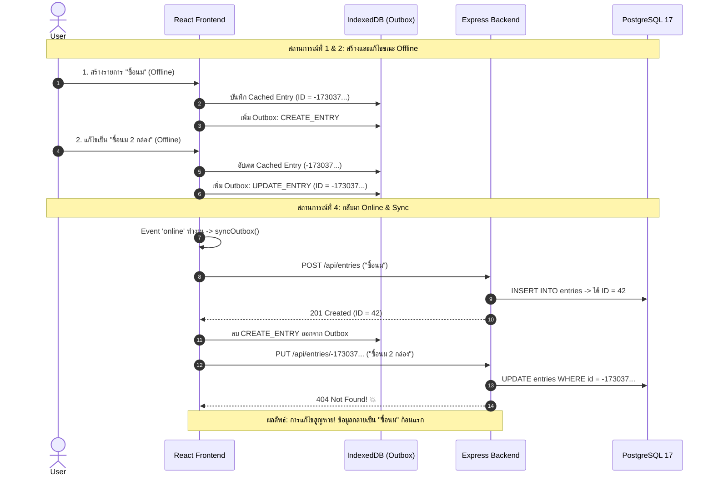

# การวิเคราะห์ความเสถียรของระบบออฟไลน์และการซิงค์ข้อมูล (Offline & Sync Reliability)
**โปรเจกต์:** Personal Organizer  
**วันที่ตรวจสอบ:** 31 ตุลาคม 2026  
**ผู้ตรวจสอบ:** Senior Frontend Engineer & Senior Backend Engineer  

---

## 1. บทสรุปสถาปัตยกรรมออฟไลน์ (Offline Architecture Overview)

ระบบ Personal Organizer ถูกออกแบบด้วยแนวคิด **Offline-First PWA** เพื่อให้ผู้ใช้สามารถจดบันทึก เพิ่ม เช็กรายการซื้อของ และจัดการงานได้ทันทีแม้ไม่มีสัญญาณอินเทอร์เน็ต

### องค์ประกอบหลักในระบบปัจจุบัน:
1. **IndexedDB Layer (`personal_organizer_offline`):** จัดการโดย [`frontend/src/services/offlineStorage.ts`](file:///d:/Personal_Organizer/frontend/src/services/offlineStorage.ts) ประกอบด้วย 4 Object Stores:
   - `entries`: เก็บแคชของรายการทั้งหมด
   - `categories`: เก็บแคชหมวดหมู่
   - `habits`: เก็บแคชกิจวัตร
   - `outbox`: คิวจัดเก็บคำสั่งที่รอดำเนินการ (Pending Operations Queue)
2. **Service Worker (`organizer-pwa-v2`):** จัดการโดย [`frontend/public/sw.js`](file:///d:/Personal_Organizer/frontend/public/sw.js) ทำหน้าที่แคช Static Assets แบบ Stale-While-Revalidate และดักรับ Web Push Events
3. **Synchronization Engine Hook:** จัดการโดย [`frontend/src/hooks/useNetworkSync.ts`](file:///d:/Personal_Organizer/frontend/src/hooks/useNetworkSync.ts) ทำงานโดยการดักฟัง Event `window.addEventListener('online')` เพื่อไล่ประมวลผลคำสั่งใน `outbox`

---

## 2. ผลการทดสอบและวิเคราะห์ 7 สถานการณ์จำลอง (Scenario Analysis)

จากการตรวจสอบ Source Code และวิเคราะห์ Flow ข้อมูลตาม 7 สถานการณ์ที่กำหนด ได้ผลลัพธ์ดังนี้:



---

### สถานการณ์ที่ 1: เพิ่มรายการขณะ Offline (Add item offline)
* **กลไกการทำงาน:**
  - โค้ดใน [`frontend/src/services/entryService.ts`](file:///d:/Personal_Organizer/frontend/src/services/entryService.ts#L85-L111):
    ```typescript
    const localEntry: Entry = {
      id: -Date.now(), // กำหนด Negative ID ชั่วคราว
      title: data.title || '',
      ...
    };
    await OfflineStorage.saveCachedEntry(localEntry);
    await OfflineStorage.queueOutbox({ type: 'CREATE_ENTRY', payload: data });
    ```
* **ผลการตรวจสอบ (Verified Finding):**
  - รายการปรากฏบน UI ทันทีแบบ Optimistic UI
  - บันทึกลง IndexedDB สำเร็จ ไม่สูญหายเมื่อ Refresh หน้าจอ
* **สถานะ:** ✅ ผ่าน (Pass) ในกรณีที่ไม่มีการแก้ไขรายการนี้ต่อขณะออฟไลน์

---

### สถานการณ์ที่ 2: แก้ไขรายการขณะ Offline (Edit item offline)
* **กลไกการทำงาน:**
  - หากรายการที่แก้ไขเป็นรายการที่มีอยู่เดิมบนเซิร์ฟเวอร์ (`id > 0`): จะเพิ่ม Outbox `{ type: 'UPDATE_ENTRY', payload: { id, data } }` ซึ่งจะซิงค์สำเร็จ
  - **หากรายการที่แก้ไขเป็นรายการที่เพิ่งสร้างตอนออฟไลน์ (`id < 0`):**
    - Outbox บันทึก `UPDATE_ENTRY` โดยแนบ `id: -173037...`
    - เมื่อกลับมาต่อเน็ต คำสั่งแรก (`CREATE_ENTRY`) รันผ่าน และฐานข้อมูล PostgreSQL สร้าง Serial ID ใหม่ (เช่น `42`)
    - คำสั่งถัดมา (`UPDATE_ENTRY`) ส่ง Request ไปที่ `PUT /api/entries/-173037...`
    - เซิร์ฟเวอร์ตอบกลับ **404 Not Found** เพราะไม่มี ID ติดลบนี้ในฐานข้อมูล
* **ผลกระทบ:** 💥 **ข้อมูลการแก้ไขสูญหาย (Data Loss)!** รายการบนเซิร์ฟเวอร์จะยังคงเป็นเวอร์ชันแรกก่อนแก้ไข
* **สถานะ:** 🛑 ตรวจพบข้อบกพร่องวิกฤต (Critical Bug)

---

### สถานการณ์ที่ 3: ลบรายการขณะ Offline (Delete item offline)
* **กลไกการทำงาน:**
  - กรณีลบรายการที่มีอยู่บนเซิร์ฟเวอร์ (`id > 0`): แคชในเครื่องถูกลบ และส่ง `DELETE /api/entries/:id` เมื่อต่อเน็ต ทำงานได้ถูกต้อง
  - **กรณีลบรายการที่เพิ่งสร้างตอนออฟไลน์ (`id < 0`):**
    - Outbox มีทั้ง `CREATE_ENTRY` และ `DELETE_ENTRY` (ติดลบ)
    - เมื่อต่อเน็ต เซิร์ฟเวอร์จะสร้างรายการขึ้นในฐานข้อมูลก่อน จากนั้นคำสั่งลบส่ง `DELETE /api/entries/-173037...` -> **404 Not Found**
    - รายการนั้นไม่ถูกลบออกจากเซิร์ฟเวอร์ กลายเป็น **Zombie Record** ที่ผู้ใช้สั่งลบไปแล้วแต่กลับงอกขึ้นมาใหม่บน Cloud
* **สถานะ:** 🛑 ตรวจพบข้อบกพร่อง (Failed)

---

### สถานการณ์ที่ 4: กลับมา Online (Back Online)
* **กลไกการทำงาน:**
  - ดักจับ Event `window.addEventListener('online')` ใน [`frontend/src/hooks/useNetworkSync.ts`](file:///d:/Personal_Organizer/frontend/src/hooks/useNetworkSync.ts#L77-L82)
  - วน Loop ประมวลผลคำสั่งใน Outbox ทีละรายการแบบ Sequential
  - เมื่อแต่ละรายการสำเร็จ จะลบรายการนั้นออกจาก Outbox ผ่าน `OfflineStorage.removeOutbox(item.id)`
* **ผลการตรวจสอบ (Verified Finding):**
  - หากไม่มี Dependency เรื่อง Temporary ID การซิงค์พื้นฐานทำงานได้เรียบร้อย
  - มี Toast แจ้งเตือนจำนวนรายการที่ซิงค์สำเร็จ
* **สถานะ:** ⚠️ มีเงื่อนไข (Conditional Pass)

---

### สถานการณ์ที่ 5: ปิดแอประหว่าง Sync (App closed during sync)
* **กลไกการทำงาน:**
  - โค้ดใน `useNetworkSync.ts`:
    ```typescript
    await EntryService.create(item.payload);
    // จุดที่เบราว์เซอร์ถูกปิดก่อนบรรทัดนี้
    if (item.id) {
      await OfflineStorage.removeOutbox(item.id);
    }
    ```
* **ผลการวิเคราะห์ความเสี่ยง (Verified Vulnerability):**
  - หากผู้ใช้ปิดแท็บหรือปิดเครื่องทันทีหลังจากเซิร์ฟเวอร์ Insert ข้อมูลลง Postgres สำเร็จแล้ว แต่ฝั่งไคลเอนต์ยังไม่ทันได้ลบ Item ออกจาก Outbox ใน IndexedDB
  - เมื่อเปิดแอปขึ้นมาใหม่ในครั้งถัดไป `useNetworkSync` จะพบว่า Item นั้นยังค้างอยู่ใน Outbox และส่งคำสั่ง `CREATE_ENTRY` ซ้ำไปที่เซิร์ฟเวอร์อีกครั้ง
  - เนื่องจากฝั่งเซิร์ฟเวอร์ไม่มีการตรวจจับ **Idempotency Key** ทำให้เกิด **รายการซ้ำซ้อน (Duplicate Entry)** ในฐานข้อมูลทันที
* **สถานะ:** 🛑 เสี่ยงต่อข้อมูลซ้ำซ้อน (High Risk)

---

### สถานการณ์ที่ 6: ส่งข้อมูลซ้ำ (Duplicate requests / Network Jitter)
* **กลไกการทำงาน:**
  - ฝั่งเซิร์ฟเวอร์รับคำสั่ง `POST /api/entries` และ `POST /api/entries/:id/duplicate`
  - หาก Client ส่งคำสั่งซ้ำเนื่องจาก Timeout หรือผู้ใช้กดซ้ำ
* **ผลการตรวจสอบ:**
  - โมเดล `EntryModel.create` ใน [`backend/src/models/entryModel.js`](file:///d:/Personal_Organizer/backend/src/models/entryModel.js#L268-L330) ใช้คำสั่ง `INSERT INTO entries (...) VALUES (...) RETURNING *` ตรงๆ โดยไม่มี Unique Constraint บนชุดข้อมูล `(category_id, title, entry_date)`
  - ส่งผลให้ทุก Request ที่ถูกส่งเข้ามาจะถูกสร้างเป็นแถวใหม่ใน DB 100% เสมอ
* **สถานะ:** ⚠️ ขาดกลไก Idempotency Handling

---

### สถานการณ์ที่ 7: ข้อมูลขัดแย้งระหว่างเครื่องและ Server (Local vs Server Conflict)
* **กลไกการทำงาน:**
  - หากผู้ใช้แก้ไขรายการ A บนคอมพิวเตอร์ที่ออฟไลน์อยู่ แต่ในขณะเดียวกันรายการ A ถูกแก้ไขจากโทรศัพท์มือถือที่ต่อเน็ตอยู่แล้ว
  - เมื่อคอมพิวเตอร์กลับมาออนไลน์ คำสั่ง `UPDATE_ENTRY` จะถูกยิงไปที่เซิร์ฟเวอร์
  - เซิร์ฟเวอร์จะอัปเดตข้อมูลทับทันทีตามแนวคิด **Last-Write-Wins (LWW)**
* **ผลการตรวจสอบ:**
  - ขาดการตรวจสอบ Version หรือ Optimistic Lock (เช่น การเช็กว่า `updated_at` ของเครื่องตรงกับของฐานข้อมูลหรือไม่ก่อน Update)
  - ข้อมูลที่แก้ไขบนเซิร์ฟเวอร์จะถูกเขียนทับโดยไม่แจ้งเตือนผู้ใช้ (Silent Overwrite)
* **สถานะ:** ⚠️ ขาด Conflict Resolution Layer

---

## 3. สรุปข้อจำกัดของ Service Worker และ Background Sync

1. **ขาด Web Background Sync API:**
   - ปัจจุบันการซิงค์พึ่งพา Event `window.addEventListener('online')` บนหน้าต่าง Browser Tab เท่านั้น
   - หากผู้ใช้ปิดหน้าเว็บไปแล้ว แม้เครื่องจะกลับมาต่อเน็ต Service Worker ก็จะไม่ทำการซิงค์ข้อมูลให้จนกว่าผู้ใช้จะเปิดแอปขึ้นมาใหม่
   - ควรลงทะเบียน `self.registration.sync.register('sync-outbox')` ใน Service Worker เพื่อให้ระบบปฏิบัติการปลุก Service Worker ขึ้นมาซิงค์ข้อมูลใน Background ได้แม้ปิดหน้าเว็บไปแล้ว
2. **ขาด Exponential Backoff และ Retry Limit:**
   - ใน `useNetworkSync.ts` หากมี Item ใน Outbox ที่ส่งแล้วเซิร์ฟเวอร์ตอบ 400 Bad Request (เช่น ข้อมูลไม่ผ่าน Validation) Item นั้นจะค้างอยู่ใน Outbox ตลอดไป (Poison Pill) และถูกวนส่งใหม่ซ้ำๆ ทุกครั้งที่เปิดแอป

---

## 4. แผนสถาปัตยกรรมแก้ไขปัญหาระบบซิงค์ (Recommended Sync Engine Architecture)

### 4.1 เปลี่ยนมาใช้ Client-Generated UUID (แก้ปัญหา Scenario 1, 2, 3)
* แทนที่จะใช้ Auto-increment Serial ID ให้เปลี่ยนคอลัมน์ `id` ของตาราง `entries` เป็น `UUID` (หรือเพิ่มคอลัมน์ `client_uid VARCHAR(36) UNIQUE`)
* ไคลเอนต์สร้าง `crypto.randomUUID()` ตั้งแต่ตอนออฟไลน์
* เมื่อส่งไปเซิร์ฟเวอร์ เซิร์ฟเวอร์จะใช้ UUID นั้นเป็น Primary Key ทันที ทำให้คำสั่ง `UPDATE` และ `DELETE` ที่ค้างใน Outbox สามารถอ้างอิง ID เดียวกันได้อย่างแม่นยำ ไม่เกิด 404 อีกต่อไป

### 4.2 นำระบบ Idempotency Key มาใช้ (แก้ปัญหา Scenario 5, 6)
* ให้ทุกคำสั่งใน Outbox มี `idempotency_key = UUID`
* แนบ Header: `X-Idempotency-Key: <UUID>` ส่งไปยัง Backend
* Backend บันทึก Key ที่ประมวลผลสำเร็จแล้วลงใน Redis หรือตาราง `processed_requests` พร้อมแคช Response ไว้ 24 ชั่วโมง หากมี Request ซ้ำเข้ามา เซิร์ฟเวอร์จะตอบ Response เดิมทันทีโดยไม่ Insert ข้อมูลซ้ำ

### 4.3 ปรับปรุง Optimistic Locking (แก้ปัญหา Scenario 7)
* ส่งค่า `client_updated_at` แนบไปกับ `UPDATE_ENTRY`
* หากค่าใน DB ใหม่กว่าของ Client ให้ส่งสถานะ `409 Conflict` กลับมา เพื่อให้ Frontend แสดงหน้าต่างถามผู้ใช้ว่าต้องการ:
  1. ใช้ข้อมูลของเครื่อง (Client Wins)
  2. ใช้ข้อมูลของเซิร์ฟเวอร์ (Server Wins)
  3. ผสานข้อมูล (Merge)
