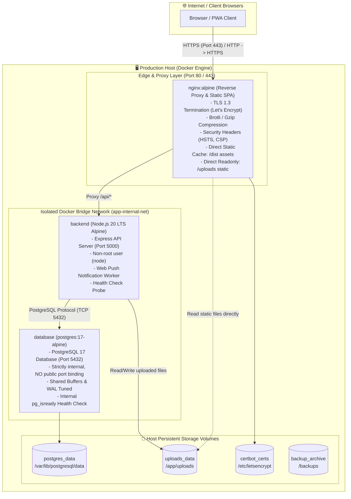

# สถาปัตยกรรมการนำระบบขึ้นใช้งานจริง (Production Deployment Architecture)
**โปรเจกต์:** Personal Organizer  
**แพลตฟอร์มเป้าหมาย:** Linux Server (Ubuntu 24.04 LTS) / Docker Compose v2  
**วันที่จัดทำ:** 31 ตุลาคม 2026  
**ผู้จัดทำ:** Senior DevOps Engineer & Application Security Engineer  

---

## 1. บทสรุปสถาปัตยกรรมระดับโปรดักชัน (System Topology Overview)

สถาปัตยกรรมระดับ Production ของ Personal Organizer ถูกออกแบบให้ทำงานเป็นระบบ **Multi-Container Microservices** ที่แยกส่วนการทำงาน (Decoupled Architecture) บน Docker Bridge Network ภายใน โดยมี **Nginx** ทำหน้าที่เป็น Single Entry Point ให้บริการทั้ง Static Asset Caching, SSL/TLS Termination และเป็น Reverse Proxy ส่งต่อ Request ไปยัง Express Backend และ PostgreSQL

### แผนผังสถาปัตยกรรมเครือข่ายและคอนเทนเนอร์ (Network & Container Diagram):



---

## 2. รายละเอียดคอนเทนเนอร์และข้อกำหนด (Container Specifications)

### 2.1 คอนเทนเนอร์ที่ 1: `nginx-proxy` (Web & Reverse Proxy)
- **Base Image:** `nginx:1.27-alpine`
- **หน้าที่:**
  - ให้บริการไฟล์ Frontend ที่ Build แล้ว (`/usr/share/nginx/html`)
  - จัดการใบรับรองความปลอดภัย SSL/TLS (Let's Encrypt Certbot)
  - ทำ Reverse Proxy ส่งเส้นทาง `/api/` ไปยังคอนเทนเนอร์ `backend:5000`
  - ทำหน้าที่เป็น Caching Proxy และบังคับใช้ Security Headers
- **พอร์ตที่เปิดสู่สาธารณะ:** `80:80` (Redirect to HTTPS), `443:443` (TLS 1.3)

### 2.2 คอนเทนเนอร์ที่ 2: `backend` (Express API Server)
- **Base Image:** `node:20-alpine` (Multi-stage build)
- **ความปลอดภัยระดับคอนเทนเนอร์:**
  - รันภายใต้ User สิทธิ์ต่ำ (`USER node`) ห้ามรันด้วย root
  - รันในโหมด `NODE_ENV=production`
- **พอร์ต:** `5000` (เปิดเฉพาะภายใน `app-internal-net` **ห้าม Map ออก Host Public**)
- **Storage Mount:** Mount Persistent Volume `uploads_data` ไปที่ `/app/uploads`

### 2.3 คอนเทนเนอร์ที่ 3: `postgres` (Relational Database)
- **Base Image:** `postgres:17-alpine`
- **หน้าที่:** จัดเก็บฐานข้อมูลเชิงสัมพันธ์ทั้งหมดของแอปพลิเคชัน
- **พอร์ต:** `5432` (**ห้าม Map สู่ Public Host เด็ดขาด** เชื่อมต่อได้เฉพาะภายใน Container Network เท่านั้น)
- **Storage Mount:** Mount Persistent Volume `postgres_data` ไปที่ `/var/lib/postgresql/data`

---

## 3. การออกแบบ Docker Compose สำหรับ Production (`docker-compose.prod.yml`)

```yaml
version: '3.8'

services:
  # 1. Database Service (PostgreSQL 17)
  postgres:
    image: postgres:17-alpine
    container_name: organizer_db
    restart: unless-stopped
    environment:
      POSTGRES_DB: ${DB_NAME:-personal_organizer}
      POSTGRES_USER: ${DB_USER:-postgres}
      POSTGRES_PASSWORD: ${DB_PASSWORD}
      PGDATA: /var/lib/postgresql/data/pgdata
    volumes:
      - postgres_data:/var/lib/postgresql/data
    networks:
      - app-internal-net
    healthcheck:
      test: ["CMD-SHELL", "pg_isready -U ${DB_USER:-postgres} -d ${DB_NAME:-personal_organizer}"]
      interval: 10s
      timeout: 5s
      retries: 5
      start_period: 10s
    deploy:
      resources:
        limits:
          cpus: '1.5'
          memory: 1024M

  # 2. Backend Application Service (Express API)
  backend:
    build:
      context: ./backend
      dockerfile: Dockerfile.prod
    container_name: organizer_backend
    restart: unless-stopped
    depends_on:
      postgres:
        condition: service_healthy
    environment:
      NODE_ENV: production
      PORT: 5000
      DB_HOST: postgres
      DB_PORT: 5432
      DB_NAME: ${DB_NAME:-personal_organizer}
      DB_USER: ${DB_USER:-postgres}
      DB_PASSWORD: ${DB_PASSWORD}
      CLIENT_URL: ${CLIENT_URL}
      VAPID_PUBLIC_KEY: ${VAPID_PUBLIC_KEY}
      VAPID_PRIVATE_KEY: ${VAPID_PRIVATE_KEY}
      VAPID_SUBJECT: ${VAPID_SUBJECT}
    volumes:
      - uploads_data:/app/uploads
    networks:
      - app-internal-net
    healthcheck:
      test: ["CMD-SHELL", "wget --no-verbose --tries=1 --spider http://127.0.0.1:5000/api/health || exit 1"]
      interval: 15s
      timeout: 5s
      retries: 3
      start_period: 15s
    deploy:
      resources:
        limits:
          cpus: '1.0'
          memory: 512M

  # 3. Web Proxy & Frontend Service (Nginx)
  nginx:
    image: nginx:1.27-alpine
    container_name: organizer_proxy
    restart: unless-stopped
    depends_on:
      backend:
        condition: service_healthy
    ports:
      - "80:80"
      - "443:443"
    volumes:
      - ./nginx/nginx.conf:/etc/nginx/nginx.conf:ro
      - ./nginx/conf.d:/etc/nginx/conf.d:ro
      - ./frontend/dist:/usr/share/nginx/html:ro
      - uploads_data:/usr/share/nginx/html/uploads:ro
      - certbot_certs:/etc/letsencrypt:ro
      - certbot_challenge:/var/www/certbot:ro
    networks:
      - app-internal-net
    healthcheck:
      test: ["CMD-SHELL", "wget --no-verbose --tries=1 --spider http://127.0.0.1/ || exit 1"]
      interval: 15s
      timeout: 5s
      retries: 3
    deploy:
      resources:
        limits:
          cpus: '0.5'
          memory: 256M

volumes:
  postgres_data:
    name: organizer_postgres_data
    driver: local
  uploads_data:
    name: organizer_uploads_data
    driver: local
  certbot_certs:
    name: organizer_certbot_certs
    driver: local
  certbot_challenge:
    name: organizer_certbot_challenge
    driver: local

networks:
  app-internal-net:
    name: organizer_internal_network
    driver: bridge
```

---

## 4. การตั้งค่า Nginx Reverse Proxy (`nginx/conf.d/default.conf`)

```nginx
# บังคับเปลี่ยนเส้นทาง HTTP เป็น HTTPS ทั้งหมด
server {
    listen 80;
    listen [::]:80;
    server_name organizer.yourdomain.com;

    location /.well-known/acme-challenge/ {
        root /var/www/certbot;
    }

    location / {
        return 301 https://$host$request_uri;
    }
}

# บล็อกหลักสำหรับ HTTPS
server {
    listen 443 ssl http2;
    listen [::]:443 ssl http2;
    server_name organizer.yourdomain.com;

    # SSL Configuration (Mozilla Modern Guide)
    ssl_certificate /etc/letsencrypt/live/organizer.yourdomain.com/fullchain.pem;
    ssl_certificate_key /etc/letsencrypt/live/organizer.yourdomain.com/privkey.pem;
    ssl_protocols TLSv1.2 TLSv1.3;
    ssl_ciphers ECDHE-ECDSA-AES128-GCM-SHA256:ECDHE-RSA-AES128-GCM-SHA256:ECDHE-ECDSA-AES256-GCM-SHA384:ECDHE-RSA-AES256-GCM-SHA384;
    ssl_prefer_server_ciphers off;
    ssl_session_cache shared:SSL:10m;
    ssl_session_timeout 1d;

    # HTTP Security Headers
    add_header Strict-Transport-Security "max-age=63072000; includeSubDomains; preload" always;
    add_header X-Frame-Options "DENY" always;
    add_header X-Content-Type-Options "nosniff" always;
    add_header Referrer-Policy "strict-origin-when-cross-origin" always;
    add_header Content-Security-Policy "default-src 'self'; img-src 'self' data: blob:; style-src 'self' 'unsafe-inline'; font-src 'self' data:; connect-src 'self';" always;

    # Compression (Gzip)
    gzip on;
    gzip_vary on;
    gzip_proxied any;
    gzip_comp_level 6;
    gzip_types text/plain text/css text/xml application/json application/javascript application/xml+rss application/atom+xml image/svg+xml;

    root /usr/share/nginx/html;
    index index.html;

    # Frontend Single Page Application Routing
    location / {
        try_files $uri $uri/ /index.html;
        expires -1;
        add_header Cache-Control "no-store, no-cache, must-revalidate";
    }

    # Static Assets Caching (Vite Hashed Files)
    location /assets/ {
        expires 1y;
        add_header Cache-Control "public, immutable";
    }

    # Service Worker & Manifest (ห้ามแคชนานเพื่อให้ Client อัปเดตทันที)
    location ~* ^/(sw\.js|manifest\.json)$ {
        expires 0;
        add_header Cache-Control "no-cache, must-revalidate";
    }

    # Protected Uploads Serving (ป้องกัน Script Execution)
    location /uploads/ {
        alias /usr/share/nginx/html/uploads/;
        add_header Content-Disposition "attachment";
        add_header X-Content-Type-Options "nosniff";
        add_header Content-Security-Policy "default-src 'none'";
        expires 30d;
    }

    # Proxy API Requests to Express Backend
    location /api/ {
        proxy_pass http://backend:5000/api/;
        proxy_http_version 1.1;
        proxy_set_header Upgrade $http_upgrade;
        proxy_set_header Connection 'upgrade';
        proxy_set_header Host $host;
        proxy_set_header X-Real-IP $remote_addr;
        proxy_set_header X-Forwarded-For $proxy_add_x_forwarded_for;
        proxy_set_header X-Forwarded-Proto $scheme;
        proxy_cache_bypass $http_upgrade;
        client_max_body_size 10M; # จำกัดขนาด Request ไม่เกิน 10MB
    }
}
```

---

## 5. เทมเพลตตัวแปรสภาพแวดล้อมจริง (`.env.production.example`)

```ini
# ====================================================================
# Personal Organizer Production Environment Configuration
# คำเตือน: ห้าม Commit ค่าจริงของไฟล์นี้ขึ้น Git
# ====================================================================

NODE_ENV=production
PORT=5000

# 1. PostgreSQL Database Configuration
DB_HOST=postgres
DB_PORT=5432
DB_NAME=personal_organizer_prod
DB_USER=organizer_app_user
DB_PASSWORD=ChangeMe_Use_Strong_Password_Min_24_Chars

# 2. Application Domain & CORS
CLIENT_URL=https://organizer.yourdomain.com

# 3. Web Push Notification VAPID Credentials
# สร้างใหม่ด้วยคำสั่ง: npx web-push generate-vapid-keys
VAPID_PUBLIC_KEY=CHANGE_TO_NEW_PRODUCTION_PUBLIC_KEY
VAPID_PRIVATE_KEY=CHANGE_TO_NEW_PRODUCTION_PRIVATE_KEY
VAPID_SUBJECT=mailto:security@yourdomain.com
```

---

## 6. แผนการสำรองข้อมูลระดับระบบปฏิบัติการ (Automated Cron Job)

ตั้งค่า Cron Tab ในเครื่อง Host Server เพื่อรันการสำรองข้อมูลทุกคืนเวลา 02:00 น. และหมุนเวียนลบไฟล์เก่าที่เกิน 14 วัน:

```bash
# เปิด crontab
crontab -e

# เพิ่มบรรทัดต่อไปนี้:
0 2 * * * /opt/personal-organizer/scripts/backup-db.sh >> /var/log/organizer-backup.log 2>&1
```
