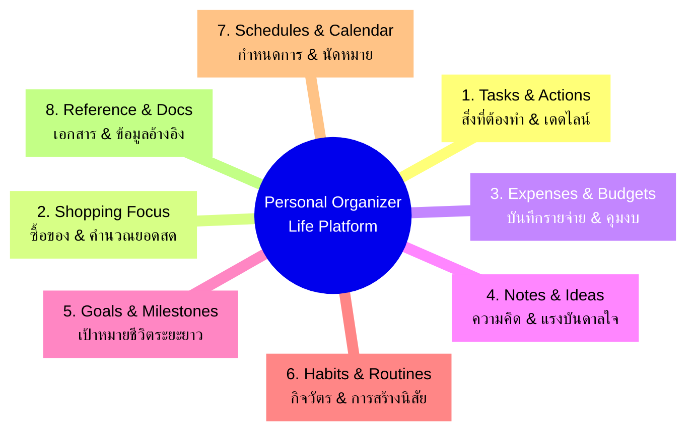

# 01. Product Vision & Strategy — Personal Organizer

**Project:** Personal Organizer  
**Current Tagline:** "One App, All Your Lists"  
**Future Evolution:** **Personal Life Management Platform** ("One Calm Space for Your Whole Life")  
**Date:** October 2026  
**Author:** Product Manager, Lead Software Architect & UX Strategist  
**Classification:** Strategic Product Definition Document  

---

## 1. Executive Summary & Vision Statement

### 1.1 The Core Problem
ในชีวิตประจำวัน ผู้คนต้องเผชิญกับข้อมูลที่กระจัดกระจาย:
- จดสิ่งที่ต้องทำในแอป To-do List ตัวหนึ่ง
- บันทึกรายการซื้อของในแอป Notes หรือกระดาษ
- จดรายจ่ายในแอปบัญชีส่วนตัวหรือ Excel
- ติดตามเป้าหมายและนิสัยในสมุดไดอารี่
- และส่งข้อความรายการเตือนความจำให้ตนเองหรือครอบครัวผ่านแอปแชท (LINE)

การสลับใช้งานหลายแอปพลิเคชัน (Context Switching) ทำให้เกิด **Cognitive Overload (ความเหนื่อยล้าทางสมอง)**, ข้อมูลตกหล่น, และขาดมุมมองภาพรวมของชีวิต (Holistic Life View)

### 1.2 The Product Vision
> **"Personal Organizer: The Calm, All-in-One Life Management Platform"**  
> *"พื้นที่จัดระเบียบชีวิตที่เรียบง่าย ยืดหยุ่น และทรงพลัง — รวมทุกการจดบันทึก สิ่งที่ต้องทำ งบประมาณ และเป้าหมายส่วนตัวไว้ในที่เดียว โดยไม่มีความซับซ้อนเกินจำเป็น"*

เรามุ่งมั่นพัฒนา **Personal Organizer** ให้ก้าวข้ามจากการเป็นเพียง "แอปบันทึกรายการ (List App)" ไปสู่การเป็น **"Personal Life Management Platform"** ที่ช่วยให้ผู้ใช้ควบคุมชีวิตประจำวันได้อย่างคล่องตัว รวดเร็ว และเป็นส่วนตัว 100% โดยยังคงจุดแข็งหลักที่เป็นเอกลักษณ์ของระบบเดิมไว้ คือ **Flexible Lists (รายการที่ปรับแต่งได้ตามใจ)** และ **Custom Categories (การจัดหมวดหมู่อิสระ)**

---

## 2. Core Strategic Pillars (8 มิติการจัดการชีวิตในแอปเดียว)

แพลตฟอร์มจะถูกขับเคลื่อนด้วยแกนหลัก 8 ด้านที่ผสานรวมกันอย่างแนบเนียน:

1. **Tasks & Action Items (สิ่งที่ต้องทำ):** จัดการงานค้าง จัดลำดับความสำคัญ (Urgent/High/Medium/Low) พร้อมระบบ Checklist และ Recurring Tasks
2. **Shopping & Market Runs (การซื้อของ):** ตะกร้าสินค้าอัจฉริยะ โหมดซื้อของเต็มจอ (Screen Wake Lock) คำนวณยอดเงินตามจริงแบบเรียลไทม์
3. **Expenses & Budgets (รายจ่ายและงบประมาณ):** บันทึกค่าใช้จ่ายย่อย คำนวณรวมอัตโนมัติ วิเคราะห์สัดส่วนรายจ่ายแยกตามหมวดหมู่
4. **Notes & Ideas (บันทึกและไอเดีย):** พื้นที่จดบันทึกความคิดเร็ว พิมพ์ด้วยเสียงภาษาไทย (Thai Speech-to-Text) และติดแท็กค้นหาง่าย
5. **Goals & Milestones (เป้าหมายชีวิต):** กำหนดเป้าหมายรายปี/รายไตรมาส และเชื่อมโยงงานประจำวันเข้าสู่เป้าหมายใหญ่
6. **Habits & Routines (กิจวัตรประจำวัน):** ตรวจสอบและติดตามนิสัย (Habit Tracker) พร้อมสถิติ Streak เพื่อสร้างวินัยเชิงบวก
7. **Schedules & Deadlines (กำหนดการและกิจกรรม):** มุมมองปฏิทินรายวัน รายสัปดาห์ และรายเดือน แจ้งเตือนงานล่วงหน้า
8. **Documents & References (เอกสารอ้างอิง):** แนบสลิป รูปถ่าย และข้อมูลสำคัญเพื่อใช้อ้างอิงย้อนหลังได้ทันที

---

## 3. Target Audience & User Personas

เพื่อกำหนดทิศทางการพัฒนาให้ตอบสนองผู้ใช้จริง เราได้จัดกลุ่ม Persona หลัก 3 กลุ่ม:

### Persona 1: "The Busy Professional & Freelancer" (คุณกิตติ์ - ฟรีแลนซ์และคนทำงานยุคใหม่)
- **พฤติกรรม:** มีงานและโปรเจกต์หลายอย่างที่ต้องส่งให้ลูกค้าในแต่ละสัปดาห์ ต้องคอยเช็กเดดไลน์และจดบันทึกไอเดียด่วน
- **Pain Points:** แอปยอดนิยมอย่าง Notion ซับซ้อนและโหลดช้า ส่วนแอป To-do ทั่วไปไม่สามารถจดบันทึกย่อยหรือเก็บสลิปค่าใช้จ่ายโปรเจกต์ได้
- **ความคาดหวังในแอป:** Quick Capture ที่เปิดปุ๊บจดปั๊บได้ใน 3 วินาที, มุมมอง Kanban/Calendar สรุปงานส่ง, และการสำรองข้อมูลที่ปลอดภัย

### Persona 2: "The Home & Family Organizer" (คุณเมย์ - ผู้จัดการชีวิตครอบครัว)
- **พฤติกรรม:** จัดการงานบ้าน ซื้อของสดเข้าตู้เย็น ชำระบิลค่าน้ำค่าไฟ และติดตามค่าใช้จ่ายในบ้าน
- **Pain Points:** จดรายการซื้อของในกระดาษแล้วลืม หน้าจอมือถือชอบดับระหว่างเดินเข็นรถในห้าง ส่งรายการให้แฟนผ่านแชทแล้วตกหล่น
- **ความคาดหวังในแอป:** โหมดซื้อของ (Shopping Mode) หน้าจอไม่ดับ, รวมราคาสินค้าได้ทันที, และปุ่มแชร์สรุปรายการสวยงามเข้า LINE ในคลิกเดียว

### Persona 3: "The Self-Improver & Habit Builder" (คุณนนท์ - นักพัฒนาตนเอง)
- **พฤติกรรม:** ตั้งเป้าหมายพัฒนาตนเอง เช่น อ่านหนังสือ ออกกำลังกาย ดื่มน้ำ และฝึกทักษะใหม่
- **Pain Points:** ต้องลงแอป Habit แยกอีกตัว ทำให้ลืมเปิดดู และไม่เห็นความเชื่อมโยงระหว่างนิสัยประจำวันกับเป้าหมายชีวิต
- **ความคาดหวังในแอป:** แถบ Habit เล็กๆ ใน Dashboard ที่สามารถติ๊กผ่านในหน้าเดียวกับงานประจำวัน

---

## 4. Product Differentiation & Competitive Advantage

| มิติการเปรียบเทียบ | Personal Organizer (Next-Gen) | Notion | Todoist | Money Manager ทั่วไป |
| :--- | :---: | :---: | :---: | :---: |
| **All-in-One Life Platform** | ✅ ครบทั้งงาน, ช้อปปิ้ง, รายจ่าย, นิสัย | ⚠️ ทำได้แต่ต้องสร้าง Template เอง | ❌ เน้นเฉพาะงาน | ❌ เน้นเฉพาะบัญชี |
| **Learning Curve / ความง่าย** | 🟢 ง่ายมาก (Zero Setup) | 🔴 ซับซ้อนสูงมาก | 🟢 ง่าย | 🟡 ปานกลาง |
| **Shopping Focus Mode** | ✅ มี (Wake Lock + Live Price) | ❌ ไม่มี | ❌ ไม่มี | ❌ ไม่มี |
| **Thai Lifestyle Integration** | ✅ พิมพ์เสียงไทย + แชร์ LINE 1-คลิก | ❌ ไม่มี | ❌ ไม่มี | ❌ ไม่มี |
| **Data Privacy & Speed** | ✅ Local-First / Private PIN / PWA | 🟡 พึ่งพา Cloud 100% | 🟡 พึ่งพา Cloud 100% | ⚠️ ปานกลาง |
| **Sub-item Auto-Expense Calc** | ✅ ติ๊กรายการย่อยแล้วรวมยอดเงินทันที | ❌ ต้องเขียน Formula | ❌ ไม่มี | ❌ ไม่รองรับ Checklist |

---

## 5. Strategic Guiding Principles

1. **Keep It Calm & Fast (คงความเรียบง่ายและรวดเร็ว):**
   - ทุกฟังก์ชันใหม่ต้องไม่เพิ่มความซับซ้อนให้หน้าหลัก
   - การบันทึกงานใหม่ต้องทำได้ภายใน **ไม่เกิน 3 วินาที (The 3-Second Rule)**
2. **Mobile-First, Desktop-Empowered (คิดบนมือถือ ต่อยอดบนคอมพิวเตอร์):**
   - ออกแบบ Touch Target และ Bottom Navigation ให้เหมาะกับนิ้วโป้งมือข้างเดียวบนโทรศัพท์
   - ปรับการแสดงผลบนจอ Desktop ให้ใช้พื้นที่กว้างอย่างคุ้มค่าด้วย Sidebar และ Multi-column Dashboard
3. **Data Sovereignty & Local Privacy (ข้อมูลเป็นของผู้ใช้ 100%):**
   - ผู้ใช้ต้องสามารถควบคุม เข้ารหัส และ Export ข้อมูลทั้งหมดของตนเองได้ตลอดเวลาโดยไม่มี Vendor Lock-in
4. **Preserve What Works (ต่อยอด ไม่ใช่รื้อทิ้ง):**
   - รักษา Design System ที่สะอาดตา (Clean Minimalist Palette: Slate, Indigo, Emerald) และฐานฟังก์ชันเดิมที่เสร็จสมบูรณ์แล้วจากการ Audit
