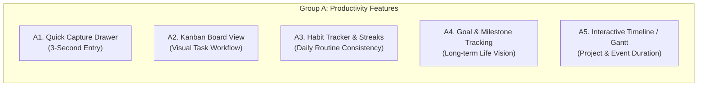
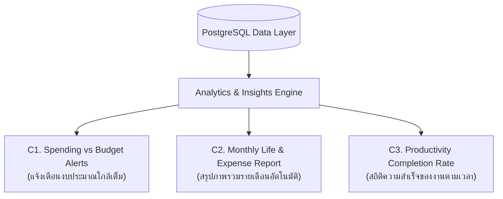

# 02. Comprehensive Feature Backlog — Personal Organizer

**Project:** Personal Organizer ("One App, All Your Lists")  
**Target Architecture:** Personal Life Management Platform  
**Date:** October 2026  
**Author:** Product Manager & Senior Software Architect  
**Classification:** Product Feature Catalog & Technical Requirements Backlog  

---

## 1. Executive Summary

เอกสารฉบับนี้รวบรวม **รายการฟีเจอร์ที่ค้นพบ (Feature Discovery)** ทั้งหมด โดยผ่านการวิเคราะห์จาก:
1. **ผลการตรวจสอบทางเทคนิค (Technical Audit Findings):** การแก้ไขข้อบกพร่องวิกฤตของฟีเจอร์เดิม (P0 Stabilization)
2. **ความต้องการของผู้ใช้งานจริง (User Needs & UX Gaps):** การลดขั้นตอนการกรอกข้อมูล และการเพิ่มความยืดหยุ่นในการจัดการชีวิต
3. **5 เสาหลักการพัฒนาฟีเจอร์ใหม่ (5 Strategic Evolution Pillars):**
   - **Group A:** Productivity (ผลิตภาพและประสิทธิภาพการทำงาน)
   - **Group B:** Data Management (การจัดการและการปกป้องข้อมูล)
   - **Group C:** Intelligence & Analytics (การวิเคราะห์ข้อมูลและรายงานเชิงลึก)
   - **Group D:** Mobile Experience (ประสบการณ์ใช้งานบนโทรศัพท์มือถือและออฟไลน์)
   - **Group E:** Personalization & Views (ความยืดหยุ่นและการปรับแต่งส่วนบุคคล)

---

## 2. Foundation: Stabilization & Audit Fixes Backlog (งานรากฐาน)

ก่อนการเปิดตัวฟีเจอร์ใหม่ใดๆ จำเป็นต้องปลดล็อกหนี้ทางเทคนิคและช่องโหว่ที่พบใน Technical Audit เสียก่อน:

| Backlog ID | รายการฟีเจอร์ / งานปรับปรุง | สภาพปัจจุบันจาก Audit | แนวทางการแก้ไขและข้อกำหนด |
| :--- | :--- | :--- | :--- |
| **STAB-01** | **Database Transactions in Models** | `entryModel.js` ลบและ Insert Sub-items โดยไม่มี Transaction เสี่ยงต่อ Data Loss | เพิ่ม `client = await pool.connect()` พร้อม `BEGIN`, `COMMIT`, `ROLLBACK` ในการเขียนข้อมูลหลายตาราง |
| **STAB-02** | **Secure Backend PIN & Authentication** | PIN เก็บเป็น Plaintext ใน LocalStorage, Backend API ไร้การตรวจสอบ | ย้ายการตรวจสอบ PIN ไปไว้ที่ Backend, เข้ารหัสด้วย `Argon2id` / `bcrypt`, เพิ่ม Auth Middleware และ Rate Limiting |
| **STAB-03** | **Eliminate `window.location.reload()`** | พบคำสั่ง Reload หน้าเว็บทั้งจอหลังการลบข้อมูลใน 3 ไฟล์ | อัปเดต Client State ใน React ให้ลบรายการออกจากหน่วยความจำทันที (Optimistic UI) โดยไม่ต้อง Refresh หน้า |
| **STAB-04** | **Complete Dark Mode Coverage** | `ArchivePage.tsx`, `EntryFilterBar.tsx`, และ Badges สีเพี้ยนในโหมดมืด | เพิ่มคลาส `dark:` และ Tailwind dark variants ให้ครอบคลุมทุก Component 100% |
| **STAB-05** | **Fix Calendar View Query Limit Bug** | Hardcode `limit: 100` ไม่ส่งช่วงวันที่ ทำให้ข้อมูลเกิน 100 หาย | แก้ไขให้ส่งพารามิเตอร์ `start_date` และ `end_date` เพื่อดึงเฉพาะรายการที่ตรงกับเดือนที่กำลังเปิดดู |
| **STAB-06** | **Search Input Debouncing** | ช่อง Search ยิง API ทุกตัวอักษรที่พิมพ์ ทำให้เซิร์ฟเวอร์โหลดหนัก | เพิ่ม Debounce Hook (300ms) ใน `Header.tsx` เพื่อหน่วงเวลาก่อนส่ง Request |

---

## 3. Group A: Productivity Enhancements (ผลิตภาพและการจัดการงาน)

### Feature A1: Quick Capture Drawer & Floating Action (บันทึกด่วนใน 3 วินาที)
- **User Story:** ในฐานะผู้ใช้งาน เมื่อมีความคิดหรือสิ่งที่ต้องทำผุดขึ้นมา ฉันต้องการพิมพ์หรือพูดบันทึกได้ทันทีโดยไม่ต้องเปิดฟอร์มใหญ่หลายขั้นตอน
- **รายละเอียดการทำงาน:**
  - แถบ Quick Input ด้านบนหรือปุ่มลัดลอย (Floating Action Button) ที่กดปุ่มเดียวแล้วพิมพ์ได้ทันที
  - **Smart NLP-lite Parsing:** ระบบตัดคำอัจฉริยะ เช่น พิมพ์ *"ซื้อนมสด 45 บ. พรุ่งนี้ #ช้อปปิ้ง"* ระบบจะแยกให้โดยอัตโนมัติ:
    - Title: `ซื้อนมสด`
    - Amount: `45`
    - Due Date: `วันพรุ่งนี้`
    - Category: `Shopping List`
  - รองรับการกดไอคอนไมโครโฟนเพื่อพูดภาษาไทยแล้วบันทึกทันที
- **ผลลัพธ์เชิงธุรกิจ:** ลด Drop-off Rate ของผู้ใช้ลงมากกว่า 50%

---

### Feature A2: Kanban Board View (มุมมองกระดานคัมบัง)
- **User Story:** ในฐานะคนทำงาน ฉันต้องการดูสถานะของงานทั้งหมดในรูปแบบคอลัมน์ และสามารถลากย้ายการ์ดเพื่อเปลี่ยนสถานะได้อย่างรวดเร็ว
- **รายละเอียดการทำงาน:**
  - เพิ่มแท็บมุมมอง "Kanban" ประกอบด้วย 4 คอลัมน์ตาม Enum: `รอดำเนินการ (Pending)`, `กำลังทำ (In Progress)`, `เสร็จสิ้น (Completed)`, และ `ยกเลิก (Cancelled)`
  - รองรับ Drag & Drop การ์ดระหว่างคอลัมน์ (ใช้ `@hello-pangea/dnd` หรือ HTML5 Drag & Drop)
  - แสดงจำนวนการ์ดและผลรวมงบประมาณรายจ่ายของแต่ละคอลัมน์ที่ส่วนหัว

---

### Feature A3: Habit Tracker & Streak Counter (ระบบติดตามนิสัยและวินัย)
- **User Story:** ในฐานะผู้ที่ต้องการพัฒนาตนเอง ฉันต้องการบันทึกกิจวัตรประจำวัน (เช่น ดื่มน้ำ 2 ลิตร, อ่านหนังสือ 20 นาที) และดูจำนวนวันที่ทำต่อเนื่อง (Streaks)
- **รายละเอียดการทำงาน:**
  - เพิ่มประเภทข้อมูลย่อย "Habit" ภายใต้หมวดหมู่
  - วงล้อปฏิทิน 7 วันย้อนหลัง (Weekly Dot Matrix) ให้ติ๊กเสร็จในคลิกเดียวจากหน้า Dashboard
  - คำนวณ Current Streak และ Best Streak เพื่อสร้างแรงจูงใจ (Gamification เล็กๆ)

---

### Feature A4: Goal & Milestone Tracking (การติดตามเป้าหมายชีวิต)
- **User Story:** ในฐานะคนมีเป้าหมายชีวิต ฉันต้องการกำหนดเป้าหมายใหญ่ (เช่น เก็บเงิน 50,000 บาท, เรียนจบหลักสูตร AI) และผูกรายการงานเข้ากับเป้าหมายนั้น
- **รายละเอียดการทำงาน:**
  - การ์ด Goal มีกำหนดวันสิ้นสุด (Target Date) และแถบ Progress Bar (คำนวณจากเปอร์เซ็นต์ของ Tasks ที่ทำเสร็จ หรือยอดเงินที่เก็บได้)
  - เชื่อมโยง Entries เข้ากับเป้าหมายผ่านฟิลด์ `goal_id`

---

### Feature A5: Timeline & Schedule View (มุมมองไทม์ไลน์กำหนดการ)
- **User Story:** ในฐานะผู้จัดตารางงาน ฉันต้องการเห็นช่วงเวลาของงานที่มีวันเริ่มต้นและวันสิ้นสุด (`entry_date` $\rightarrow$ `due_date`) ทอดยาวบนแกนเวลา เพื่อวางแผนล่วงหน้าไม่ให้งานชนกัน
- **รายละเอียดการทำงาน:**
  - กราฟแนวนอนแบบ Gantt-lite แสดงแถบสีของงานตามหมวดหมู่ สามารถซูมดูแบบสัปดาห์หรือแบบเดือนได้

---

## 4. Group B: Data Management & Extensibility (การจัดการข้อมูล)

### Feature B1: Full Import & Restore Engine (ระบบนำเข้าและกู้คืนข้อมูล 100%)
- **User Story:** ในฐานะผู้ใช้ ฉันต้องการนำไฟล์ JSON หรือ CSV สำรองข้อมูลที่เคยส่งออกไว้ กลับเข้าสู่ระบบได้เมื่อย้ายเครื่องหรือติดตั้งใหม่
- **รายละเอียดการทำงาน:**
  - หน้าต่าง Modal ให้ลากวางไฟล์ JSON/CSV
  - **Schema Validation & Dry-Run:** ตรวจสอบโครงสร้างไฟล์ก่อนบันทึกจริง แสดงตัวอย่างจำนวนหมวดหมู่และรายการที่จะนำเข้า
  - **Conflict Resolution Strategy:** ให้ผู้ใช้เลือกว่ากรณีชื่อซ้ำจะ *"เขียนทับ (Overwrite)"*, *"ข้าม (Skip)"*, หรือ *"สร้างเป็นรายการใหม่ (Keep Both)"*

---

### Feature B2: Attachments & Slip Receipts (ระบบแนบรูปภาพและสลิป)
- **User Story:** ในฐานะผู้บันทึกรายจ่าย ฉันต้องการแนบรูปถ่ายใบเสร็จ สลิปโอนเงิน หรือรูปถ่ายสินค้าไว้กับรายการ เพื่อใช้อ้างอิงย้อนหลัง
- **รายละเอียดการทำงาน:**
  - รองรับการอัปโหลดไฟล์ภาพ (PNG, JPG, WebP) ขนาดไม่เกิน 5MB ต่อไฟล์
  - บีบอัดภาพฝั่ง Client ก่อนอัปโหลดเพื่อประหยัดพื้นที่จัดเก็บ
  - มี Image Viewer Preview พร้อมปุ่มขยายดูภาพขนาดเต็ม

---

### Feature B3: Advanced Multi-Criteria Filter (ระบบค้นหาและกรองขั้นสูง)
- **User Story:** ในฐานะผู้ใช้งานที่มีข้อมูลสะสมจำนวนมาก ฉันต้องการค้นหารายการด้วยเงื่อนไขหลายอย่างพร้อมกัน เช่น "รายการช้อปปิ้งที่เลยกำหนด และยอดเงินมากกว่า 500 บาท"
- **รายละเอียดการทำงาน:**
  - Filter Builder ที่รองรับการกรองตาม: ช่วงยอดเงิน (`min_amount` - `max_amount`), ช่วงวันที่แบบกำหนดเอง, แท็กหลายแท็กพร้อมกัน (AND / OR logic), และการมีหรือไม่มีรายการย่อย

---

### Feature B4: Custom Fields per Category (ฟิลด์ข้อมูลกำหนดเองตามหมวดหมู่)
- **User Story:** ในฐานะผู้ใช้ ฉันต้องการให้หมวดหมู่บางหมวดมีช่องกรอกพิเศษ เช่น หมวด "หนังสือที่อยากอ่าน" มีช่อง `ชื่อผู้แต่ง` และ `คะแนนรีวิว`
- **รายละเอียดการทำงาน:**
  - ใช้ประโยชน์จากคอลัมน์ JSONB ที่มีอยู่ใน PostgreSQL โดยให้ผู้ใช้กำหนด Field Type (Text, Number, Date, Select, URL) ประจำหมวดหมู่ได้

---

## 5. Group C: Intelligence & Analytics (การวิเคราะห์และรายงานข้อมูล)

### Feature C1: Spending vs Budget Alerts (การคุมงบประมาณและการแจ้งเตือน)
- **User Story:** ในฐานะผู้คุมรายจ่าย ฉันต้องการตั้งงบประมาณรายเดือนในแต่ละหมวดหมู่ (เช่น ค่าอาหาร 10,000 บ.) และเห็นแถบเตือนเมื่อใช้เงินไปแล้วเกิน 80%
- **รายละเอียดการทำงาน:**
  - เพิ่มฟิลด์ `monthly_budget` ในตาราง `categories`
  - หน้า Dashboard คำนวณยอดรวมรายจ่ายในเดือนปัจจุบันเทียบกับงบประมาณ แสดงเป็น Progress Bar สีเขียว/เหลือง/แดง

---

### Feature C2: Monthly Review & Exportable PDF Reports (รายงานสรุปประจำเดือน)
- **User Story:** ในฐานะผู้ใช้ เมื่อสิ้นเดือน ฉันต้องการเปิดดูรายงานสรุปว่าในเดือนที่ผ่านมาฉันทำงานเสร็จไปกี่ชิ้น ใช้เงินไปเท่าไร และมีเป้าหมายใดคืบหน้าบ้าง
- **รายละเอียดการทำงาน:**
  - หน้าสรุป Monthly Review แสดงชาร์ตวงกลมสัดส่วนรายจ่าย, ชาร์ตแท่งเปรียบเทียบกับเดือนที่แล้ว, และรายชื่องานเด่นที่เสร็จสิ้น พร้อมปุ่มพิมพ์ออกเป็น PDF หรือบันทึกเป็นรูปภาพแชร์ลงโซเชียล

---

### Feature C3: Productivity Velocity Statistics (สถิติความเร็วในการสะสางงาน)
- **User Story:** ในฐานะผู้รักการพัฒนาตนเอง ฉันต้องการเห็นว่าวันใดในสัปดาห์ที่ฉันทำงานเสร็จมากที่สุด และมีงานค้างเฉลี่ยกี่วันก่อนจะถูกเคลียร์
- **รายละเอียดการทำงาน:**
  - คำนวณหาค่าเฉลี่ย Time-to-Complete จาก `created_at` ถึง `updated_at` (เมื่อ `status = 'completed'`)

---

## 6. Group D: Mobile & Cloud Experience (ประสบการณ์โมบายล์และคลาวด์)

### Feature D1: True Offline-First Architecture (ออฟไลน์สมบูรณ์แบบ 100%)
- **User Story:** ในฐานะผู้ใช้ที่เดินทางบ่อย ฉันต้องการเปิดดูและสร้างรายการใหม่ได้เสมอแม้ขณะอยู่บนรถไฟใต้ดินที่ไม่มีสัญญาณเน็ต และเมื่อเน็ตกลับมาระบบต้องซิงค์ให้อัตโนมัติ
- **รายละเอียดการทำงาน:**
  - ปรับปรุง Service Worker (`sw.js`) ให้ทำ Pre-caching สำหรับ App Shell (HTML, CSS, JS, Fonts)
  - นำ **IndexedDB (ผ่าน TanStack Query Persister หรือ Dexie.js)** มาทำ Local Cache จัดเก็บข้อมูล Entries ทั้งหมดไว้ในเครื่อง
  - เมื่อมีสัญญาณเชื่อมต่อ ระบบจะรัน Background Sync เพื่อส่งข้อมูลไปยัง Backend พร้อมระบบแก้ไขข้อขัดแย้ง (Last-Write-Wins / Client Timestamp)

---

### Feature D2: Web Push Notifications & Due Date Reminders (ระบบแจ้งเตือนงานล่วงหน้า)
- **User Story:** ในฐานะผู้ใช้ ฉันต้องการรับการแจ้งเตือนบนหน้าจอมือถือเมื่อถึงเวลาเดดไลน์ของงานหรือถึงวันที่ต้องจ่ายบิลสำคัญ
- **รายละเอียดการทำงาน:**
  - ใช้ Web Notifications API ร่วมกับ Service Worker Push API
  - ผู้ใช้สามารถตั้งเวลาแจ้งเตือนล่วงหน้าได้ (เช่น ก่อน 1 วัน, หรือตอนเช้า 09:00 น. ของวันครบกำหนด)

---

### Feature D3: PWA Home Screen Shortcuts (ปุ่มลัดบนหน้าจอโฮม)
- **User Story:** ในฐานะผู้ใช้ ฉันต้องการกดค้างที่ไอคอนแอปบนหน้าจอมือถือ แล้วเลือกเมนู "สร้างรายการด่วน" หรือ "เปิดโหมดซื้อของ" ได้ทันทีโดยไม่ต้องรอเปิดแอป
- **รายละเอียดการทำงาน:**
  - กำหนด `shortcuts` ใน `manifest.json`:
    - Shortcut 1: `+ บันทึกด่วน` $\rightarrow$ `/quick-add`
    - Shortcut 2: `🛒 โหมดซื้อของ` $\rightarrow$ `/shopping`

---

### Feature D4: Encrypted Cloud Backup (การสำรองข้อมูลเข้ารหัสบนคลาวด์)
- **User Story:** ในฐานะผู้ใช้ ฉันต้องการให้ระบบสำรองข้อมูลอัตโนมัติไปยัง Cloud Storage ของตนเอง (เช่น Google Drive, Dropbox หรือ WebDAV) โดยที่ข้อมูลถูกเข้ารหัสลับส่วนบุคคล (Client-Side Encryption)
- **รายละเอียดการทำงาน:**
  - ข้อมูลสำรองถูกเข้ารหัสด้วย AES-256-GCM โดยใช้ Master PIN ของผู้ใช้เป็น Key ก่อนส่งออกจากเครื่อง

---

## 7. Group E: Personalization & Views (การปรับแต่งตามใจผู้ใช้)

### Feature E1: Modular Drag-and-Drop Dashboard (แดชบอร์ดโมดูลาร์)
- **User Story:** ในฐานะผู้ใช้ ฉันต้องการจัดเรียงการ์ดบนหน้า Dashboard ด้วยตนเอง เช่น นำแถบซื้อของขึ้นมาไว้บนสุด และซ่อนกราฟรายจ่ายหากไม่ได้ใช้งาน
- **รายละเอียดการทำงาน:**
  - ผู้ใช้สามารถเปิด/ปิด และสลับตำแหน่งของ Widget:
    - Widget A: Overview Stat Cards
    - Widget B: Expense Breakdown Chart
    - Widget C: Habit Tracker Dots
    - Widget D: Overdue & Upcoming Due List
    - Widget E: Favorite Pinned Entries

---

### Feature E2: Ready-to-use Life Templates (คลังเทมเพลตสำเร็จรูป)
- **User Story:** ในฐานะผู้ใช้งานใหม่ ฉันต้องการกดโหลดรายการตัวอย่างที่พร้อมใช้งานได้ทันที แทนที่จะต้องเริ่มพิมพ์จากศูนย์
- **รายละเอียดการทำงาน:**
  - เทมเพลตมาตรฐานในตัวแอป:
    1. *จัดกระเป๋าไปเที่ยวทะเล 3 วัน 2 คืน (Checklist เสื้อผ้า, ยา, อุปกรณ์)*
    2. *ย้ายบ้าน / ย้ายคอนโด (Checklist เปลี่ยนที่อยู่, ตรวจรับห้อง)*
    3. *แผนงบประมาณประจำเดือน (บิลค่าน้ำ, ไฟ, อินเทอร์เน็ต, ผ่อนบัตร)*
    4. *เช็กลิสต์ตรวจสุขภาพประจำปี*
