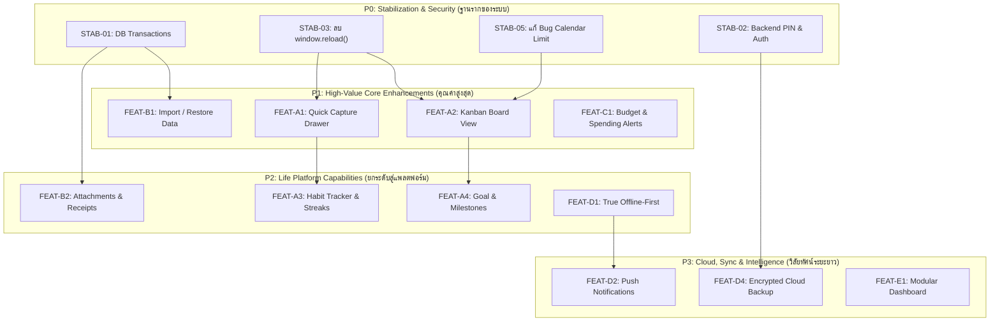

# 03. Feature Prioritization & Scoring Matrix — Personal Organizer

**Project:** Personal Organizer ("One App, All Your Lists")  
**Target Architecture:** Personal Life Management Platform  
**Date:** October 2026  
**Author:** Lead Product Manager & Strategic Systems Architect  
**Classification:** Product Prioritization & Decision Matrix  

---

## 1. Prioritization Framework & Methodology

เพื่อจัดลำดับฟีเจอร์อย่างเป็นระบบ ป้องกันการพัฒนาฟีเจอร์ที่เกินความจำเป็น (Feature Bloat) และควบคุมความเสี่ยงทางเทคนิค เราใช้เกณฑ์การประเมิน 6 มิติ ดังนี้:

1. **User Value (คุณค่าต่อผู้ใช้):** ระดับประโยชน์ที่ผู้ใช้จะได้รับโดยตรงในการประหยัดเวลา ลดความผิดพลาด หรือเพิ่มความสะดวก (ระดับ: High, Medium, Low)
2. **Technical Complexity (ความซับซ้อนทางเทคนิค):** ระดับความยากในการพัฒนา การกระทบต่อ Architecture และการออกแบบ Schema (ระดับ: Low, Medium, High)
3. **Implementation Cost / Effort (ระยะเวลาและแรงงาน):** ปริมาณงานที่ต้องใช้ในการพัฒนา ทดสอบ และปรับแต่ง (ระดับ: Low, Medium, High)
4. **Dependencies (สิ่งที่ต้องมีก่อน):** ฟังก์ชันหรือโครงสร้างระบบที่ต้องสร้างให้เสร็จสมบูรณ์ก่อนฟีเจอร์นี้จะทำงานได้
5. **Risk Level (ระดับความเสี่ยง):** ความเสี่ยงต่อการเกิดข้อผิดพลาด ข้อมูลสูญหาย หรือความปลอดภัย (ระดับ: Critical, High, Medium, Low)
6. **Maintenance Cost (ต้นทุนการดูแลรักษาระยะยาว):** ภาระในการบำรุงรักษา อัปเดตแพ็กเกจ หรือจัดการฐานข้อมูลในอนาคต (ระดับ: Low, Medium, High)

---

## 2. Priority Classification Tiers

- **P0: Critical Improvements (ปรับปรุงรากฐานเร่งด่วนที่สุด):** งานแก้จุดบกพร่องวิกฤตจาก Technical Audit เพื่อป้องกัน Data Loss และปิดช่องโหว่ความปลอดภัย *ต้องทำให้เสร็จก่อนเริ่มฟีเจอร์ใหม่ทั้งหมด*
- **P1: High Value Features (ฟีเจอร์คุณค่าสูง & Quick Wins):** ฟีเจอร์ที่สร้างความประทับใจให้ผู้ใช้ทันที ใช้เวลาพัฒนาปานกลาง และต่อยอดจากจุดแข็งเดิมของระบบ
- **P2: Medium Priority Features (ฟีเจอร์ยกระดับสู่แพลตฟอร์ม):** ฟีเจอร์ที่ขยายขีดความสามารถของแอปพลิเคชันไปสู่การจัดการชีวิตอย่างรอบด้าน (Data Intelligence, Habit, Attachments)
- **P3: Future Ideas (วิสัยทัศน์ระยะยาว):** ฟีเจอร์ที่ต้องอาศัยโครงสร้างพื้นฐานระดับสูง เช่น Cloud Sync, Push Notifications หรือ Multi-user Collaboration

---

## 3. Master Feature Prioritization Matrix Table

ตารางประเมินและจัดลำดับความสำคัญของฟีเจอร์ทั้งหมดตามข้อกำหนด:

| Feature Name | User Value | Complexity | Priority | Dependencies | Strategic Reason / Justification |
| :--- | :---: | :---: | :---: | :---: | :--- |
| **STAB-01: Database Transactions** | High | Low | **P0** | PostgreSQL Driver | **Critical Data Safety:** ป้องกันข้อมูล Sub-items สูญหายถาวรจากการ Delete & Insert โดยไม่มี Transaction |
| **STAB-02: Secure Backend PIN & Auth** | High | Medium | **P0** | Express Middleware, Bcrypt | **Critical Security:** ปิดช่องโหว่ Plaintext PIN ใน LocalStorage และคุ้มครอง API ทุก Endpoint จากการเข้าถึงโดยไม่ได้รับอนุญาต |
| **STAB-03: Eliminate `window.location.reload()`** | High | Low | **P0** | React State Handlers | **Core UX:** แก้ไขการกระพริบขาวทั้งหน้าจอ คืนความลื่นไหลระดับ Single Page Application แท้จริง |
| **STAB-04: Complete Dark Mode Coverage** | Medium | Low | **P0** | Tailwind CSS Classes | **Visual Accessibility:** แก้ปัญหาตัวหนังสือและพื้นหลังกลืนกันใน Archive, FilterBar, และ Badges |
| **STAB-05: Fix Calendar View Month Query** | High | Low | **P0** | Entry Service, SQL | **Data Integrity:** แก้บั๊กข้อมูลงานเกิน 100 รายการหายไปจากปฏิทิน โดยส่ง `start_date` และ `end_date` ตามเดือน |
| **STAB-06: Search Input Debouncing** | Medium | Low | **P0** | React Custom Hook | **Performance:** ลดจำนวน API Calls ลง 80% ป้องกันเซิร์ฟเวอร์ค้างและแก้ปัญหา Race Condition ของผลลัพธ์ค้นหา |
| **FEAT-A1: Quick Capture Bar / Drawer** | **High** | **Low** | **P1** | Entry Service, STAB-06 | **High Value Quick Win:** บันทึกงานได้ใน 3 วินาทีจากทุกหน้าจอ ลด Drop-off ของผู้ใช้ได้อย่างมหาศาล |
| **FEAT-B1: Full Import & Restore Engine** | **High** | **Medium** | **P1** | STAB-01 (DB Transaction) | **Data Sovereignty:** เติมเต็มฟีเจอร์ Export ที่มีอยู่แล้ว ให้ผู้ใช้กู้คืนข้อมูลสำรองกลับเข้าฐานข้อมูลได้จริง 100% |
| **FEAT-A2: Kanban Board View** | **High** | **Medium** | **P1** | Drag & Drop Lib, STAB-03 | **Workflow Ergonomics:** เพิ่มมุมมอง Visual Workflow ให้คนทำงานสลับสถานะงานได้ง่ายผ่านการลากวาง |
| **FEAT-C1: Spending vs Budget Alerts** | **High** | **Low** | **P1** | Category Schema Budget | **Financial Control:** ช่วยผู้ใช้คุมงบประมาณรายจ่ายรายเดือนตามหมวดหมู่ แจ้งเตือนเมื่อใช้เงินใกล้เต็มงบ |
| **FEAT-D3: PWA Home Screen Shortcuts** | **Medium** | **Low** | **P1** | Manifest.json | **Mobile Polish:** กดค้างที่ไอคอนแอปเพื่อบันทึกด่วนหรือเปิดโหมดซื้อของได้ทันที |
| **FEAT-A3: Habit Tracker & Streaks** | **High** | **Medium** | **P2** | New Habits Schema | **Life Engagement:** ดึงดูดให้ผู้ใช้เปิดแอปทุกวันเพื่อรักษา Streak และสร้างวินัยเชิงบวก |
| **FEAT-B2: Attachments & Receipts** | **High** | **Medium** | **P2** | Storage/Upload Engine | **Practical Life Need:** แนบรูปสลิปใบเสร็จหรือภาพถ่ายสินค้าไว้เป็นหลักฐานอ้างอิงย้อนหลัง |
| **FEAT-A4: Goal & Milestone Tracking** | **High** | **Medium** | **P2** | Goals Schema, Entry Link | **Holistic Life Vision:** เชื่อมโยงงานประจำวันเข้ากับเป้าหมายใหญ่ในชีวิต |
| **FEAT-C2: Monthly Review Reports** | **Medium** | **Medium** | **P2** | Dashboard Service, PDF | **Self-Reflection:** สรุปภาพรวมผลิตภาพและสถิติรายจ่ายประจำเดือนพิมพ์เป็นรายงานได้ |
| **FEAT-D1: True Offline-First (IndexedDB)** | **High** | **High** | **P2** | TanStack Query, Dexie | **True PWA Power:** ใช้งานแอปพลิเคชันได้ 100% แม้ไม่มีสัญญาณอินเทอร์เน็ต |
| **FEAT-E2: Ready-to-use Life Templates** | **Medium** | **Low** | **P2** | Template Seed Data | **Onboarding Speed:** ช่วยผู้ใช้ใหม่เริ่มต้นใช้งานได้ทันทีด้วยตัวอย่าง Checklist จัดกระเป๋า/ย้ายบ้าน |
| **FEAT-A5: Timeline / Gantt-lite View** | **Medium** | **High** | **P3** | Date Math, Canvas/SVG | **Advanced Planning:** วางแผนงานที่มีช่วงเวลากำหนดการต่อเนื่อง |
| **FEAT-B4: Custom Fields per Category** | **Medium** | **High** | **P3** | JSONB Schema Engine | **Ultimate Flexibility:** ให้แต่ละหมวดหมู่กำหนดฟิลด์ข้อมูลเฉพาะของตนเองได้ |
| **FEAT-D2: Web Push Notifications** | **High** | **High** | **P3** | Service Worker Push, VAPID | **Proactive Engagement:** แจ้งเตือนเตือนความจำบนหน้าจอมือถือเมื่อถึงเวลาเดดไลน์ |
| **FEAT-D4: Encrypted Cloud Backup** | **Medium** | **High** | **P3** | WebDAV / Google Drive API | **Peace of Mind:** สำรองข้อมูลอัตโนมัติขึ้นคลาวด์ส่วนตัวของผู้ใช้แบบเข้ารหัสลับ |
| **FEAT-E1: Modular Drag & Drop Dashboard**| **Medium** | **High** | **P3** | Grid Layout Lib, LocalState | **Deep Personalization:** จัดเรียงและซ่อน Widget บน Dashboard ได้อย่างอิสระ |

---

## 4. Strategic Dependency Flow

แผนภาพแสดงลำดับการปลดล็อกฟีเจอร์ตามความสัมพันธ์เชิงสถาปัตยกรรม (Architectural Dependency Flow):

---

## 5. Strategic Takeaways

1. **ไม่ข้ามขั้นตอน P0:** การเร่งพัฒนาฟีเจอร์ใหม่อย่าง Import หรือ Kanban โดยไม่ทำ STAB-01 (DB Transactions) และ STAB-03 (State Management) จะส่งผลให้ระบบพังง่ายขึ้นและข้อมูลสูญหาย
2. **P1 คือจุดคุ้มค่าสูงสุด (Highest ROI):** การทำ `Quick Capture` ควบคู่กับ `Import / Restore` และ `Kanban` จะเปลี่ยนความรู้สึกของผู้ใช้จากการใช้งาน "สมุดจดธรรมดา" ไปเป็น "ระบบจัดการชีวิตที่ทรงพลัง" โดยใช้เวลาพัฒนาเพียง 4-6 สัปดาห์
3. **P2 และ P3 คือการสร้างความผูกพันระยะยาว (Long-Term Retention):** ฟีเจอร์ Habit Tracker และ Offline-first จะทำให้แอปกลายเป็นอวัยวะชิ้นที่ 33 ที่ผู้ใช้ต้องเปิดใช้งานทุกวันอย่างแท้จริง
