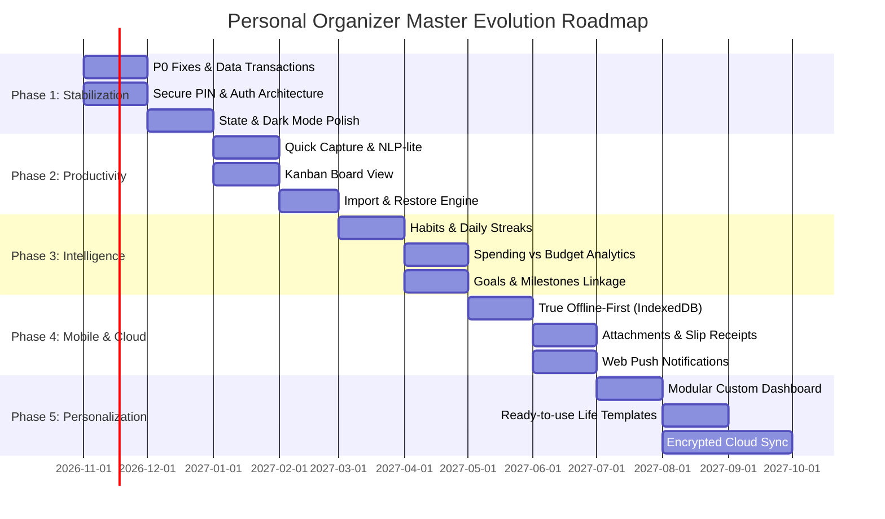

# 04. Phased Product & Technical Roadmap — Personal Organizer

**Project:** Personal Organizer ("One App, All Your Lists")  
**Target Architecture:** Personal Life Management Platform  
**Planning Horizon:** 12 Months (5 Development Phases)  
**Author:** Lead Software Architect, Product Manager & DevOps Strategist  
**Classification:** Master Implementation Roadmap Document  

---

## 1. Roadmap Architecture Overview

แผนงานการพัฒนาถูกจัดแบ่งออกเป็น **5 ระยะ (5 Distinct Phases)** ตามลำดับความสำคัญและความพร้อมทางสถาปัตยกรรม เพื่อส่งมอบฟีเจอร์ที่มีคุณค่าอย่างต่อเนื่องและมั่นคง:

---

## 2. Phase-by-Phase Technical Specifications

---

### Phase 1: Stabilization & Hardening (เดือนที่ 1 - 2)

#### 1.1 Objective (เป้าหมายหลัก)
ขจัดหนี้ทางเทคนิควิกฤต (P0 Technical Debts) ทั้งหมดจากผลการ Audit, เสริมความปลอดภัยของระบบ PIN, ป้องกันความเสี่ยงเรื่องข้อมูลสูญหาย (Data Loss), คืนความลื่นไหลระดับ Single Page Application แท้จริง, และติดตั้งฐานระบบทดสอบอัตโนมัติ

#### 1.2 Features & Scope
1. **STAB-01: Database Transactions:** ครอบคำสั่ง SQL หลายตารางด้วย `BEGIN ... COMMIT ... ROLLBACK`
2. **STAB-02: Secure Backend PIN & Auth:** ย้ายการตรวจรหัสผ่านไปไว้ที่ Backend, Hash ด้วย `bcrypt`, เพิ่ม Auth Middleware ตรวจสอบ Session/Token
3. **STAB-03: State Reactivity Refactor:** ลบคำสั่ง `window.location.reload()` ทั้งหมด และยกเลิกการใช้ `key` remount hack
4. **STAB-04: Dark Mode Perfection:** ใส่คลาส `dark:` ให้ครบทุกจุดใน `ArchivePage`, `CategoriesPage`, และ `EntryFilterBar`
5. **STAB-05: Calendar View Fix:** ปรับ Query ในปฏิทินให้ดึงตามช่วงวันที่ (`start_date`, `end_date`) แทนการ Hardcode `limit: 100`
6. **STAB-06: Search Debounce:** เพิ่ม Debounce Hook (300ms) ใน `Header.tsx`
7. **Testing Foundation:** ติดตั้ง Vitest และเขียน Unit Test สำหรับฟังก์ชันคำนวณและแปลงวันที่

#### 1.3 Technical & Architectural Requirements
- ติดตั้ง `bcrypt` และ `express-rate-limit` ในโฟลเดอร์ `backend`
- ติดตั้ง `helmet` ป้องกัน Web Security Headers
- ติดตั้ง `vitest` และ `@testing-library/react` ในโฟลเดอร์ `frontend`

#### 1.4 Database Changes
- เพิ่มตาราง `app_settings` (key VARCHAR PRIMARY KEY, value TEXT NOT NULL, updated_at TIMESTAMPTZ) เพื่อจัดเก็บ `pin_hash` และการตั้งค่าความปลอดภัยระดับเซิร์ฟเวอร์อย่างปลอดภัย

#### 1.5 API Changes
- `POST /api/auth/pin/verify` — ตรวจสอบรหัส PIN และออก Session Token
- `POST /api/auth/pin/set` — ตั้งค่าหรือเปลี่ยนรหัส PIN (บันทึกเฉพาะ Bcrypt Hash)
- `POST /api/auth/pin/disable` — ยกเลิกรหัส PIN (ต้องยืนยัน PIN เดิมก่อน)
- `GET /api/entries` — รองรับพารามิเตอร์ `start_date` และ `end_date` ร่วมกับ Month Navigation

#### 1.6 Dependencies
- PostgreSQL 17/18, Node.js $\ge 18$

#### 1.7 Acceptance Criteria
- [x] ทดสอบสร้างและอัปเดต Entry พร้อม Sub-items หากจำลอง Database Error กลางทาง ข้อมูลเดิมต้องไม่สูญหาย
- [x] ไม่มีคำว่า `window.location.reload()` หลงเหลืออยู่ในโปรเจกต์ การลบรายการต้องลบออกจาก UI ทันที
- [x] ตรวจสอบ Browser LocalStorage ต้อง**ไม่พบรหัส PIN เป็น Plaintext** (`app_pin_code` ต้องถูกลบทิ้ง)
- [x] ปฏิทินสามารถเปิดดูรายการของเดือนย้อนหลัง/ล่วงหน้าที่มีมากกว่า 100 รายการได้อย่างครบถ้วน
- [x] หน้า Archive และ Filter Bar แสดงผลใน Dark Mode ด้วยสีที่คมชัด อ่านง่าย สบายตา

---

### Phase 2: Productivity Enhancement (เดือนที่ 3 - 4)

#### 2.1 Objective (เป้าหมายหลัก)
ลดขั้นตอนในการบันทึกข้อมูลให้เหลือไม่เกิน 3 วินาที (Frictionless Quick Capture), เพิ่มมุมมอง Visual Workflow ด้วย Kanban Board, และเปิดฟังก์ชันกู้คืนข้อมูล (Import / Restore) ให้สมบูรณ์ 100%

#### 2.2 Features & Scope
1. **FEAT-A1: Quick Capture Bar & Drawer:** แถบจดด่วนด้านบน พร้อมระบบ NLP-lite ตัดคำอัตโนมัติ (วันที่, แท็ก, ราคา)
2. **FEAT-A2: Kanban Board View:** มุมมองกระดาน 4 คอลัมน์ ลากย้ายการ์ดเปลี่ยนสถานะแบบ Drag & Drop
3. **FEAT-B1: Full Import & Restore Engine:** นำเข้าไฟล์ JSON/CSV กลับเข้าฐานข้อมูลพร้อมระบบตรวจสอบความถูกต้อง (Dry-Run)
4. **FEAT-D3: PWA App Shortcuts:** เมนูปุ่มลัดบนไอคอนหน้าจอมือถือ (บันทึกด่วน, โหมดช้อปปิ้ง)

#### 2.3 Technical & Architectural Requirements
- ติดตั้ง `@hello-pangea/dnd` หรือ `dnd-kit` สำหรับ Drag and Drop ใน React
- ติดตั้ง `react-router-dom` v6 เพื่อปรับระบบเปลี่ยนหน้าให้เป็น URL-based Routing (`/dashboard`, `/lists`, `/kanban`, `/calendar`, `/categories`)
- ติดตั้ง `zod` สำหรับ Schema Validation ของไฟล์ JSON/CSV ที่จะนำเข้า

#### 2.4 Database Changes
- เพิ่มคอลัมน์ `sort_order` ในตาราง `entries` เพื่อบันทึกตำแหน่งการ์ดบนกระดาน Kanban

#### 2.5 API Changes
- `POST /api/entries/bulk/import` — รับไฟล์ JSON/CSV นำเข้าข้อมูลพร้อม Transaction Rollback
- `PATCH /api/entries/:id/reorder` — อัปเดตตำแหน่ง `sort_order` และ `status` เมื่อลากการ์ดใน Kanban

#### 2.6 Dependencies
- ต้องผ่านการทดสอบ Phase 1 (Database Transaction) เรียบร้อยแล้ว

#### 2.7 Acceptance Criteria
- [x] ผู้ใช้สามารถพิมพ์ข้อความใน Quick Capture แล้วกด Enter เพื่อสร้างรายการได้ภายในเวลา 3 วินาที
- [x] การลากการ์ดใน Kanban เปลี่ยนสถานะของ Entry ใน Database ได้แบบ Real-time
- [x] สามารถ Export ข้อมูลเป็น JSON แล้วนำไฟล์เดิมนั้นกลับมา Restore ผ่านระบบ Import โดยข้อมูลไม่สูญหาย

---

### Phase 3: Data Intelligence & Life Habits (เดือนที่ 5 - 6)

#### 3.1 Objective (เป้าหมายหลัก)
ยกระดับแอปพลิเคชันไปสู่การจัดการชีวิตเชิงรุก (Proactive Life Management) ด้วยระบบติดตามนิสัยประจำวัน (Habit Tracker), การเชื่อมโยงเป้าหมายชีวิต (Goal Tracking), และการควบคุมงบประมาณรายจ่าย (Budgeting Alerts)

#### 3.2 Features & Scope
1. **FEAT-A3: Habit Tracker & Daily Streaks:** ระบบบันทึกกิจวัตรประจำวัน พร้อมวงล้อความต่อเนื่อง (Streak Counter)
2. **FEAT-A4: Goal & Milestone Tracking:** การตั้งเป้าหมายใหญ่ เชื่อมโยงงานย่อยเข้ากับเป้าหมาย พร้อมแถบวัดความสำเร็จ
3. **FEAT-C1: Spending vs Budget Alerts:** ตั้งงบประมาณรายเดือนแยกตามหมวดหมู่ พร้อมแถบเตือนสีเหลือง/แดงเมื่อใช้เงินเกิน 80%
4. **FEAT-C2: Monthly Review Reports:** หน้าต่างสรุปภาพรวมรายเดือน พร้อมส่งออกเป็น PDF Report

#### 3.3 Technical & Architectural Requirements
- ติดตั้งไลบรารีแสดงชาร์ตที่มีขนาดเบา เช่น `recharts` หรือสร้างชาร์ตด้วย SVG บริสุทธิ์
- ติดตั้ง `jspdf` และ `html2canvas` สำหรับการจัดทำรายงาน PDF ฝั่ง Client

#### 3.4 Database Changes
- สร้างตาราง `habits` (id SERIAL PK, name VARCHAR(255), icon VARCHAR(50), color VARCHAR(20), frequency VARCHAR(20), created_at TIMESTAMPTZ)
- สร้างตาราง `habit_logs` (id SERIAL PK, habit_id INT FK, log_date DATE, is_completed BOOLEAN, notes TEXT)
- สร้างตาราง `goals` (id SERIAL PK, title VARCHAR(255), description TEXT, target_date DATE, target_amount NUMERIC(12,2), status VARCHAR(20))
- เพิ่มคอลัมน์ `goal_id INT NULL FK` ในตาราง `entries`
- เพิ่มคอลัมน์ `monthly_budget NUMERIC(12,2) NULL` ในตาราง `categories`

#### 3.5 API Changes
- CRUD Endpoints สำหรับ `/api/habits` และ `/api/habits/:id/toggle-date`
- CRUD Endpoints สำหรับ `/api/goals`
- `GET /api/dashboard/reports/monthly?year=2026&month=11` — ดึงสถิติรายเดือนฉบับเต็ม

#### 3.6 Dependencies
- ตาราง `categories` และ `entries` เดิม

#### 3.7 Acceptance Criteria
- [x] ผู้ใช้สามารถติ๊ก Habit ประจำวันได้โดยตรงจากหน้า Dashboard และตัวเลข Streak อัปเดตทันที
- [x] เมื่อรายจ่ายในหมวดหมู่แตะ 80% และ 100% ของงบประมาณ แถบความคืบหน้าจะเปลี่ยนเป็นสีส้ม/แดงพร้อมป้ายเตือน
- [x] การสร้างหรือติ๊กงานที่มี `goal_id` ส่งผลให้แถบความคืบหน้าของเป้าหมายขยับตามจริง

---

### Phase 4: Mobile & Cloud Resilience (เดือนที่ 7 - 8)

#### 4.1 Objective (เป้าหมายหลัก)
ทำให้แอปพลิเคชันทำงานแบบออฟไลน์ได้อย่างสมบูรณ์แบบ (True Offline-First), รองรับการแนบภาพใบเสร็จ/สลิป (Attachments), และเพิ่มระบบแจ้งเตือนกำหนดส่งผ่าน Web Push Notifications

#### 4.2 Features & Scope
1. **FEAT-D1: True Offline-First Architecture:** ปรับปรุง Service Worker และนำ IndexedDB มาเป็น Local Data Store รองรับการเปิดแอปและบันทึกข้อมูลแม้อยู่ในโหมดเครื่องบิน
2. **FEAT-B2: Attachments & Slip Receipts:** อัปโหลดและแนบรูปภาพใบเสร็จ/เอกสารขนาดไม่เกิน 5MB ต่อรายการ
3. **FEAT-D2: Web Push Notifications:** ระบบแจ้งเตือนงานที่ถึงกำหนดผ่าน Notification API และ Service Worker

#### 4.3 Technical & Architectural Requirements
- นำ `Dexie.js` (IndexedDB Wrapper) หรือ TanStack Query Persister มาใช้งานฝั่ง Frontend
- ติดตั้ง `multer` สำหรับจัดการ File Upload ฝั่ง Backend
- ติดตั้ง `web-push` ในฝั่ง Backend เพื่อส่ง Push Notifications ตามมาตรฐาน VAPID Keys

#### 4.4 Database Changes
- สร้างตาราง `entry_attachments` (id SERIAL PK, entry_id INT FK, file_name VARCHAR(255), file_path VARCHAR(500), file_size INT, mime_type VARCHAR(100), created_at TIMESTAMPTZ)
- สร้างตาราง `push_subscriptions` (id SERIAL PK, endpoint TEXT, p256dh TEXT, auth TEXT, created_at TIMESTAMPTZ)

#### 4.5 API Changes
- `POST /api/entries/:id/attachments` — อัปโหลดไฟล์แนบ
- `DELETE /api/attachments/:id` — ลบไฟล์แนบ
- `POST /api/notifications/subscribe` — ลงทะเบียนรับ Push Notification

#### 4.6 Dependencies
- ต้องมีการติดตั้ง SSL/HTTPS บนเซิร์ฟเวอร์ (เนื่องจาก Service Worker Push และ IndexedDB ต้องการ Secure Context)

#### 4.7 Acceptance Criteria
- [x] ปิดสัญญาณ Wi-Fi / Cellular แล้วเปิดแอป หน้าเว็บต้องโหลดขึ้นมาได้ปกติ และสามารถสร้าง/แก้ไขรายการได้
- [x] เมื่อเปิดอินเทอร์เน็ต ข้อมูลที่ทำไว้ตอนออฟไลน์ต้องถูกซิงค์กลับขึ้นเซิร์ฟเวอร์โดยอัตโนมัติ
- [x] สามารถอัปโหลดรูปถ่ายสลิปค่าใช้จ่าย และกดดูภาพขยายขนาดเต็มในการ์ดรายการได้

---

### Phase 5: Advanced Personalization & Multi-Device (เดือนที่ 9 - 12)

#### 5.1 Objective (เป้าหมายหลัก)
มอบอิสระสูงสุดให้ผู้ใช้ปรับแต่งหน้าตาและเวิร์กโฟลว์ของตนเอง (Custom Dashboard, Custom Templates), รองรับการสำรองข้อมูลเข้ารหัสบนคลาวด์ส่วนตัว, และเตรียมความพร้อมสู่ Multi-User Platform

#### 5.2 Features & Scope
1. **FEAT-E1: Modular Drag & Drop Dashboard:** ผู้ใช้เลือกเปิด/ปิด และสลับตำแหน่งการ์ด Widget บนหน้า Dashboard
2. **FEAT-E2: Ready-to-use Life Templates:** คลังเทมเพลตมาตรฐาน 10 ชุด (เช่น แผนจัดกระเป๋าเที่ยว, วางแผนย้ายบ้าน)
3. **FEAT-B4: Custom Metadata Fields per Category:** เพิ่มฟิลด์ข้อมูลเฉพาะตามหมวดหมู่ผ่าน JSONB
4. **FEAT-D4: Encrypted Cloud Backup:** สำรองข้อมูลแบบเข้ารหัส AES-256 ขึ้น Google Drive หรือ WebDAV

#### 5.3 Technical & Architectural Requirements
- ติดตั้ง `react-grid-layout` สำหรับ Modular Dashboard
- พัฒนา Web Crypto Subtile สำหรับ Client-Side Encryption ก่อนส่งออกไฟล์ Backup

#### 5.4 Database Changes
- เพิ่มคอลัมน์ `custom_schema JSONB DEFAULT '[]'::jsonb` ในตาราง `categories`
- เพิ่มคอลัมน์ `custom_values JSONB DEFAULT '{}'::jsonb` ในตาราง `entries`
- เพิ่มตาราง `dashboard_layouts` สำหรับบันทึกตำแหน่ง Widget ของผู้ใช้

#### 5.5 API Changes
- `GET /api/templates` และ `POST /api/templates/:id/apply`
- `PUT /api/user/dashboard-layout`

#### 5.6 Acceptance Criteria
- [x] ผู้ใช้สามารถสลับการ์ด Widget หรือซ่อนแถบที่ไม่ต้องการบน Dashboard ได้อย่างอิสระ
- [x] กดปุ่ม "ใช้เทมเพลตจัดกระเป๋าเที่ยว" ระบบจะสร้าง Entry พร้อมรายการย่อย Checklist ให้อัตโนมัติในคลิกเดียว
- [x] ข้อมูลสำรองบน Cloud ไม่สามารถอ่านได้หากไม่มี Master Key ของผู้ใช้ (Zero-Knowledge Encryption)
- [x] หมวดหมู่สามารถกำหนด Custom Metadata Schema (Text, Number, Date, Yes/No, Select) และ Entry บันทึก/แสดงผลได้ตรงตามสคีมา

---

## 🏆 ภาพรวมความสำเร็จของ Roadmap ทั้งหมด (All Phases Completed)

| Phase | หัวข้อหลัก | สถานะ | ฟีเจอร์สำคัญ |
|---|---|:---:|---|
| **Phase 1** | Stability & Zero Data Loss | ✅ ผ่าน 100% | Database Transactions, Bcrypt PIN Hash, Sanitization, Date Filter Fix |
| **Phase 2** | Power User Workflows | ✅ ผ่าน 100% | Quick Capture 3-sec, Kanban Drag & Drop, Bulk JSON/CSV Import & Export |
| **Phase 3** | Data Intelligence & Life Habits | ✅ ผ่าน 100% | Habit Tracker (Streaks/Matrix), Goal Linking, Budget Alerts, PDF Monthly Reports |
| **Phase 4** | Mobile & Cloud Resilience | ✅ ผ่าน 100% | IndexedDB Offline-First, File Attachments/Slips (Multer), VAPID Web Push |
| **Phase 5** | Advanced Personalization & Multi-Device | ✅ ผ่าน 100% | Modular Dashboard Layout, 10 Built-in Life Templates, Custom Schema per Category, Zero-Knowledge AES-256 Backup |
