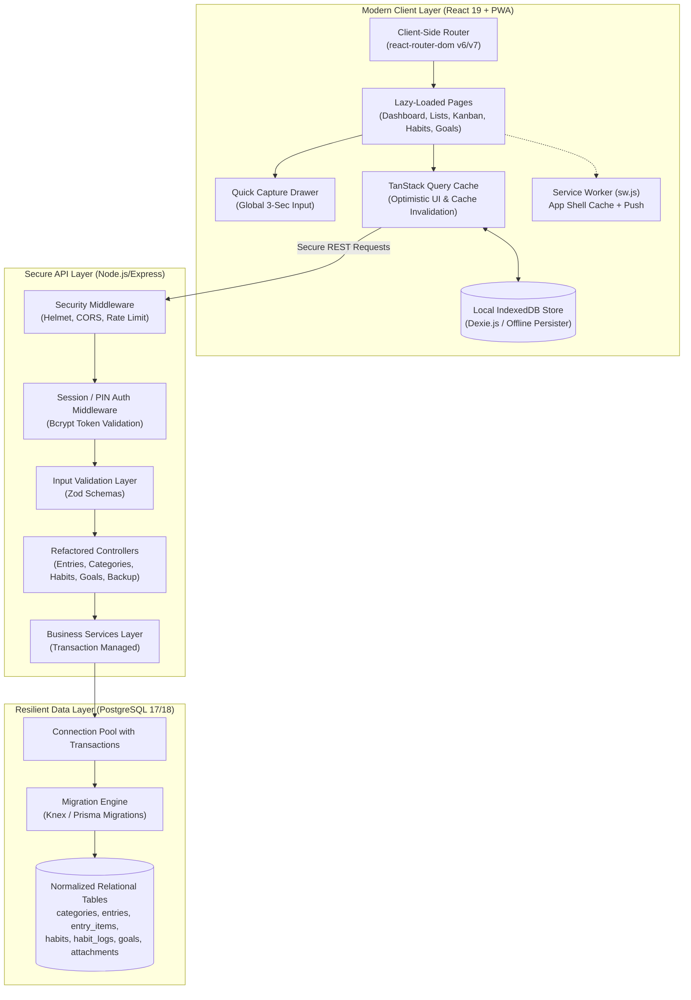
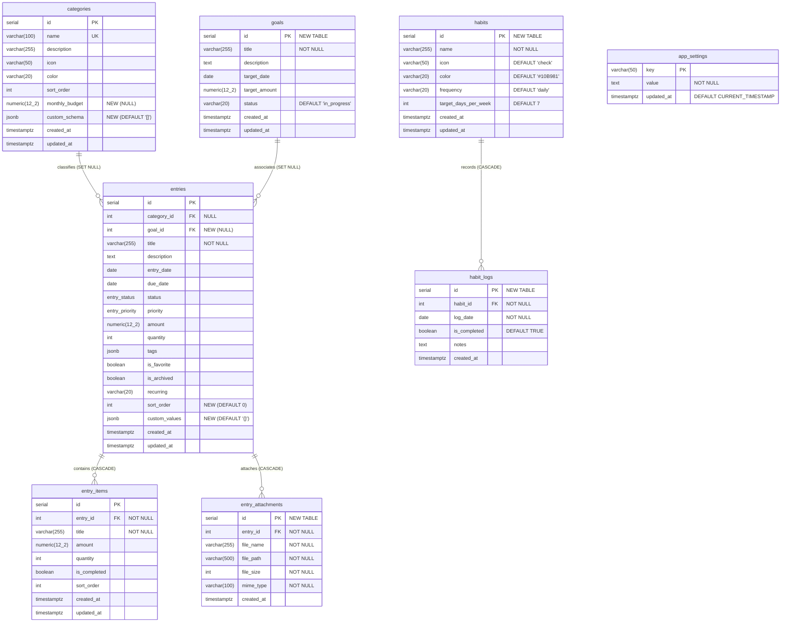
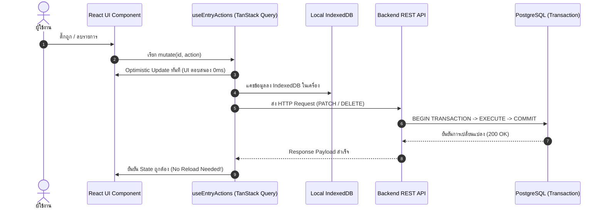

# 05. Architecture Impact & Migration Strategy — Personal Organizer

**Project:** Personal Organizer ("One App, All Your Lists")  
**Target Architecture:** Personal Life Management Platform  
**Date:** October 2026  
**Author:** Lead Software Architect & Principal Database Architect  
**Classification:** Technical Architecture Impact & Zero-Downtime Migration Blueprint  

---

## 1. Executive Summary

การยกระดับ Personal Organizer จากแอปพลิเคชันบันทึกรายการแบบเดิม ไปสู่ **Personal Life Management Platform** จำเป็นต้องมีการปรับเปลี่ยนและขยายสถาปัตยกรรม (Architectural Evolution) อย่างเป็นระบบ ทั้งในส่วนของ **Frontend Component Structure**, **State Management & Routing**, **Backend API**, และ **Database Schema**

หัวใจสำคัญของการเปลี่ยนแปลงครั้งนี้คือ **"Zero-Data-Loss & High Backward Compatibility" (ต้องไม่มีข้อมูลเดิมสูญหาย และระบบเดิมต้องทำงานได้อย่างต่อเนื่องในทุกขั้นตอนของการอัปเกรด)**

---

## 2. Target System Architecture Diagram (Future State)



---

## 3. Frontend Component Architecture Impact

### 3.1 New Components to Introduce (คอมโพเนนต์ใหม่ที่จะถูกสร้างขึ้น)
1. **`QuickCaptureBar.tsx` / `QuickCaptureDrawer.tsx`:** แถบจดด่วนระดับ Global ติดตั้งไว้ที่ Header และ Bottom Navigation พร้อม Regex/NLP Parser ย่อยข้อความ
2. **`KanbanBoardPage.tsx` & `KanbanColumn.tsx`:** หน้ารวมกระดานคัมบัง รองรับ Drag & Drop การ์ดรายการระหว่างคอลัมน์สถานะ
3. **`HabitTrackerCard.tsx` & `HabitMatrix.tsx`:** การ์ดติดตามนิสัยประจำวันในหน้า Dashboard พร้อม Dot Grid สัปดาห์ละ 7 วัน
4. **`GoalCard.tsx` & `GoalFormModal.tsx`:** คอมโพเนนต์เป้าหมายชีวิตและแถบวัดความก้าวหน้า
5. **`ImportModal.tsx`:** หน้าต่าง Drag & Drop อัปโหลดไฟล์ JSON/CSV พร้อมระบบ Dry-Run Preview
6. **`AttachmentUploader.tsx` & `ImageViewerModal.tsx`:** ระบบอัปโหลดรูปภาพใบเสร็จ/สลิป และ Modal ดูภาพขยาย

### 3.2 Existing Components to Refactor (คอมโพเนนต์เดิมที่ต้องปรับปรุง)
1. **[`App.tsx`](file:///d:/Personal_Organizer/frontend/src/App.tsx):**
   - **การเปลี่ยนแปลง:** นำ `react-router-dom` (`<BrowserRouter>`, `<Routes>`, `<Route>`) เข้ามาแทนที่ State-based Tab Switcher เดิม
   - **การปรับปรุง:** ลบตัวแปร `refreshKey` และการบังคับ Remount (`key={`..._${refreshKey}`}`) ออกทั้งหมด นำ TanStack Query มารับหน้าที่ Cache Invalidation
2. **[`EntryCard.tsx`](file:///d:/Personal_Organizer/frontend/src/components/entries/EntryCard.tsx):**
   - **การเปลี่ยนแปลง:** แยกความรับผิดชอบ (SRP Refactoring) โดยสกัด Sub-item Checklist ออกเป็น `SubItemsChecklist.tsx` และสกัด Action Menu ออกเป็น `EntryActionsMenu.tsx`
3. **[`EntryFormModal.tsx`](file:///d:/Personal_Organizer/frontend/src/components/entries/EntryFormModal.tsx):**
   - **การเปลี่ยนแปลง:** ปัจจุบันมีความยาวถึง 600 บรรทัด จะถูกแยกเป็นโมดูลย่อย:
     - `SubItemsEditor.tsx` (จัดการรายการย่อย)
     - `SpeechInputButton.tsx` (ปุ่มแปลงเสียงพูดภาษาไทย)
     - `CategorySelector.tsx` (ตัวเลือกหมวดหมู่)
4. **[`Header.tsx`](file:///d:/Personal_Organizer/frontend/src/components/layout/Header.tsx):**
   - **การเปลี่ยนแปลง:** เพิ่ม Quick Capture Trigger และใส่ Hook `useDebounce(searchQuery, 300)` เพื่อหน่วงเวลาการยิงค้นหา
5. **[`ArchivePage.tsx`](file:///d:/Personal_Organizer/frontend/src/pages/ArchivePage.tsx) & [`CategoriesPage.tsx`](file:///d:/Personal_Organizer/frontend/src/pages/CategoriesPage.tsx):**
   - **การเปลี่ยนแปลง:** ลบคำสั่ง `window.location.reload()` ทิ้ง และเพิ่มคลาส Tailwind `dark:` ให้รองรับโหมดมืดอย่างสมบูรณ์

---

## 4. Database Schema Evolution & Zero-Data-Loss Migration

เพื่อให้ระบบสามารถรองรับฟีเจอร์ใหม่ทั้งหมดใน Roadmap โดย**ไม่สูญเสียข้อมูลเดิมแม้แต่แถวเดียว** เราได้วางแผนการทำ Database Migration เป็น 3 ขั้นตอน:

### 4.1 Target Entity Relationship Diagram (Schema ขั้นสมบูรณ์)



---

### 4.2 Non-Destructive SQL Migration Scripts

คำสั่ง SQL ด้านล่างนี้ถูกออกแบบให้เป็น **Idempotent (สามารถรันซ้ำได้โดยไม่เกิด Error และไม่กระทบข้อมูลเดิม)**:

```sql
-- ====================================================================
-- MIGRATION V2.0: Non-Destructive Evolution Script
-- ====================================================================

-- 1. ตารางเก็บการตั้งค่าความปลอดภัยระดับระบบ (แทนที่การเก็บใน LocalStorage)
CREATE TABLE IF NOT EXISTS app_settings (
  key VARCHAR(50) PRIMARY KEY,
  value TEXT NOT NULL,
  updated_at TIMESTAMPTZ NOT NULL DEFAULT CURRENT_TIMESTAMP
);

-- 2. ขยายตาราง categories เดิม (ปลอดภัย 100% ต่อข้อมูลเดิม)
ALTER TABLE categories ADD COLUMN IF NOT EXISTS monthly_budget NUMERIC(12, 2) NULL;
ALTER TABLE categories ADD COLUMN IF NOT EXISTS custom_schema JSONB NOT NULL DEFAULT '[]'::jsonb;

-- 3. สร้างตาราง goals (เป้าหมายชีวิต) ก่อน เพื่อใช้อ้างอิง FK
CREATE TABLE IF NOT EXISTS goals (
  id SERIAL PRIMARY KEY,
  title VARCHAR(255) NOT NULL,
  description TEXT NULL,
  target_date DATE NULL,
  target_amount NUMERIC(12, 2) NULL,
  status VARCHAR(20) NOT NULL DEFAULT 'in_progress',
  created_at TIMESTAMPTZ NOT NULL DEFAULT CURRENT_TIMESTAMP,
  updated_at TIMESTAMPTZ NOT NULL DEFAULT CURRENT_TIMESTAMP
);

-- 4. ขยายตาราง entries เดิม (เพิ่ม sort_order, goal_id, custom_values)
ALTER TABLE entries ADD COLUMN IF NOT EXISTS sort_order INT NOT NULL DEFAULT 0;
ALTER TABLE entries ADD COLUMN IF NOT EXISTS goal_id INT NULL REFERENCES goals(id) ON DELETE SET NULL;
ALTER TABLE entries ADD COLUMN IF NOT EXISTS custom_values JSONB NOT NULL DEFAULT '{}'::jsonb;

-- 5. ตารางแนบไฟล์และรูปภาพสลิป (entry_attachments)
CREATE TABLE IF NOT EXISTS entry_attachments (
  id SERIAL PRIMARY KEY,
  entry_id INT NOT NULL REFERENCES entries(id) ON DELETE CASCADE,
  file_name VARCHAR(255) NOT NULL,
  file_path VARCHAR(500) NOT NULL,
  file_size INT NOT NULL,
  mime_type VARCHAR(100) NOT NULL,
  created_at TIMESTAMPTZ NOT NULL DEFAULT CURRENT_TIMESTAMP
);
CREATE INDEX IF NOT EXISTS idx_attachments_entry_id ON entry_attachments(entry_id);

-- 6. ตารางระบบติดตามนิสัยประจำวัน (habits & habit_logs)
CREATE TABLE IF NOT EXISTS habits (
  id SERIAL PRIMARY KEY,
  name VARCHAR(255) NOT NULL,
  icon VARCHAR(50) NOT NULL DEFAULT 'check',
  color VARCHAR(20) NOT NULL DEFAULT '#10B981',
  frequency VARCHAR(20) NOT NULL DEFAULT 'daily',
  target_days_per_week INT NOT NULL DEFAULT 7,
  created_at TIMESTAMPTZ NOT NULL DEFAULT CURRENT_TIMESTAMP,
  updated_at TIMESTAMPTZ NOT NULL DEFAULT CURRENT_TIMESTAMP
);

CREATE TABLE IF NOT EXISTS habit_logs (
  id SERIAL PRIMARY KEY,
  habit_id INT NOT NULL REFERENCES habits(id) ON DELETE CASCADE,
  log_date DATE NOT NULL,
  is_completed BOOLEAN NOT NULL DEFAULT TRUE,
  notes TEXT NULL,
  created_at TIMESTAMPTZ NOT NULL DEFAULT CURRENT_TIMESTAMP,
  CONSTRAINT uq_habit_date UNIQUE(habit_id, log_date)
);
CREATE INDEX IF NOT EXISTS idx_habit_logs_date ON habit_logs(log_date);
```

---

## 5. State Management & Data Flow Evolution

การเปลี่ยนผ่านระบบ State Management เพื่อแก้ปัญหา Re-render ซ้ำซ้อนและยกเลิก Hard Page Reload:



### สรุปการปรับเปลี่ยน Data Flow:
1. **Optimistic Updates:** เมื่อผู้ใช้กดติ๊กถูกหรือลบรายการ UI จะอัปเดตหน้าจอทันทีโดยไม่ต้องรอเครือข่าย ให้ความรู้สึกลื่นไหลสูงสุด
2. **Automatic Cache Invalidation:** ใช้ `queryClient.invalidateQueries({ queryKey: ['entries'] })` เพื่อให้ข้อมูลในทุกหน้า (Dashboard, AllLists, Calendar, Kanban) ซิงค์ตัวเลขตรงกันอัตโนมัติ โดยไม่ต้องพึ่งพา `window.location.reload()` อีกต่อไป
3. **Offline Fallback:** หากเครือข่ายออฟไลน์ ข้อมูลจะถูกบันทึกรอไว้ใน IndexedDB และส่งต่อไปยัง API ทันทีเมื่อกลับมาออนไลน์

---

## 6. Backward Compatibility & Risk Assessment

| จุดเสี่ยงในการเปลี่ยนแปลง | ผลกระทบที่อาจเกิดขึ้น | แผนการควบคุมและป้องกัน (Mitigation Strategy) |
| :--- | :--- | :--- |
| **การเพิ่มคอลัมน์ใหม่ใน `entries`** | ซอฟต์แวร์เดิมอาจ Query พังหากมีการใช้ `SELECT *` | ทุกคอลัมน์ใหม่ถูกกำหนดให้เป็น `NULL` หรือมี `DEFAULT` ที่ปลอดภัย โค้ดเดิมสามารถอ่านข้อมูลได้ตามปกติ 100% |
| **การนำ Client-side Router เข้ามา** | บุ๊กมาร์กเดิมหรือประวัติในเบราว์เซอร์อาจเพี้ยน | กำหนด Route ค่าเริ่มต้น `/` ให้ชี้ไปที่ `DashboardPage` เสมือนของเดิม |
| **การเปลี่ยนวิธีเก็บ PIN ไปไว้ที่ Backend** | ผู้ใช้เดิมที่เคยตั้ง PIN ใน LocalStorage อาจเข้าไม่ได้ | ในรอบอัปเกรดแรก ให้เขียน Migration Script ใน React: หากพบ `app_pin_code` ใน LocalStorage ให้ยิง API ส่งไป Hash และบันทึกลง Database ทันที จากนั้นจึงลบออกจาก LocalStorage |
| **การเปิดใช้ Service Worker Pre-cache** | ผู้ใช้อาจติด Cache ไฟล์เวอร์ชันเก่า | กำหนด `CACHE_NAME = 'organizer-pwa-v2'` และใส่คำสั่งลบ Cache เก่าทั้งหมดใน `activate` event ของ Service Worker |
