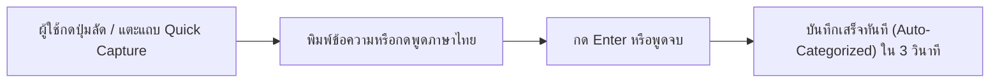
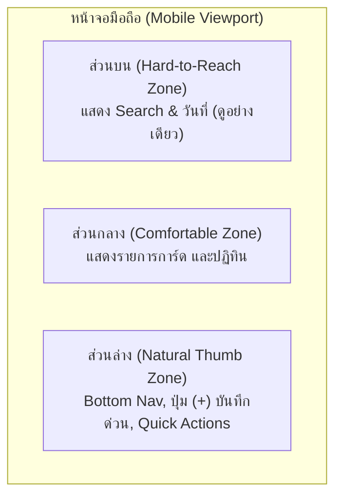

# 06. UX/UI Strategic Recommendations — Personal Organizer

**Project:** Personal Organizer ("One App, All Your Lists")  
**Target Architecture:** Personal Life Management Platform  
**Date:** October 2026  
**Author:** Lead UX Strategist, Product Designer & Accessibility Specialist  
**Classification:** User Experience Design & Interface Guidelines  

---

## 1. UX/UI Philosophy & Design Principles

เพื่อให้ Personal Organizer ตอบสนองต่อการเป็น **"Personal Life Management Platform"** ที่ใช้งานได้ง่าย ไม่สร้างภาระทางสมอง (Cognitive Load) และสอดคล้องกับพฤติกรรมผู้ใช้งานจริง เราได้กำหนดหลักการออกแบบ 4 ข้อ:

1. **The 3-Second Rule (กฎ 3 วินาทีสำหรับการบันทึก):** ผู้ใช้ต้องสามารถเปิดแอปแล้วบันทึกสิ่งที่คิดอยู่ในหัวได้สำเร็จภายในเวลาไม่เกิน 3 วินาที
2. **Thumb-Zone Optimization (พื้นที่เอื้อมถึงของนิ้วโป้ง):** องค์ประกอบสำคัญ ปุ่มบันทึก และการสลับหน้าจอ ต้องอยู่ในครึ่งล่างของหน้าจอมือถือ (Bottom 50%) เพื่อให้ใช้งานมือเดียวขณะเดินหรือถือของได้สบาย
3. **Calm Technology & Progressive Disclosure (เทคโนโลยีที่สงบเงียบ):** ข้อมูลที่ซับซ้อน (เช่น รายการย่อย รายจ่าย กราฟ) จะถูกจัดแสดงแบบเปิดเผยเป็นลำดับขั้น ไม่โถมข้อมูลทั้งหมดใส่ผู้ใช้พร้อมกัน
4. **Preserve Design System Integrity (รักษาเอกลักษณ์ความเรียบหรูเดิม):** คงชุดสี Minimalist Palette เดิมที่เป็นจุดเด่น (Slate 900/950, Indigo 600, Emerald 500, Amber 500) แต่ปรับปรุง Contrast และช่องไฟให้ประณีตยิ่งขึ้น

---

## 2. Reducing Steps to Create an Entry (ลดขั้นตอนการบันทึกงาน)

### 2.1 Current Bottleneck Analysis (ปัญหาของขั้นตอนเดิม)
ปัจจุบัน การจะบันทึกรายการใดรายการหนึ่ง ผู้ใช้ต้อง:
1. กดปุ่ม `+ สร้างรายการใหม่`
2. รอ Modal ฟอร์มขนาด 600 บรรทัดเด้งขึ้นมา
3. แตะช่อง "ชื่อรายการ"
4. เลื่อนหน้าจอเพื่อเลือกหมวดหมู่, วันที่, ความสำคัญ, รายการย่อย
5. เลื่อนลงมาล่างสุดเพื่อกดปุ่ม "สร้างรายการ"
**รวมทั้งสิ้น 5 ขั้นตอน (ใช้เวลาเฉลี่ย 12-18 วินาที)** ซึ่งช้าเกินไปสำหรับความคิดแวบแรก (Quick Thought Capture)

### 2.2 The New Streamlined 1-Step Flow (แนวทางใหม่ใน 1 ขั้นตอน)

#### แนวทางปรับปรุง:
1. **Always-Accessible Quick Capture Bar:**
   - ติดตั้ง Input Bar ไว้ที่ส่วนบนของหน้าจอ (ใต้ Header เล็กน้อย) และมีปุ่มไมโครโฟนภาษาไทยในตัว
   - ผู้ใช้เพียงแตะ พิมพ์ และกด Enter รายการจะถูกบันทึกทันทีโดยใช้หมวดหมู่ปัจจุบันเป็นค่าเริ่มต้น
2. **Smart NLP-lite Auto Extraction:**
   - เมื่อผู้ใช้พิมพ์ข้อความ เช่น:
     > *"จ่ายค่าไฟ 1,250 พรุ่งนี้ #บิล"*
   - ระบบจะตรวจจับตัวเลข (`1,250` $\rightarrow$ Amount), คำบอกเวลา (`พรุ่งนี้` $\rightarrow$ Due Date), และแฮชแท็ก (`#บิล` $\rightarrow$ Category/Tag) โดยที่ผู้ใช้ไม่ต้องเสียเวลากดเปิด Dropdown ใดๆ
3. **Modal Expansion when Needed:**
   - หากต้องการใส่รายการย่อย Checklist หรือแนบรูปภาพ จึงค่อยกดปุ่ม "เพิ่มรายละเอียด (Advanced)" เพื่อเปิดฟอร์มฉบับเต็ม

---

## 3. Mobile Navigation & Thumb-Zone Refinements

### แนวทางปรับปรุง:
1. **Enhanced Bottom Navigation Bar:**
   - ขยายปุ่มตรงกลาง `(+)` ให้โดดเด่น มี Haptic Feedback แบบ `light` เมื่อสัมผัส
   - เพิ่มเมนู Kanban และ Quick Drawer เข้ามาใน Bottom Navigation
2. **Swipe-to-Action Gestures (การปัดนิ้วบนการ์ด):**
   - **ปัดขวา (Swipe Right):** เปลี่ยนสถานะเป็น "เสร็จสิ้น (Completed)" พร้อมเสียงคลิกสั่นเบาๆ
   - **ปัดซ้าย (Swipe Left):** เก็บเข้าคลัง "Archive" หรือแสดงปุ่มลบสีแดง

---

## 4. Empathetic & Actionable Empty States (การออกแบบสถานะว่างเปล่า)

### 4.1 Current Issue
หน้าจอที่ยังไม่มีข้อมูล (เช่น หน้า Favorites หรือหน้า Categories) ในปัจจุบันแสดงเพียงกล่องสีเทาและข้อความธรรมดา ขาดการชักจูงหรือแนะนำผู้ใช้ (Onboarding)

### 4.2 New Actionable Empty State Design

| หน้าจอ | ภาพประกอบและข้อความสร้างแรงบันดาลใจ | ปุ่มกดสั่งการใน 1-คลิก (Action Trigger) |
| :--- | :--- | :--- |
| **All Lists (ว่างเปล่า)** | 📋 ภาพสมุดบันทึกที่สะอาดตา *"พื้นที่ว่างสำหรับความคิดใหม่ๆ เริ่มต้นบันทึกสิ่งที่คุณอยากทำวันนี้"* | ปุ่ม: `+ สร้างรายการแรก` หรือ `โหลดเทมเพลตตัวอย่าง` |
| **Favorites (ว่างเปล่า)** | ⭐ ภาพดวงดาวสีทองเปล่งประกาย *"ยังไม่มีรายการโปรด ปักหมุดรายการสำคัญด้วยไอคอน ⭐ เพื่อเข้าถึงได้ไวที่สุด"* | ปุ่ม: `ดูรายการทั้งหมดเพื่อเลือกปักหมุด` |
| **Archive (ว่างเปล่า)** | 📦 ภาพกล่องเอกสารที่เรียบร้อย *"คลังเอกสารว่างเปล่า รายการที่ทำเสร็จแล้วสามารถเก็บเข้าคลังเพื่อลดความแออัด"* | ปุ่ม: `เคลียร์งานที่เสร็จแล้วเข้าคลัง (Bulk Archive)` |
| **Shopping (ว่างเปล่า)** | 🛒 ภาพตะกร้าสินค้า *"ไม่มีของที่ต้องซื้อ วางแผนช้อปปิ้งรอบต่อไปเพื่อคุมงบประมาณ"* | ปุ่ม: `+ สร้างรายการซื้อของเข้าบ้าน` |

---

## 5. Visual Feedback & Micro-Interactions (การตอบสนองเชิงภาพและสัมผัส)

1. **Optimistic UI Updates:**
   - เมื่อผู้ใช้แตะ Checkbox ติ๊กถูกที่รายการย่อย ให้ขีดฆ่าข้อความและขยับแถบ Progress Bar ทันที **(Zero Latency)** ก่อนที่ผลลัพธ์จาก API จะตอบกลับมา
2. **Confetti & Celebration Micro-Animation:**
   - เมื่อติ๊กรายการย่อยใน Shopping Mode ครบ 100% ให้แสดงแอนิเมชัน Confetti (พลุกระดาษ) พุ่งขึ้นมาสั้นๆ 1 วินาที พร้อม Haptic `success` เพื่อสร้างความรู้สึกพึงพอใจและความสุขในการทำภารกิจสำเร็จ
3. **Skeleton Loading Skeletons:**
   - คงการใช้ Skeleton Loaders ที่มีอยู่แล้ว แต่ปรับแสง Shimmer ให้เนียนตากลมกลืนกับธีม Dark Mode

---

## 6. Reducing Dashboard Cognitive Load (ลดความซับซ้อนของแดชบอร์ด)

### แนวทางปรับปรุง:
1. **Progressive Disclosure:** ซ่อนตัวเลขที่ไม่จำเป็นในแถบแรก และรวมสถิติเหลือ 3 ตัวเลขสำคัญ:
   - งานที่ต้องส่งเร็วๆ นี้ (Due Soon)
   - ความคืบหน้าของงานวันนี้ (Today's Progress)
   - ยอดเงินที่ใช้ไปแล้วในเดือนนี้ (Current Month Spending)
2. **Collapsible Analytics Cards:**
   - แถบวิเคราะห์รายจ่าย (Expense Analytics) มีปุ่มย่อ/ขยายได้ เพื่อให้ผู้ที่ไม่ต้องการดูเรื่องเงินสามารถพับเก็บเพื่อโฟกัสกับงานอย่างเดียวได้

---

## 7. Accessibility (a11y) & Dark Mode Polish

### 7.1 WCAG 2.1 AA Compliance Checklist
- [x] **Touch Target Size:** ปุ่มกดทุกปุ่ม (โดยเฉพาะ Checkbox ในการ์ดและปุ่มใน Shopping Mode) ต้องมีขนาดพื้นที่แตะไม่ต่ำกว่า **44 x 44 พิกเซล**
- [x] **Color Contrast Ratio:** อัตราส่วนความต่างของสีตัวหนังสือกับพื้นหลังต้องผ่านเกณฑ์ขั้นต่ำ **4.5:1** สำหรับข้อความปกติ และ **3:1** สำหรับข้อความขนาดใหญ่
- [x] **Dark Mode Fixes:**
  - แก้ไขสีตัวหนังสือใน [`ArchivePage.tsx`](file:///d:/Personal_Organizer/frontend/src/pages/ArchivePage.tsx) ให้เป็น `dark:text-slate-100`
  - ปรับพื้นหลัง Dropdown ใน [`EntryFilterBar.tsx`](file:///d:/Personal_Organizer/frontend/src/components/entries/EntryFilterBar.tsx) ให้เป็น `dark:bg-slate-800 dark:border-slate-700 dark:text-slate-200`
- [x] **Full Keyboard Navigation:**
  - ในหน้า PIN Lock Modal ([`PinLockModal.tsx`](file:///d:/Personal_Organizer/frontend/src/components/common/PinLockModal.tsx)) ต้องรองรับการกดตัวเลข 0-9 และปุ่ม Backspace/Escape บนคีย์บอร์ดคอมพิวเตอร์จริง
- [x] **Screen Reader Support:**
  - เพิ่ม `aria-label` ให้กับปุ่มที่มีแต่ไอคอน เช่น ปุ่ม Favorite Star (`aria-label="ปักหมุดรายการโปรด"`), ปุ่ม Action Menu (`aria-label="เมนูจัดการรายการ"`)
